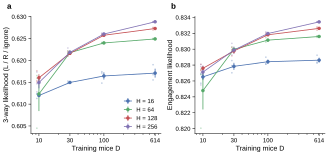

# r4 — 3-way and engagement likelihood scale with D

**Question.** On the 149 held-out mice, how well does the 3-way GRU predict every trial, ignores
included, and how well does it predict whether the mouse responds at all? r1 scores left vs right on
engaged trials only, and r2 scores ignore detection by PR-AUC and recall; neither gives these two
likelihoods. This report publishes them per H × D, so the atlas can rank the GRU against the
GLM-HMM (study 14) on the same scores.

| score | what it is | chance |
|---|---|---|
| 3-way likelihood | geometric-mean probability of the actual outcome (left, right or ignore), every held-out trial | 1/3 |
| engagement likelihood | geometric-mean probability of respond vs ignore, every held-out trial | 1/2 |

**Method.** No new runs: the kept runs of `frozen_runs.json`, the same 3 seeds per cell as r1 and r2
(W&B keys `heldout/final/eval_likelihood` and `eval_likelihood_engage`).

<!-- BEGIN result-1 -->

The 3-way GRU (left, right or ignore) on the 149 held-out mice, against training mice D, per hidden size H. Mean ± SEM over 3 seeds; small dots are single seeds. Same kept runs as r1 and r2.

**a. 3-way likelihood**: likelihood of the actual outcome (left, right or ignore) on every held-out trial; chance 1/3.

| H | D = 10 | D = 30 | D = 100 | D = 614 | Δ (D = 10 → 614) |
|---|---:|---:|---:|---:|---:|
| 16 | 0.6120 ± 0.0003 | 0.6150 ± 0.0002 | 0.6164 ± 0.0008 | 0.6171 ± 0.0010 | +0.0051 |
| 64 | 0.6123 ± 0.0039 | 0.6218 ± 0.0002 | 0.6240 ± 0.0001 | 0.6249 ± 0.0001 | +0.0126 |
| 128 | 0.6160 ± 0.0008 | 0.6216 ± 0.0003 | 0.6258 ± 0.0001 | 0.6273 ± 0.0002 | +0.0113 |
| 256 | 0.6149 ± 0.0013 | 0.6218 ± 0.0005 | 0.6260 ± 0.0001 | 0.6288 ± 0.0000 | +0.0139 |

**b. Engagement likelihood**: likelihood of respond vs ignore on every held-out trial; chance 1/2.

| H | D = 10 | D = 30 | D = 100 | D = 614 | Δ (D = 10 → 614) |
|---|---:|---:|---:|---:|---:|
| 16 | 0.8265 ± 0.0004 | 0.8278 ± 0.0004 | 0.8284 ± 0.0003 | 0.8286 ± 0.0003 | +0.0021 |
| 64 | 0.8248 ± 0.0024 | 0.8300 ± 0.0002 | 0.8311 ± 0.0002 | 0.8316 ± 0.0001 | +0.0068 |
| 128 | 0.8276 ± 0.0003 | 0.8298 ± 0.0003 | 0.8318 ± 0.0001 | 0.8326 ± 0.0001 | +0.0050 |
| 256 | 0.8271 ± 0.0008 | 0.8299 ± 0.0004 | 0.8320 ± 0.0001 | 0.8334 ± 0.0000 | +0.0063 |
<!-- END result-1 -->

## What it says

- **Both scores rise with D for every H.** At H ≥ 64 the 3-way likelihood gains 0.011–0.014 from
  D = 10 to D = 614, and the engagement likelihood 0.005–0.007. The best cell is H = 256, D = 614
  (3-way 0.6288, engagement 0.8334), still rising, as r1 found for L/R on engaged trials.
- **H = 16 flattens early**, as in r1: +0.0051 (3-way) and +0.0021 (engagement) over the whole D range.
- **H = 64 at D = 10 has a wide SEM.** One of its 3 seeds (from `sweep-validate-capnsteps`) scores
  0.6045, against 0.6159 and 0.6165 for the other two. r1 and r2 use the same run.
- **The D = 614 values equal the GRU reference in study 14** (r1, r2), which reads the same runs.
