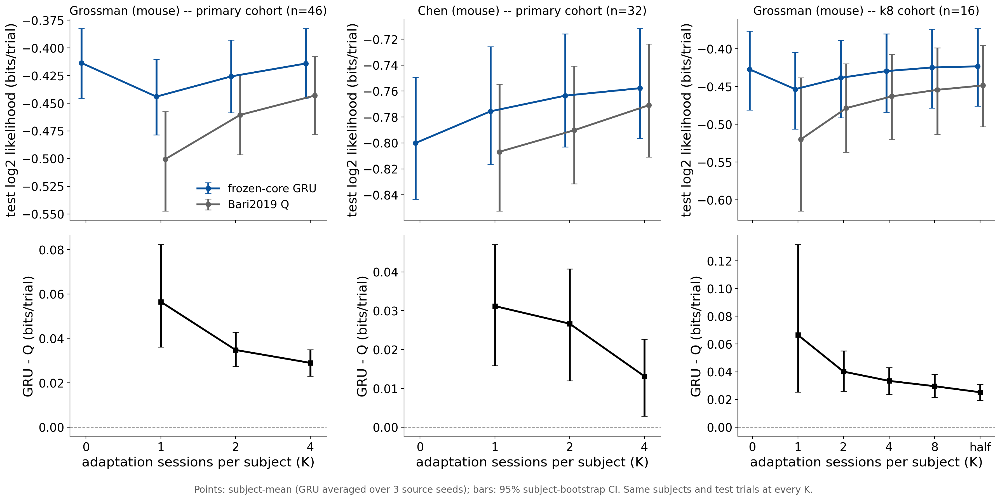

# r7 -- How transfer depends on the target adaptation budget

**Question.** The matched-half results (r1) adapt each new subject's embedding on its whole
adaptation half. How much of the GRU's transfer survives when it sees only K adaptation
sessions, and where does it cross the subject-level Bari2019 Q fit on the same sessions?

**Design.** Grossman (mouse) and Chen (mouse); frozen-core H=128 E4 GRU from the Study 01
D=614 source cells (seeds 0--2), embedding-only fine-tune (500 steps), at K in
{0, 1, 2, 4, 8, half} adaptation sessions -- the first K of each subject's chronological
odd-position sessions. Bari2019 common Q is refit per subject at every K >= 1 (a subject-level
Q fit has no zero-shot condition). Test sessions, and therefore the scored trials, are
identical at every K; the freeze asserts exact ordered trial-key equality across every cell.

**Cohorts, fixed before any result** (`analysis/adaptation_budget_cohort.json`): every Chen
subject has exactly 4 adaptation sessions, so the shared curve is K <= 4 over subjects with
>= 4 adaptation sessions (Grossman 46/48, Chen 32/32; Chen's K=4 is its half), and Grossman's
16 subjects with >= 8 sessions carry K=8 and half. Each cohort's numbers use the same
subjects at every K.

## Results

<!-- BEGIN result-1 -->
[regenerated by `analysis/report_adaptation_budget.py` -- do not edit by hand]

| cohort | dataset | K | n | GRU bits/trial [95% CI] | Q bits/trial [95% CI] | GRU - Q [95% CI] | subjects GRU better |
|---|---|---|---|---|---|---|---|
| primary | Grossman (mouse) | 0 | 46 | -0.4136 [-0.4453, -0.3824] | -- | -- | -- |
| primary | Grossman (mouse) | 1 | 46 | -0.4440 [-0.4786, -0.4104] | -0.5005 [-0.5474, -0.4576] | +0.0565 [+0.0362, +0.0823] | 87% |
| primary | Grossman (mouse) | 2 | 46 | -0.4257 [-0.4585, -0.3928] | -0.4605 [-0.4965, -0.4240] | +0.0348 [+0.0273, +0.0428] | 93% |
| primary | Grossman (mouse) | 4 | 46 | -0.4141 [-0.4459, -0.3825] | -0.4430 [-0.4782, -0.4076] | +0.0290 [+0.0231, +0.0349] | 91% |
| primary | Chen (mouse) | 0 | 32 | -0.8000 [-0.8433, -0.7494] | -- | -- | -- |
| primary | Chen (mouse) | 1 | 32 | -0.7756 [-0.8165, -0.7258] | -0.8068 [-0.8525, -0.7548] | +0.0312 [+0.0158, +0.0470] | 78% |
| primary | Chen (mouse) | 2 | 32 | -0.7635 [-0.8030, -0.7159] | -0.7902 [-0.8314, -0.7406] | +0.0267 [+0.0119, +0.0408] | 81% |
| primary | Chen (mouse) | 4 | 32 | -0.7578 [-0.7966, -0.7117] | -0.7709 [-0.8107, -0.7236] | +0.0131 [+0.0029, +0.0227] | 75% |
| k8 | Grossman (mouse) | 0 | 16 | -0.4274 [-0.4809, -0.3766] | -- | -- | -- |
| k8 | Grossman (mouse) | 1 | 16 | -0.4536 [-0.5061, -0.4050] | -0.5201 [-0.6147, -0.4384] | +0.0665 [+0.0254, +0.1317] | 94% |
| k8 | Grossman (mouse) | 2 | 16 | -0.4385 [-0.4915, -0.3888] | -0.4786 [-0.5369, -0.4201] | +0.0401 [+0.0260, +0.0550] | 94% |
| k8 | Grossman (mouse) | 4 | 16 | -0.4297 [-0.4841, -0.3803] | -0.4631 [-0.5201, -0.4073] | +0.0334 [+0.0235, +0.0429] | 94% |
| k8 | Grossman (mouse) | 8 | 16 | -0.4249 [-0.4783, -0.3742] | -0.4544 [-0.5131, -0.3988] | +0.0295 [+0.0216, +0.0380] | 94% |
| k8 | Grossman (mouse) | half | 16 | -0.4234 [-0.4758, -0.3733] | -0.4486 [-0.5034, -0.3957] | +0.0252 [+0.0193, +0.0309] | 100% |

Source W&B groups: `gru-adaptation-budget@20261024-060709-hpc`, `q-adaptation-budget@20261024-035709`.
<!-- END result-1 -->

## Reading

- **The GRU beats subject-level Q at every budget K >= 1, in both datasets.** Every paired
  GRU - Q interval excludes 0. The margin is largest when the target data are scarcest and
  narrows as K grows: Grossman (mouse) +0.057 bits/trial at K=1 to +0.029 at K=4, and
  +0.025 at the full half (k8 cohort); Chen (mouse) +0.031 at K=1 to +0.013 at K=4, its half.
  Most of the gap at small K is Q's: a one-session subject fit costs Q 0.06 bits/trial
  (Grossman) relative to K=4, the GRU much less.
- **Zero-shot is already strong for Grossman, and one- or two-session adaptation hurts it.**
  The K=0 GRU (-0.414 bits/trial, primary cohort) is better than K=1 (-0.444) and K=2
  (-0.426), and matches K=4 (-0.414); on the k8 cohort the zero-shot GRU (-0.427) also beats
  the fully fitted Q at the half (-0.449). Chen improves monotonically from K=0 (-0.800)
  instead, and its zero-shot GRU is worse than Q from K=2 on. Likely, unconfirmed: with
  `selection_policy=fixed_final` the fixed 500-step fine-tune overfits the embedding to one
  or two sessions; a budget-dependent stopping rule (or a shrinkage prior toward the
  zero-shot embedding) would be the test. The matched-half protocol is unaffected.
- **Backend check.** The grid ran on HPC A100s after Beaker stayed saturated. Its `half`
  cells reproduce the Beaker H200 matched-half cells of r1 (same D=614 seeds) to five
  decimals of normalized likelihood (per-subject differences <= 5e-5 nats) with identical
  ordered test-trial keys. The Q half fits agree with r1's to ~1e-6 in normalized
  likelihood (Grossman 0.7317660 vs 0.7317650; Chen 0.5874680 vs 0.5874684), with
  per-subject differences up to 1.4e-4 nats and identical trial keys -- close, not
  bit-identical. Likely, unconfirmed: optimizer-level floating-point differences in the
  differential-evolution fit across nodes; far below the GRU - Q gaps reported here.

Single fine-tuning protocol per K and three source seeds; intervals are over subjects
(seed-averaged), not over source seeds.
