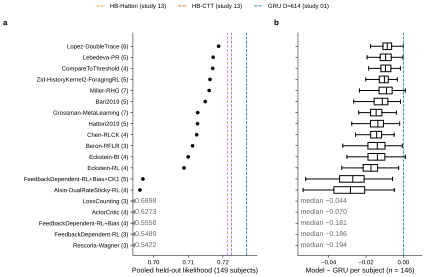

# r1 — Literature models on the held-out subjects: the leaderboard

**Question.** Fit per subject on our subjects, how well does each literature model predict
held-out sessions, and how far is the best one from the hierarchical cognitive baselines
(HB-CTT, HB-Hattori) and from the GRU?

**Method.** Each of the 20 literature models ([CONTEXT.md](../../CONTEXT.md)) gets one parameter
set per subject, fit by differential evolution on the subject's even sessions and scored on its
odd sessions (study 01 r8's protocol). A score pools over subjects: exp(Σ log p / Σ n). The
leaderboard ranks 19 of them (Win-Stay-Lose-Shift is a strawman: fit, but not ranked) on the 149
held-out subjects, the cohort that HB-CTT and HB-Hattori (study 13) were
scored on. The GRU's held-out list differs by 3 subjects each way (study 13 r2), so the paired
comparison with the GRU uses the 146 subjects on both lists.

## Leaderboard

<!-- BEGIN result-1 -->

**a**, pooled held-out likelihood of each literature model (free parameters in brackets) on the 149 held-out subjects (1,013,172 scored trials); dashed lines: HB-CTT and HB-Hattori (study 13 r5, same subjects) and the GRU at D≈614 (study 01 r1, on its own held-out list). **b**, per-subject likelihood minus the GRU's (3-seed mean) on the 146 subjects on both lists; boxes are quartiles, whiskers 1.5 IQR. Models below 0.69 are drawn off scale (grey) with their value. One fit per subject and model, so no error bars.

| rank | literature model | params | held-out (149) | median subject | training pool (614) | shared (146) | GRU's list (149) | median − GRU | GRU higher |
|---:|---|---:|---:|---:|---:|---:|---:|---:|---:|
| 1 | Lopez-DoubleTrace | 6 | 0.7187 | 0.7344 | 0.7227 | 0.7181 | 0.7181 | −0.0086 | 99% |
| 2 | Lebedeva-PR | 5 | 0.7172 | 0.7332 | 0.7212 | 0.7166 | 0.7165 | −0.0095 | 100% |
| 3 | CompareToThreshold | 4 | 0.7170 | 0.7331 | 0.7210 | 0.7165 | 0.7164 | −0.0095 | 100% |
| 4 | Zid-HistoryKernel2-ForagingRL | 5 | 0.7163 | 0.7318 | 0.7203 | 0.7157 | 0.7156 | −0.0101 | 100% |
| 5 | Miller-RHG | 7 | 0.7160 | 0.7350 | 0.7209 | 0.7156 | 0.7155 | −0.0090 | 99% |
| 6 | Bari2019 | 5 | 0.7149 | 0.7311 | 0.7181 | 0.7144 | 0.7142 | −0.0113 | 100% |
| 7 | Grossman-MetaLearning | 7 | 0.7127 | 0.7281 | 0.7159 | 0.7122 | 0.7121 | −0.0146 | 100% |
| 8 | Hattori2019 | 5 | 0.7127 | 0.7285 | 0.7159 | 0.7121 | 0.7120 | −0.0136 | 100% |
| 9 | Chen-RLCK | 4 | 0.7124 | 0.7263 | 0.7163 | 0.7118 | 0.7118 | −0.0143 | 99% |
| 10 | Beron-RFLR | 3 | 0.7112 | 0.7298 | 0.7143 | 0.7107 | 0.7105 | −0.0139 | 100% |
| 11 | Eckstein-BI | 4 | 0.7100 | 0.7300 | 0.7132 | 0.7094 | 0.7093 | −0.0139 | 99% |
| 12 | Eckstein-RL | 4 | 0.7088 | 0.7265 | 0.7120 | 0.7082 | 0.7081 | −0.0173 | 100% |
| 13 | FeedbackDependent-RL+Bias+CK1 | 5 | 0.6969 | 0.7171 | 0.6999 | 0.6964 | 0.6962 | −0.0271 | 100% |
| 14 | Alsio-DualRateSticky-RL | 4 | 0.6961 | 0.7147 | 0.6993 | 0.6955 | 0.6954 | −0.0283 | 100% |
| 15 | LossCounting | 3 | 0.6698 | 0.6922 | 0.6671 | 0.6691 | 0.6692 | −0.0441 | 100% |
| 16 | ActorCritic | 4 | 0.6273 | 0.6588 | 0.6258 | 0.6279 | 0.6287 | −0.0703 | 100% |
| 17 | FeedbackDependent-RL+Bias | 4 | 0.5558 | 0.5525 | 0.5535 | 0.5559 | 0.5553 | −0.1811 | 100% |
| 18 | FeedbackDependent-RL | 3 | 0.5489 | 0.5414 | 0.5478 | 0.5490 | 0.5486 | −0.1861 | 100% |
| 19 | Rescorla-Wagner | 3 | 0.5422 | 0.5407 | 0.5395 | 0.5422 | 0.5419 | −0.1944 | 100% |
| | *HB-CTT (study 13)* | | 0.7225 | | | | | | |
| | *HB-Hattori (study 13)* | | 0.7213 | | | | | | |
| | *GRU D≈614 (study 01)* | | 0.7268† | | | 0.7268 | 0.7268 | | |

† On the GRU's own held-out list, which shares 146 of the 149 subjects. Shared subjects whose scored-trial count differs from the GRU's: 0. "GRU's list" pools each literature model over the GRU's own 149 test subjects; the 3 of them in our training pool are fit per subject like the rest, so the pool does not change their score.

Best literature model: **Lopez-DoubleTrace**, 0.7187, which is −0.0038 from HB-CTT and −0.0087 from the GRU on the shared subjects.

Fitted but not ranked: Win-Stay-Lose-Shift (strawman: deterministic policy, no lapse term); pooled held-out likelihood 0.0062. Its fits are in the freeze.
<!-- END result-1 -->

## Check: the re-fit reproduces study 01 r8

<!-- BEGIN result-2 -->
Per-subject held-out likelihood of the re-fit against study 01 r8's fit of the same model (seed 0, same data and protocol). Tolerance: |Δ| ≤ 0.0001 per subject.

| literature model | subjects | max abs Δ | over tolerance | pooled, re-fit | pooled, r8 |
|---|---:|---:|---:|---:|---:|
| Hattori2019 | 149 | 7.27e-07 | 0 | 0.7127 | 0.7127 |
| Bari2019 | 149 | 1.39e-06 | 0 | 0.7149 | 0.7149 |
| CompareToThreshold | 149 | 2.34e-04 | 1 | 0.7170 | 0.7170 |
<!-- END result-2 -->

## Models

<!-- BEGIN result-3 -->
Each card is written from the code that was fitted (aind-dynamic-foraging-models at the commit named under Code). Ranks are those of the leaderboard above.

### Q-learning + choice history

#### 1. Lopez-DoubleTrace (6 free parameters)

Learns a reward value for each side (the unchosen side decays toward zero) plus two choice traces, one fast and one slow, that track recent choices; the traces can push toward repeating or alternating; softmax over the sum.

Notation: trial $t$; choice $c_t \in \{L, R\}$; reward $r_t \in \{0, 1\}$; signed choice $s_t = +1$ (right) or $-1$ (left); signed outcome $f_t = +1$ (rewarded) or $-1$ (unrewarded); $\sigma(x) = 1/(1+e^{-x})$. Latent variables with index $t$ are the ones used to choose on trial $t$; they are updated after $c_t, r_t$ are seen.

**Update** (both sides, same rate; the unchosen side decays toward 0):

$$\begin{aligned} Q_{t+1}(a) &= Q_t(a) + \alpha\,\big(\mathbf{1}[a = c_t]\,r_t - Q_t(a)\big) \\ F_{t+1}(a) &= F_t(a) + \tau_F\,\big(\mathbf{1}[a = c_t] - F_t(a)\big) \\ S_{t+1}(a) &= S_t(a) + \tau_S\,\big(\mathbf{1}[a = c_t] - S_t(a)\big) \end{aligned}$$

Initial values $Q_0 = 0.5$, $F_0 = S_0 = 0$.

**Choice** (trace weights inside $\beta$; no side bias):

$$P(c_t = a) = \operatorname{softmax}_a\!\Big(\beta\,\big[Q_t(a) + \varphi\,F_t(a) + \vartheta\,S_t(a)\big]\Big)$$

**Symbols and parameters:**

- $Q_t(a)$: reward value; $F_t(a)$, $S_t(a)$: fast and slow choice traces.
- $\alpha$ `learn_rate`: Free, $[0, 1]$.
- $\beta$ `softmax_inverse_temperature`: Free, $[0, 50]$.
- $\varphi$ `fast_choice_trace_weight`: Free, $[-25, 25]$.
- $\vartheta$ `slow_choice_trace_weight`: Free, $[-25, 25]$.
- $\tau_F$ `fast_choice_trace_step_size`: Free, $[0, 1]$.
- $\tau_S$ `slow_choice_trace_step_size`: Free, $[0, 1]$.

Label switching: nothing forces $\tau_F > \tau_S$, so a fit can swap the 'fast' and 'slow' traces; compare traces by step size, not by name.

Differs from the paper: the original data-fit code and initialization details are not in the release, so $Q_0 = 0.5$ and $F_0 = S_0 = 0$ are our choices. The study-09 citation string names Frontiers in Behavioral Neuroscience, but Crossref lists this paper in PLOS Computational Biology (corrected here). Not checked against the paper: the finite bounds and the missing order constraint on $\tau_F, \tau_S$.

*Paper:* López-Yépez et al. 2021, PLOS Computational Biology ([link](https://doi.org/10.1371/journal.pcbi.1009452)). *Code:* [`ForagerLopezDoubleTrace`](https://github.com/AllenNeuralDynamics/aind-dynamic-foraging-models/blob/0c95b4b85c5f3d16c30d7dd297f3f2ee1325f112/src/aind_dynamic_foraging_models/generative_model/forager_published_bandits.py).

#### 2. Lebedeva-PR (5 free parameters)

Keeps two running tendencies toward the right side: a perseveration state that follows recent choices, and a reward-seeking state that moves toward a side after reward there and away after no reward; their sum plus a bias sets the log-odds of choosing right.

*Family:* Debatable: it keeps no value per side; it accumulates two signed log-odds states (perseveration and reward-seeking), the same recursive-logistic form as Beron-RFLR and Miller-RHG.

Notation: trial $t$; choice $c_t \in \{L, R\}$; reward $r_t \in \{0, 1\}$; signed choice $s_t = +1$ (right) or $-1$ (left); signed outcome $f_t = +1$ (rewarded) or $-1$ (unrewarded); $\sigma(x) = 1/(1+e^{-x})$. Latent variables with index $t$ are the ones used to choose on trial $t$; they are updated after $c_t, r_t$ are seen.

**Update:**

$$\begin{aligned} P_{t+1} &= (1-\alpha_p)\,P_t + \alpha_p\,\lambda_p\,s_t \\ R_{t+1} &= (1-\alpha_r)\,R_t + \alpha_r\,\lambda_r\,s_t\,f_t \end{aligned}$$

Initial values $P_0 = 0$, $R_0 = 0$.

**Choice:**

$$P(c_t = R) = \sigma\!\big(P_t + R_t + b\big)$$

**Symbols and parameters:**

- $P_t$: perseveration state; $R_t$: reward-seeking state (both in log-odds of right).
- $\alpha_p$ `perseveration_learning_rate`: Free, $[0, 1]$.
- $\alpha_r$ `reward_learning_rate`: Free, $[0, 1]$.
- $\lambda_p$ `perseveration_weight`: asymptotic perseveration magnitude. Free, $[-20, 20]$.
- $\lambda_r$ `reward_weight`: asymptotic reward-seeking magnitude. Free, $[-20, 20]$.
- $b$ `choice_bias`: right bias in log-odds. Free, $[-20, 20]$.

Differs from the paper: the paper says both states start at zero, but the pinned author code starts the reward state at 5; this code follows the paper ($R_0 = 0$). The authors fit $\lambda_p, \lambda_r, b$ without bounds; here they are bounded to $[-20, 20]$ because the differential-evolution fitter needs finite bounds (at $\pm 20$ choice probabilities differ from 0 or 1 by under $2\times10^{-9}$).

*Paper:* Lebedeva et al. 2026, Nature Communications (Eqs. 9–11) ([link](https://doi.org/10.1038/s41467-026-71664-w)). *Code:* [`ForagerLebedevaPR`](https://github.com/AllenNeuralDynamics/aind-dynamic-foraging-models/blob/0c95b4b85c5f3d16c30d7dd297f3f2ee1325f112/src/aind_dynamic_foraging_models/generative_model/forager_published_bandits.py).

#### 5. Miller-RHG (7 free parameters)

Mixes three running tendencies: reward-seeking (go back to a side that paid off, leave one that did not), habit (repeat recent choices regardless of outcome), and gambler's fallacy (a trace that moves only after unrewarded trials); a weighted sum plus a bias gives the log-odds of choosing right.

*Family:* Debatable: it keeps no value per side; reward-seeking, habit and gambler's-fallacy states are signed log-odds traces, the same recursive-logistic form as Beron-RFLR.

Notation: trial $t$; choice $c_t \in \{L, R\}$; reward $r_t \in \{0, 1\}$; signed choice $s_t = +1$ (right) or $-1$ (left); signed outcome $f_t = +1$ (rewarded) or $-1$ (unrewarded); $\sigma(x) = 1/(1+e^{-x})$. Latent variables with index $t$ are the ones used to choose on trial $t$; they are updated after $c_t, r_t$ are seen.

**Update** (retentions $a_X = \sigma(\ell_X)$):

$$\begin{aligned} R_{t+1} &= a_R\,R_t + (1-a_R)\,f_t\,s_t \\ H_{t+1} &= a_H\,H_t + (1-a_H)\,s_t \\ G_{t+1} &= a_G\,G_t + (1-a_G)\,(s_t - f_t\,s_t) \end{aligned}$$

$s_t - f_t s_t$ is 0 after reward and $2 s_t$ after no reward, so $G$ moves only on unrewarded trials. Initial values $R_0 = H_0 = G_0 = 0$.

**Choice** (factor 2 because the published implementation returns logits $\pm$ the choice term):

$$P(c_t = R) = \sigma\!\big(2\,[\,w_R R_t + w_H H_t + w_G G_t + b\,]\big)$$

**Symbols and parameters:**

- $R_t, H_t, G_t$: reward-seeking, habit and gambler's-fallacy states.
- $w_R$ `reward_weight`, $w_H$ `habit_weight`, $w_G$ `gambler_fallacy_weight`: Free, each $[-20, 20]$.
- $\ell_R$ `reward_retention_logit`, $\ell_H$ `habit_retention_logit`, $\ell_G$ `gambler_fallacy_retention_logit`: Free, each $[-10, 10]$.
- $b$ `choice_bias`: right bias in half-logit units. Free, $[-20, 20]$.

Differs from the paper: the original paper has no maintained fitting code; the executable equations were taken from Castro et al. 2025, bioRxiv (https://doi.org/10.1101/2025.02.05.636732), Appendix E.2. Finite optimization bounds are added (above).

*Paper:* Miller et al. 2021, bioRxiv (v3; first posted 2018) ([link](https://doi.org/10.1101/461129)). *Code:* [`ForagerMillerRHG`](https://github.com/AllenNeuralDynamics/aind-dynamic-foraging-models/blob/0c95b4b85c5f3d16c30d7dd297f3f2ee1325f112/src/aind_dynamic_foraging_models/generative_model/forager_published_bandits.py).

#### 6. Bari2019 (5 free parameters)

Learns a value for each side from reward with one learning rate and lets the unchosen side's value decay; a one-trial choice kernel adds a tendency to repeat the last choice; softmax choice with a left bias.

Notation: trial $t$; choice $c_t \in \{L, R\}$; reward $r_t \in \{0, 1\}$; signed choice $s_t = +1$ (right) or $-1$ (left); signed outcome $f_t = +1$ (rewarded) or $-1$ (unrewarded); $\sigma(x) = 1/(1+e^{-x})$. Latent variables with index $t$ are the ones used to choose on trial $t$; they are updated after $c_t, r_t$ are seen.

**Update:**

$$\begin{aligned} Q_{t+1}(c_t) &= Q_t(c_t) + \alpha\,\big(r_t - Q_t(c_t)\big) \\ Q_{t+1}(u) &= (1-\delta)\,Q_t(u) \quad (u \ne c_t) \\ C_{t+1}(a) &= C_t(a) + \alpha_{ck}\,\big(\mathbf{1}[a = c_t] - C_t(a)\big), \quad \alpha_{ck} = 1 \;\Rightarrow\; C_{t+1}(a) = \mathbf{1}[a = c_t] \end{aligned}$$

Initial values $Q_0 = 0$, $C_0 = 0$ (no kernel on trial 0).

**Choice** (the kernel weight is relative to $\beta$; bias outside $\beta$, left logit only):

$$P(c_t = L) = \sigma\!\big(\beta\,[Q_t(L) - Q_t(R)] + \beta\, w_{ck}\,[C_t(L) - C_t(R)] + b_L\big)$$

(`act_softmax` returns a greedy one-hot if any logit exceeds 700; this cannot happen inside the fit bounds.)

**Symbols and parameters:**

- $Q_t(a)$: value of side $a$; $C_t(a)$: choice kernel (one-hot of the last choice).
- $\alpha$ `learn_rate`: learning rate (same after reward and no reward). Free, $[0, 1]$.
- $\delta$ `forget_rate_unchosen`: forgetting rate of the unchosen side. Free, $[0, 1]$.
- $w_{ck}$ `choice_kernel_relative_weight`: kernel weight relative to $\beta$ (effective weight $\beta w_{ck}$). Free, $[0, 1]$, so it can only favour repeating, never alternating.
- $\alpha_{ck}$ `choice_kernel_step_size`: fixed at 1 (frozen, not fitted).
- $\beta$ `softmax_inverse_temperature`: Free, $[0, 100]$.
- $b_L$ `biasL`: left bias in logit units. Free, $[-5, 5]$.

Differs from the paper: none documented. Not checked against the paper: whether the paper's stickiness weight is scaled by $\beta$ and restricted to $\ge 0$ (here $w_{ck} \in [0, 1]$), $Q_0 = 0$, and the finite bound $\beta \le 100$.

*Paper:* Bari et al. 2019, Neuron ([link](https://doi.org/10.1016/j.neuron.2019.06.001)). *Code:* [`ForagerQLearning`](https://github.com/AllenNeuralDynamics/aind-dynamic-foraging-models/blob/0c95b4b85c5f3d16c30d7dd297f3f2ee1325f112/src/aind_dynamic_foraging_models/generative_model/forager_q_learning.py).

#### 9. Chen-RLCK (4 free parameters)

Learns a value for each side from reward (only the chosen side is updated) and a slowly updated choice kernel that tracks how often each side was chosen recently; softmax with separate weights for value and kernel.

Notation: trial $t$; choice $c_t \in \{L, R\}$; reward $r_t \in \{0, 1\}$; signed choice $s_t = +1$ (right) or $-1$ (left); signed outcome $f_t = +1$ (rewarded) or $-1$ (unrewarded); $\sigma(x) = 1/(1+e^{-x})$. Latent variables with index $t$ are the ones used to choose on trial $t$; they are updated after $c_t, r_t$ are seen.

**Update:**

$$\begin{aligned} Q_{t+1}(c_t) &= Q_t(c_t) + \alpha\,\big(r_t - Q_t(c_t)\big) \quad \text{(unchosen unchanged)} \\ K_{t+1}(a) &= K_t(a) + \alpha_K\,\big(\mathbf{1}[a = c_t] - K_t(a)\big) \end{aligned}$$

Initial values $Q_0 = 0$, $K_0 = 0$.

**Choice** (no side-bias term):

$$P(c_t = L) = \sigma\!\big(\beta\,[Q_t(L) - Q_t(R)] + \beta_K\,[K_t(L) - K_t(R)]\big)$$

**Symbols and parameters:**

- $Q_t(a)$: value; $K_t(a)$: choice kernel.
- $\alpha$ `learn_rate`: Free, $[0, 1]$.
- $\alpha_K$ `choice_kernel_step_size`: Free, $[0, 1]$.
- $\beta$ `softmax_inverse_temperature`: Free, $[0, 100]$.
- $\beta_K$ `choice_kernel_inverse_temperature`: Free, $[0, 100]$, so the kernel can only favour repeating.

Differs from the paper: study 09 notes only a fitting-protocol difference (its matched-half fits versus the paper's full-data model selection). Not checked against the paper: $Q_0 = K_0 = 0$, the sign restriction $\beta_K \ge 0$ and the finite bounds $\beta, \beta_K \le 100$.

*Paper:* Chen et al. 2021, eLife ([link](https://doi.org/10.7554/eLife.69748)). *Code:* [`ForagerRLCK`](https://github.com/AllenNeuralDynamics/aind-dynamic-foraging-models/blob/0c95b4b85c5f3d16c30d7dd297f3f2ee1325f112/src/aind_dynamic_foraging_models/generative_model/forager_published_bandits.py).

#### 12. Eckstein-RL (4 free parameters)

Learns a value for each side with separate learning rates after reward and no reward, and also updates the unchosen side as if it had the opposite outcome; a bonus on the last-chosen side adds stickiness; softmax choice with a small lapse floor.

*Family:* Moved from 'value only' as expected: a perseveration bonus is added to the value of the previous choice before the softmax.

Notation: trial $t$; choice $c_t \in \{L, R\}$; reward $r_t \in \{0, 1\}$; signed choice $s_t = +1$ (right) or $-1$ (left); signed outcome $f_t = +1$ (rewarded) or $-1$ (unrewarded); $\sigma(x) = 1/(1+e^{-x})$. Latent variables with index $t$ are the ones used to choose on trial $t$; they are updated after $c_t, r_t$ are seen.

**Update** (chosen side $c_t$, unchosen side $u$, same learning rate for both):

$$\begin{aligned} \alpha_t &= \begin{cases} \alpha^+ & r_t = 1 \\ \alpha^- & r_t = 0 \end{cases} \\ Q_{t+1}(c_t) &= Q_t(c_t) + \alpha_t\,\big(r_t - Q_t(c_t)\big) \\ Q_{t+1}(u) &= Q_t(u) + \alpha_t\,\big((1 - r_t) - Q_t(u)\big) \end{aligned}$$

Initial values $Q_0 = 0.5$. The counterfactual update uses the learning rate picked by the chosen side's outcome.

**Choice** (bonus inside $\beta$; fixed lapse floor):

$$\tilde Q_t(a) = Q_t(a) + p\,\mathbf{1}[a = c_{t-1}], \qquad P(c_t = R) = 0.0001 + 0.9998\,\sigma\!\big(\beta\,[\tilde Q_t(R) - \tilde Q_t(L)]\big)$$

No bonus on trial 0.

**Symbols and parameters:**

- $Q_t(a)$: value of side $a$.
- $\alpha^+$ `positive_learning_rate`: Free, $[0, 1]$.
- $\alpha^-$ `negative_learning_rate`: Free, $[0, 1]$.
- $\beta$ `softmax_inverse_temperature`: Free, $[0, 15]$.
- $p$ `perseveration_bonus`: value bonus for the previous choice (effective logit $\beta p$). Free, $[-1, 1]$.

Differs from the paper: individual (per-subject) MLE replaces the paper's hierarchical population fit. Study 09 names pinned OSF author code as its source. Not checked against the paper: none further.

*Paper:* Eckstein et al. 2022, Developmental Cognitive Neuroscience ([link](https://doi.org/10.1016/j.dcn.2022.101106)). *Code:* [`ForagerEcksteinRL`](https://github.com/AllenNeuralDynamics/aind-dynamic-foraging-models/blob/0c95b4b85c5f3d16c30d7dd297f3f2ee1325f112/src/aind_dynamic_foraging_models/generative_model/forager_published_bandits.py).

#### 13. FeedbackDependent-RL+Bias+CK1 (5 free parameters)

FeedbackDependent-RL with a fixed side bias plus Bari's one-trial choice kernel, which adds a tendency to repeat the last choice; softmax choice.

Notation: trial $t$; choice $c_t \in \{L, R\}$; reward $r_t \in \{0, 1\}$; signed choice $s_t = +1$ (right) or $-1$ (left); signed outcome $f_t = +1$ (rewarded) or $-1$ (unrewarded); $\sigma(x) = 1/(1+e^{-x})$. Latent variables with index $t$ are the ones used to choose on trial $t$; they are updated after $c_t, r_t$ are seen.

**Update** (unchosen side unchanged):

$$Q_{t+1}(c_t) = Q_t(c_t) + \alpha_t\,\big(r_t - Q_t(c_t)\big), \qquad \alpha_t = \begin{cases} \alpha^+ & r_t = 1 \\ \alpha^- & r_t = 0 \end{cases}$$

$$C_{t+1}(a) = C_t(a) + \alpha_{ck}\,\big(\mathbf{1}[a = c_t] - C_t(a)\big), \quad \alpha_{ck} = 1 \;\Rightarrow\; C_{t+1}(a) = \mathbf{1}[a = c_t]$$

Initial values $Q_0 = 0.5$, $C_0 = 0$.

**Choice** (kernel weight inside $\beta$; bias outside):

$$P(c_t = R) = \sigma\!\big(\beta\,\big([Q_t(R) - Q_t(L)] + w_{ck}\,[C_t(R) - C_t(L)]\big) + b\big)$$

**Symbols and parameters:**

- $Q_t(a)$: value of side $a$.
- $\alpha^+$ `positive_learning_rate`: Free, $[0, 1]$.
- $\alpha^-$ `negative_learning_rate`: Free, $[0, 1]$.
- $\beta$ `softmax_inverse_temperature`: Free, $[0, 100]$.
- $C_t(a)$: one-step choice kernel (one-hot of the last choice).
- $b$ `choice_bias`: right bias in log-odds. Free, $[-5, 5]$.
- $w_{ck}$ `choice_kernel_relative_weight`: kernel weight relative to $\beta$. Free, $[0, 1]$ (repeat only).
- $\alpha_{ck}$ `choice_kernel_step_size`: fixed at 1 (frozen, not fitted).

Differs from the paper: the bias and the Bari et al. 2019 one-step choice kernel are our declared augmentations (a mechanism-sensitivity variant), not in Costa et al. In the paper the monkeys chose between shapes (stimulus values); here the same equations are applied to left/right sides. Study 09 also notes that its matched-half fitting replaces the paper's phase-specific fitting protocol (here: per-subject MLE). Not checked against the paper: $Q_0 = 0.5$ and the finite bound $\beta \le 100$.

*Paper:* Costa et al. 2016, Neuron (choice bias and Bari et al. 2019 one-step choice kernel added here) ([link](https://doi.org/10.1016/j.neuron.2016.09.025)). *Code:* [`ForagerFeedbackDependentRLBiasCK1`](https://github.com/AllenNeuralDynamics/aind-dynamic-foraging-models/blob/0c95b4b85c5f3d16c30d7dd297f3f2ee1325f112/src/aind_dynamic_foraging_models/generative_model/forager_published_bandits.py).

#### 14. Alsio-DualRateSticky-RL (4 free parameters)

Learns a value for each side, updating only the chosen side, with separate learning rates after wins and losses; a stickiness term adds a bonus (or penalty) for repeating the previous side; softmax choice.

Notation: trial $t$; choice $c_t \in \{L, R\}$; reward $r_t \in \{0, 1\}$; signed choice $s_t = +1$ (right) or $-1$ (left); signed outcome $f_t = +1$ (rewarded) or $-1$ (unrewarded); $\sigma(x) = 1/(1+e^{-x})$. Latent variables with index $t$ are the ones used to choose on trial $t$; they are updated after $c_t, r_t$ are seen.

**Update** (unchosen side unchanged):

$$Q_{t+1}(c_t) = Q_t(c_t) + \alpha_t\,\big(r_t - Q_t(c_t)\big), \qquad \alpha_t = \begin{cases} \alpha^+ & r_t = 1 \\ \alpha^- & r_t = 0 \end{cases}$$

Initial values $Q_0 = 0.5$.

**Choice** (stickiness outside $\beta$; none on trial 0):

$$P(c_t = R) = \sigma\!\big(\beta\,[Q_t(R) - Q_t(L)] + \kappa\,s_{t-1}\big)$$

**Symbols and parameters:**

- $Q_t(a)$: value of side $a$.
- $\alpha^+$ `positive_learning_rate`: Free, $[0, 1]$.
- $\alpha^-$ `negative_learning_rate`: Free, $[0, 1]$.
- $\beta$ `softmax_inverse_temperature`: Free, $[0, 100]$.
- $\kappa$ `perseveration_bonus`: previous-side log-odds bonus ($> 0$ repeat, $< 0$ alternate). Free, $[-20, 20]$.

Differs from the paper: study 09 notes the selected model was chosen on the authors' separate probabilistic-reversal cohort, not on the cohorts its data came from (a data issue, not an equation change). The study-09 citation string names Neuropsychopharmacology, but Crossref lists this paper in Psychopharmacology (corrected here). Not checked against the paper: $Q_0 = 0.5$, the finite bounds $\beta \le 100$ and $\kappa \in [-20, 20]$, and no side bias.

*Paper:* Alsiö et al. 2019, Psychopharmacology ([link](https://doi.org/10.1007/s00213-019-05296-y)). *Code:* [`ForagerAlsioRL`](https://github.com/AllenNeuralDynamics/aind-dynamic-foraging-models/blob/0c95b4b85c5f3d16c30d7dd297f3f2ee1325f112/src/aind_dynamic_foraging_models/generative_model/forager_published_bandits.py).

### Foraging and counting heuristics

#### 3. CompareToThreshold (4 free parameters)

Tracks one running value for the side it is currently on, restarting from a threshold after each switch; it stays when that value is above the threshold and leaves when below, through a soft (logistic) rule.

*Family:* Choice is defined as stay or leave relative to the last choice, and the left bias acts only after a left choice, so the model has built-in choice history; its core is still a threshold rule.

Notation: trial $t$; choice $c_t \in \{L, R\}$; reward $r_t \in \{0, 1\}$; signed choice $s_t = +1$ (right) or $-1$ (left); signed outcome $f_t = +1$ (rewarded) or $-1$ (unrewarded); $\sigma(x) = 1/(1+e^{-x})$. Latent variables with index $t$ are the ones used to choose on trial $t$; they are updated after $c_t, r_t$ are seen.

**Update** (one value $v$, not one per side):

$$v_{t+1} = \begin{cases} \rho + \alpha\,(r_t - \rho) & \text{if } c_t \ne c_{t-1} \text{ (a switch) or } t = 0 \\ v_t + \alpha\,(r_t - v_t) & \text{otherwise} \end{cases}$$

Initial value $v_0 = \rho$ (so the $t = 0$ case is the same either way).

**Choice** (stay probability; bias only after a left choice):

$$P(c_t = c_{t-1}) = \operatorname{clip}\Big(\sigma\big(\beta\,(v_t - \rho) + b_L\,\mathbf{1}[c_{t-1} = L]\big),\; 10^{-12},\; 1 - 10^{-12}\Big), \qquad P(c_0 = L) = \tfrac12$$

**Symbols and parameters:**

- $v_t$: running value of the current side (latent).
- $\alpha$ `learn_rate`: Free, $[0, 1]$ (preset uses one learning rate).
- $\rho$ `threshold`: threshold, also the reset point and $v_0$. Free, $[-1, 1]$.
- $\beta$ `softmax_inverse_temperature`: Free, $[10^{-11}, 100]$.
- $b_L$ `biasL`: extra stay logit after a left choice, so a net left stickiness rather than a side bias. Free, $[-5, 5]$.
- `reset_to_threshold = True` (structural, not fitted).

Differs from the paper: no single source paper. Code choices worth knowing: the reset to $\rho$ on every switch, $v_0 = \rho$, the left-only stay bias, and the probability clip.

*Paper:* Model in aind-dynamic-foraging-models (no single source paper). *Code:* [`ForagerCompareThreshold`](https://github.com/AllenNeuralDynamics/aind-dynamic-foraging-models/blob/0c95b4b85c5f3d16c30d7dd297f3f2ee1325f112/src/aind_dynamic_foraging_models/generative_model/forager_compare_threshold.py).

#### 4. Zid-HistoryKernel2-ForagingRL (5 free parameters)

Like CompareToThreshold, tracks one running value for the current side, resets it to a threshold after a switch, and stays when the value beats the threshold; a history kernel that grows with each consecutive stay adds extra pull to keep staying.

*Family:* Moved from 'Q-learning + choice history': the core is a compare-to-threshold stay/leave rule (the class docstring calls it compare-to-threshold foraging-RL), with a stay-count history kernel added on top.

Notation: trial $t$; choice $c_t \in \{L, R\}$; reward $r_t \in \{0, 1\}$; signed choice $s_t = +1$ (right) or $-1$ (left); signed outcome $f_t = +1$ (rewarded) or $-1$ (unrewarded); $\sigma(x) = 1/(1+e^{-x})$. Latent variables with index $t$ are the ones used to choose on trial $t$; they are updated after $c_t, r_t$ are seen.

**Update** (one value $V$ and one stay kernel $K$):

$$V_{t+1} = \begin{cases} \rho + \alpha\,(r_t - \rho) & t \ge 1 \text{ and } c_t \ne c_{t-1} \\ V_t + \alpha\,(r_t - V_t) & \text{otherwise (including } t = 0) \end{cases}$$

$$K_{t+1} = \begin{cases} 0 & t = 0 \text{ or } c_t \ne c_{t-1} \\ K_t + \alpha_K\,(1 - K_t) & \text{otherwise} \end{cases}$$

Initial values $V_0 = 1$, $K_0 = 0$. Unlike CompareToThreshold, the first update starts from $V_0 = 1$, not from $\rho$.

**Choice** (stay probability; no side bias):

$$P(c_t = c_{t-1}) = \sigma\!\big(\beta\,(V_t - \rho) + \beta_K\,K_t\big), \qquad P(c_0 = L) = \tfrac12$$

**Symbols and parameters:**

- $V_t$: running value of the current side; $K_t$: stay kernel (rises toward 1 with consecutive stays).
- $\alpha$ `learn_rate`: Free, $[0, 1]$.
- $\rho$ `threshold`: Free, $[0, 2]$.
- $\alpha_K$ `choice_kernel_step_size`: Free, $[0, 1]$.
- $\beta$ `softmax_inverse_temperature`: Free, $[0, 100]$.
- $\beta_K$ `choice_kernel_inverse_temperature`: Free, $[0, 100]$ (stay only).

Differs from the paper: study 09 notes only a fitting-protocol difference (matched-half fits versus the paper's full-data AIC cohort). Not checked against the paper: $V_0 = 1$, the first update not resetting to $\rho$, $\beta_K \ge 0$, and the finite bounds.

*Paper:* Zid et al. 2026, Nature Communications (Eq. 22) ([link](https://doi.org/10.1038/s41467-026-75773-4)). *Code:* [`ForagerZidHistoryKernel`](https://github.com/AllenNeuralDynamics/aind-dynamic-foraging-models/blob/0c95b4b85c5f3d16c30d7dd297f3f2ee1325f112/src/aind_dynamic_foraging_models/generative_model/forager_published_bandits.py).

#### 15. LossCounting (3 free parameters)

Counts consecutive unrewarded trials on the current side and switches sides once the count passes a threshold drawn from a normal distribution with a fitted mean and spread; a left bias is added directly to the choice probability.

*Family:* Choice is defined as stay or switch relative to the last choice, so the rule uses choice history by construction.

Notation: trial $t$; choice $c_t \in \{L, R\}$; reward $r_t \in \{0, 1\}$; signed choice $s_t = +1$ (right) or $-1$ (left); signed outcome $f_t = +1$ (rewarded) or $-1$ (unrewarded); $\sigma(x) = 1/(1+e^{-x})$. Latent variables with index $t$ are the ones used to choose on trial $t$; they are updated after $c_t, r_t$ are seen.

**Update** (loss count $n$):

$$n_{t+1} = \begin{cases} 0 & r_t = 1 \\ 1 & r_t = 0 \text{ and } (t = 0 \text{ or } c_t \ne c_{t-1}) \\ n_t + 1 & \text{otherwise} \end{cases}, \qquad n_0 = 0$$

**Choice** (switch probability from a normal CDF, then an additive bias on the probability):

$$p^{sw}_t = \Phi\!\left(\frac{n_t - \mu + 10^{-10}}{\sigma + 10^{-16}}\right), \qquad \tilde p_t(L) = \begin{cases} 1 - p^{sw}_t & c_{t-1} = L \\ p^{sw}_t & c_{t-1} = R \end{cases}$$

$$P(c_t = L) = \operatorname{clip}\big(\tilde p_t(L) + b_L,\; 0,\; 1\big), \qquad P(c_0 = L) = \tfrac12 \text{ (no bias on trial 0)}$$

The $10^{-10}$ makes the rule switch when $n_t \ge \mu$ for integer $\mu$; the $10^{-16}$ keeps the CDF defined at $\sigma = 0$, where the rule becomes deterministic. A probability clipped to 0 is floored at $10^{-16}$ in the likelihood.

**Symbols and parameters:**

- $n_t$: consecutive losses on the current side since the last reward or switch.
- $\mu$ `loss_count_threshold_mean`: Free, $[0, 10]$.
- $\sigma$ `loss_count_threshold_std`: Free, $[0, 10]$.
- $b_L$ `biasL`: added to $P(L)$ itself, not to a logit. Free, $[-1, 1]$.
- `win_stay_lose_switch = False` (the free form; the Win-Stay-Lose-Shift preset fixes $\mu = 1$, $\sigma = 0$).

Differs from the paper: no single source paper. Code choices worth knowing: the probability-scale bias with clipping (not comparable to logit biases in other models) and the count reset to 1 on a loss right after a switch.

*Paper:* Model in aind-dynamic-foraging-models (no single source paper). *Code:* [`ForagerLossCounting`](https://github.com/AllenNeuralDynamics/aind-dynamic-foraging-models/blob/0c95b4b85c5f3d16c30d7dd297f3f2ee1325f112/src/aind_dynamic_foraging_models/generative_model/forager_loss_counting.py).

### Q-learning, value only

#### 7. Grossman-MetaLearning (7 free parameters)

Learns a value for each side and lets the unchosen side decay; it also tracks how surprising outcomes usually are, and uses surprise to change its learning rate after bad outcomes and to damp learning when outcomes are noisy; logistic choice with a side bias.

Notation: trial $t$; choice $c_t \in \{L, R\}$; reward $r_t \in \{0, 1\}$; signed choice $s_t = +1$ (right) or $-1$ (left); signed outcome $f_t = +1$ (rewarded) or $-1$ (unrewarded); $\sigma(x) = 1/(1+e^{-x})$. Latent variables with index $t$ are the ones used to choose on trial $t$; they are updated after $c_t, r_t$ are seen.

**Update** (chosen side $c_t$, unchosen side $u$):

$$\begin{aligned} \delta_t &= r_t - Q_t(c_t), \qquad \upsilon_t = |\delta_t| - \varepsilon_t \\ \alpha^-_{t+1} &= \begin{cases} \max\!\big(0,\; \psi\,(\upsilon_t + \alpha^-_0) + (1-\psi)\,\alpha^-_t\big) & \delta_t < 0 \\ \alpha^-_t & \delta_t \ge 0 \end{cases} \\ Q_{t+1}(c_t) &= Q_t(c_t) + \alpha_t\,\delta_t\,(1 - \varepsilon_t), \qquad \alpha_t = \begin{cases} \alpha^-_{t+1} & \delta_t < 0 \\ \alpha^+ & \delta_t \ge 0 \end{cases} \\ Q_{t+1}(u) &= \zeta\,Q_t(u) \\ \varepsilon_{t+1} &= \varepsilon_t + \alpha_v\,\upsilon_t \end{aligned}$$

Initial values $Q_0 = 0$, $\varepsilon_0 = 0$, $\alpha^-_{\text{init}} = \alpha^-_0$. $\alpha^-$ is clipped at 0 but not at 1, and $\varepsilon$ is not bounded, so $(1 - \varepsilon_t)$ can turn negative.

**Choice** (bias inside the inverse temperature):

$$P(c_t = R) = \sigma\!\big(\beta\,[Q_t(R) - Q_t(L) + b]\big)$$

If the logit is not finite (the meta-learning state diverged), the code returns $P = 1/2$ so the optimizer can reject that parameter set.

**Symbols and parameters:**

- $Q_t(a)$: value; $\varepsilon_t$: expected uncertainty; $\upsilon_t$: unexpected uncertainty; $\alpha^-_t$: current negative learning rate.
- $\alpha^+$ `learn_rate_rew`: learning rate when $\delta \ge 0$. Free, $[0, 1]$.
- $\alpha^-_0$ `learn_rate_unrew`: baseline negative learning rate. Free, $[0, 1]$.
- $\zeta$ `forgetting_factor`: retention of the unchosen value. Free, $[0, 1]$.
- $\alpha_v$ `expected_uncertainty_step_size`: Free, $[0, 1]$.
- $\psi$ `negative_learning_rate_step_size`: Free, $[0, 1]$.
- $b$ `choice_bias`: right bias in value units (effective logit bias $\beta b$). Free, $[-1, 1]$.
- $\beta$ `softmax_inverse_temperature`: Free, $[0, 10]$.

Differs from the paper: the original hierarchical Stan fit and its parameter-order constraint are not reproduced (per-subject MLE by differential evolution instead). Not checked against the paper: the clip of $\alpha^-$ at 0, the non-finite fallback, and the bounds $b \in [-1, 1]$, $\beta \le 10$.

*Paper:* Grossman et al. 2022, Current Biology ([link](https://doi.org/10.1016/j.cub.2021.12.006)). *Code:* [`ForagerGrossmanMetaLearning`](https://github.com/AllenNeuralDynamics/aind-dynamic-foraging-models/blob/0c95b4b85c5f3d16c30d7dd297f3f2ee1325f112/src/aind_dynamic_foraging_models/generative_model/forager_published_bandits.py).

#### 8. Hattori2019 (5 free parameters)

Learns a value for each side, with separate learning rates after rewarded and unrewarded trials, and lets the unchosen side's value decay toward zero; softmax choice with a left bias.

Notation: trial $t$; choice $c_t \in \{L, R\}$; reward $r_t \in \{0, 1\}$; signed choice $s_t = +1$ (right) or $-1$ (left); signed outcome $f_t = +1$ (rewarded) or $-1$ (unrewarded); $\sigma(x) = 1/(1+e^{-x})$. Latent variables with index $t$ are the ones used to choose on trial $t$; they are updated after $c_t, r_t$ are seen.

**Update** (chosen side $c_t$; unchosen side $u$):

$$\begin{aligned} Q_{t+1}(c_t) &= Q_t(c_t) + \alpha_t\,\big(r_t - Q_t(c_t)\big), \qquad \alpha_t = \begin{cases}\alpha_{rew} & r_t = 1\\ \alpha_{unr} & r_t = 0\end{cases} \\ Q_{t+1}(u) &= (1-\delta)\,Q_t(u) \end{aligned}$$

Initial values $Q_0(L) = Q_0(R) = 0$. The chosen side does not forget.

**Choice** (softmax, bias outside the inverse temperature, added to the left logit only):

$$P(c_t = L) = \sigma\!\big(\beta\,[Q_t(L) - Q_t(R)] + b_L\big)$$

(`act_softmax` returns a greedy one-hot if any logit exceeds 700; this cannot happen inside the fit bounds.)

**Symbols and parameters** (all free; fit bounds in brackets):

- $Q_t(a)$: value of side $a$ (latent).
- $\alpha_{rew}$ `learn_rate_rew`: learning rate after reward. Free, $[0, 1]$.
- $\alpha_{unr}$ `learn_rate_unrew`: learning rate after no reward. Free, $[0, 1]$.
- $\delta$ `forget_rate_unchosen`: forgetting rate of the unchosen side. Free, $[0, 1]$.
- $\beta$ `softmax_inverse_temperature`: inverse temperature. Free, $[0, 100]$.
- $b_L$ `biasL`: left bias in logit units. Free, $[-5, 5]$.

Differs from the paper: the study-09 runner (`run_published_baseline.py`) cites the same configuration as Hattori et al. 2023, Nature Neuroscience, Eqs. 17–19; that paper fitted with an L2 penalty chosen by tenfold cross-validation, which is not reproduced here (unpenalised per-subject MLE). Not checked against the 2019 Cell paper: the equations above, $Q_0 = 0$, the $b_L$ convention and the finite bound $\beta \le 100$.

*Paper:* Hattori et al. 2019, Cell ([link](https://doi.org/10.1016/j.cell.2019.04.027)). *Code:* [`ForagerQLearning`](https://github.com/AllenNeuralDynamics/aind-dynamic-foraging-models/blob/0c95b4b85c5f3d16c30d7dd297f3f2ee1325f112/src/aind_dynamic_foraging_models/generative_model/forager_q_learning.py).

#### 17. FeedbackDependent-RL+Bias (4 free parameters)

Same as FeedbackDependent-RL (per-side values with separate learning rates after reward and no reward) plus a fixed side bias in the softmax.

Notation: trial $t$; choice $c_t \in \{L, R\}$; reward $r_t \in \{0, 1\}$; signed choice $s_t = +1$ (right) or $-1$ (left); signed outcome $f_t = +1$ (rewarded) or $-1$ (unrewarded); $\sigma(x) = 1/(1+e^{-x})$. Latent variables with index $t$ are the ones used to choose on trial $t$; they are updated after $c_t, r_t$ are seen.

**Update** (unchosen side unchanged):

$$Q_{t+1}(c_t) = Q_t(c_t) + \alpha_t\,\big(r_t - Q_t(c_t)\big), \qquad \alpha_t = \begin{cases} \alpha^+ & r_t = 1 \\ \alpha^- & r_t = 0 \end{cases}$$

Initial values $Q_0 = 0.5$.

**Choice** (bias outside $\beta$, on the right logit):

$$P(c_t = R) = \sigma\!\big(\beta\,[Q_t(R) - Q_t(L)] + b\big)$$

**Symbols and parameters:**

- $Q_t(a)$: value of side $a$.
- $\alpha^+$ `positive_learning_rate`: Free, $[0, 1]$.
- $\alpha^-$ `negative_learning_rate`: Free, $[0, 1]$.
- $\beta$ `softmax_inverse_temperature`: Free, $[0, 100]$.
- $b$ `choice_bias`: right bias in log-odds. Free, $[-5, 5]$.

Differs from the paper: the bias $b$ is our declared augmentation, not in Costa et al. In the paper the monkeys chose between shapes (stimulus values); here the same equations are applied to left/right sides. Study 09 also notes that its matched-half fitting replaces the paper's phase-specific fitting protocol (here: per-subject MLE). Not checked against the paper: $Q_0 = 0.5$ and the finite bound $\beta \le 100$.

*Paper:* Costa et al. 2016, Neuron (choice bias added here, not in the paper) ([link](https://doi.org/10.1016/j.neuron.2016.09.025)). *Code:* [`ForagerFeedbackDependentRLBias`](https://github.com/AllenNeuralDynamics/aind-dynamic-foraging-models/blob/0c95b4b85c5f3d16c30d7dd297f3f2ee1325f112/src/aind_dynamic_foraging_models/generative_model/forager_published_bandits.py).

#### 18. FeedbackDependent-RL (3 free parameters)

Learns a value for each side, updating only the chosen side, with separate learning rates after reward and no reward; softmax choice with no bias.

Notation: trial $t$; choice $c_t \in \{L, R\}$; reward $r_t \in \{0, 1\}$; signed choice $s_t = +1$ (right) or $-1$ (left); signed outcome $f_t = +1$ (rewarded) or $-1$ (unrewarded); $\sigma(x) = 1/(1+e^{-x})$. Latent variables with index $t$ are the ones used to choose on trial $t$; they are updated after $c_t, r_t$ are seen.

**Update** (unchosen side unchanged):

$$Q_{t+1}(c_t) = Q_t(c_t) + \alpha_t\,\big(r_t - Q_t(c_t)\big), \qquad \alpha_t = \begin{cases} \alpha^+ & r_t = 1 \\ \alpha^- & r_t = 0 \end{cases}$$

Initial values $Q_0 = 0.5$.

**Choice:**

$$P(c_t = R) = \sigma\!\big(\beta\,[Q_t(R) - Q_t(L)]\big)$$

**Symbols and parameters:**

- $Q_t(a)$: value of side $a$.
- $\alpha^+$ `positive_learning_rate`: Free, $[0, 1]$.
- $\alpha^-$ `negative_learning_rate`: Free, $[0, 1]$.
- $\beta$ `softmax_inverse_temperature`: Free, $[0, 100]$.

Differs from the paper: In the paper the monkeys chose between shapes (stimulus values); here the same equations are applied to left/right sides. Study 09 also notes that its matched-half fitting replaces the paper's phase-specific fitting protocol (here: per-subject MLE). Not checked against the paper: $Q_0 = 0.5$ and the finite bound $\beta \le 100$.

*Paper:* Costa et al. 2016, Neuron ([link](https://doi.org/10.1016/j.neuron.2016.09.025)). *Code:* [`ForagerFeedbackDependentRL`](https://github.com/AllenNeuralDynamics/aind-dynamic-foraging-models/blob/0c95b4b85c5f3d16c30d7dd297f3f2ee1325f112/src/aind_dynamic_foraging_models/generative_model/forager_published_bandits.py).

#### 19. Rescorla-Wagner (3 free parameters)

Learns a value for each side from reward with one learning rate; only the chosen side is updated and nothing is forgotten. Picks the higher-valued side most of the time and a random side with a fixed probability (epsilon-greedy).

Notation: trial $t$; choice $c_t \in \{L, R\}$; reward $r_t \in \{0, 1\}$; signed choice $s_t = +1$ (right) or $-1$ (left); signed outcome $f_t = +1$ (rewarded) or $-1$ (unrewarded); $\sigma(x) = 1/(1+e^{-x})$. Latent variables with index $t$ are the ones used to choose on trial $t$; they are updated after $c_t, r_t$ are seen.

**Update** (unchosen side unchanged):

$$Q_{t+1}(c_t) = Q_t(c_t) + \alpha\,\big(r_t - Q_t(c_t)\big)$$

Initial values $Q_0 = 0$.

**Choice** (epsilon-greedy on bias-adjusted values $Q'_t(L) = Q_t(L) + b_L$, $Q'_t(R) = Q_t(R)$):

$$P(c_t = a) = \begin{cases} 1 - \epsilon/2 & a = \arg\max Q'_t \\ \epsilon/2 & \text{otherwise} \\ 1/2 & \text{if } Q'_t(L) = Q'_t(R) \end{cases}$$

**Symbols and parameters:**

- $Q_t(a)$: value of side $a$.
- $\alpha$ `learn_rate`: Free, $[0, 1]$.
- $\epsilon$ `epsilon`: total probability of a random choice. Free, $[0, 1]$.
- $b_L$ `biasL`: added to the left value (not a logit). Free, $[-5, 5]$. Trial 0 is $1/2$ only if $b_L = 0$.

Fitting note: the likelihood is piecewise constant in $\alpha$ and $b_L$ (only the sign of $Q'_t(L) - Q'_t(R)$ matters), so differential evolution works but the gradient polish step cannot improve those two.

Differs from the paper: the 1972 rule is an update rule only; the epsilon-greedy choice rule and the left bias are additions (the preset describes it as the model discussed in Sutton & Barto). Not checked: none further.

*Paper:* Rescorla & Wagner 1972, in Classical Conditioning II (Appleton-Century-Crofts); epsilon-greedy choice: Sutton & Barto 2018, Reinforcement Learning: An Introduction (MIT Press). *Code:* [`ForagerQLearning`](https://github.com/AllenNeuralDynamics/aind-dynamic-foraging-models/blob/0c95b4b85c5f3d16c30d7dd297f3f2ee1325f112/src/aind_dynamic_foraging_models/generative_model/forager_q_learning.py).

### Choice-history regression

#### 10. Beron-RFLR (3 free parameters)

A logistic regression on past trials, computed recursively: rewarded choices add evidence for that side, which decays exponentially over trials, and a separate term captures the tendency to repeat (or alternate from) the last choice.

*Family:* Also has a one-trial choice-history term (repeat or alternate the last choice); kept under regression because its core is a recursively computed logistic regression.

Notation: trial $t$; choice $c_t \in \{L, R\}$; reward $r_t \in \{0, 1\}$; signed choice $s_t = +1$ (right) or $-1$ (left); signed outcome $f_t = +1$ (rewarded) or $-1$ (unrewarded); $\sigma(x) = 1/(1+e^{-x})$. Latent variables with index $t$ are the ones used to choose on trial $t$; they are updated after $c_t, r_t$ are seen.

**Update** (reward evidence; only rewarded trials add evidence):

$$\phi_{t+1} = e^{-1/\tau}\,\phi_t + \beta_r\,r_t\,s_t, \qquad \phi_0 = 0$$

**Choice** (no side-bias term):

$$P(c_t = R) = \sigma\!\big(\phi_t + \alpha_c\,s_{t-1}\big), \qquad P(c_0 = R) = \tfrac12$$

**Symbols and parameters:**

- $\phi_t$: decaying choice-by-reward evidence (log-odds of right).
- $\alpha_c$ `choice_history_weight`: last-choice weight ($> 0$ repeat, $< 0$ alternate). Free, $[-20, 20]$.
- $\beta_r$ `reward_evidence_weight`: Free, $[-20, 20]$.
- $\tau$ `evidence_time_constant`: decay time constant in trials. Free, $[0.05, 100]$.

Differs from the paper: the original fit used unconstrained stochastic gradient descent; here it is bounded differential evolution (bounds above), per subject.

*Paper:* Beron et al. 2022, PNAS (Eqs. 3–5) ([link](https://doi.org/10.1073/pnas.2113961119)). *Code:* [`ForagerBeronRFLR`](https://github.com/AllenNeuralDynamics/aind-dynamic-foraging-models/blob/0c95b4b85c5f3d16c30d7dd297f3f2ee1325f112/src/aind_dynamic_foraging_models/generative_model/forager_published_bandits.py).

### Bayesian state inference

#### 11. Eckstein-BI (4 free parameters)

Assumes one side is 'correct' at any time and the correct side can secretly switch; after each outcome it updates its belief that right is correct by Bayes' rule and then allows for a possible switch; it chooses by a softmax on that belief plus a stickiness bonus.

*Family:* Also has a perseveration bonus on the previous choice; kept under Bayesian inference because its core is a hidden-state belief update.

Notation: trial $t$; choice $c_t \in \{L, R\}$; reward $r_t \in \{0, 1\}$; signed choice $s_t = +1$ (right) or $-1$ (left); signed outcome $f_t = +1$ (rewarded) or $-1$ (unrewarded); $\sigma(x) = 1/(1+e^{-x})$. Latent variables with index $t$ are the ones used to choose on trial $t$; they are updated after $c_t, r_t$ are seen.

**Update** (belief $p_t = P(\text{right is correct})$). Reward likelihoods: the correct side pays with probability $p_{rew}$, the other with $\eta = 10^{-5}$:

$$\begin{aligned} \ell_R &= P(r_t \mid R \text{ correct}), \quad \ell_L = P(r_t \mid L \text{ correct}) \\ \tilde p_t &= \frac{\ell_R\,p_t}{\ell_R\,p_t + \ell_L\,(1 - p_t)} \quad (\tfrac12 \text{ if the denominator is } 0) \\ p_{t+1} &= (1 - p_{sw})\,\tilde p_t + p_{sw}\,(1 - \tilde p_t) \end{aligned}$$

with $P(r_t = 1 \mid c_t \text{ correct}) = p_{rew}$ and $P(r_t = 1 \mid c_t \text{ not correct}) = \eta$. Initial belief $p_0 = 0.5$.

**Choice** (bonus added to the belief; lapse floor):

$$P(c_t = R) = 0.0001 + 0.9998\,\sigma\!\big(\beta\,[\,2(p_t + \kappa\,s_{t-1}) - 1\,]\big), \qquad P(c_0 = R) = \tfrac12$$

**Symbols and parameters:**

- $p_t$: belief that right is the correct side.
- $p_{sw}$ `subjective_switch_probability`: Free, $[0, 1]$.
- $p_{rew}$ `subjective_reward_probability`: Free, $[0, 1]$.
- $\beta$ `softmax_inverse_temperature`: Free, $[0, 15]$.
- $\kappa$ `perseveration_bonus`: belief bonus for the previous choice. Free, $[-1, 1]$.
- $\eta = 10^{-5}$: reward probability on the incorrect side (fixed constant, not fitted).

Differs from the paper: individual (per-subject) MLE replaces the paper's hierarchical population fit. Study 09 names pinned OSF author code as its source. Not checked against the paper: none further.

*Paper:* Eckstein et al. 2022, Developmental Cognitive Neuroscience ([link](https://doi.org/10.1016/j.dcn.2022.101106)). *Code:* [`ForagerEcksteinBI`](https://github.com/AllenNeuralDynamics/aind-dynamic-foraging-models/blob/0c95b4b85c5f3d16c30d7dd297f3f2ee1325f112/src/aind_dynamic_foraging_models/generative_model/forager_published_bandits.py).

### Actor-critic

#### 16. ActorCritic (4 free parameters)

A critic learns the average reward; an actor learns a preference for each side, pushed up when the outcome beats the critic's expectation and down when it falls short; softmax over the preferences with a left bias.

Notation: trial $t$; choice $c_t \in \{L, R\}$; reward $r_t \in \{0, 1\}$; signed choice $s_t = +1$ (right) or $-1$ (left); signed outcome $f_t = +1$ (rewarded) or $-1$ (unrewarded); $\sigma(x) = 1/(1+e^{-x})$. Latent variables with index $t$ are the ones used to choose on trial $t$; they are updated after $c_t, r_t$ are seen.

**Update** (state-less, so the TD error has no bootstrap term):

$$\begin{aligned} \delta_t &= r_t - V_t \\ V_{t+1} &= V_t + \alpha_c\,\delta_t \\ H_{t+1}(a) &= H_t(a) + \alpha_a\,\delta_t\,\big(\mathbf{1}[a = c_t] - \pi_t(a)\big) \end{aligned}$$

$\pi_t$ is the choice probability actually used on trial $t$ (including $b_L$). Initial values $H_0 = 0$, $V_0 = 0$; $H_t(L) + H_t(R) = 0$ always.

**Choice:**

$$\pi_t(L) = P(c_t = L) = \sigma\!\big(\beta\,[H_t(L) - H_t(R)] + b_L\big)$$

**Symbols and parameters:**

- $H_t(a)$: actor preference; $V_t$: critic value (one scalar); $\delta_t$: reward prediction error.
- $\alpha_a$ `learn_rate_actor`: Free, $[0, 1]$.
- $\alpha_c$ `learn_rate_critic`: Free, $[0, 1]$.
- $\beta$ `softmax_inverse_temperature`: Free, $[0, 100]$.
- $b_L$ `biasL`: left bias in logit units. Free, $[-5, 5]$.

Identifiability: only the product $\beta\,\alpha_a$ affects the likelihood. The code's docstring recommends clamping $\beta = 1$, but the study-12 fit left both free (`clamp_params: {}`), so the separate fitted values of $\beta$ and $\alpha_a$ are not interpretable; only their product is.

Differs from the paper: (textbook) Sutton & Barto's softmax has no inverse temperature or bias and its policy gradient carries no $\beta$; here $\beta$ and $b_L$ are added and $\beta$ is intentionally left out of the actor update. The baseline is the critic $V$ (learning rate $\alpha_c$), not the sample-average reward of the gradient-bandit form.

*Paper:* Sutton & Barto 2018, Reinforcement Learning: An Introduction, 2nd ed. (MIT Press). *Code:* [`ForagerActorCritic`](https://github.com/AllenNeuralDynamics/aind-dynamic-foraging-models/blob/0c95b4b85c5f3d16c30d7dd297f3f2ee1325f112/src/aind_dynamic_foraging_models/generative_model/forager_actor_critic.py).
<!-- END result-3 -->

## What it says

- **No literature model reaches the hierarchical baselines or the GRU.** The best,
  Lopez-DoubleTrace (0.7187), sits 0.0038 below HB-CTT and 0.0087 below the GRU on the shared
  subjects. The GRU beats every ranked model on 99–100% of subjects (panel b).
- **The top is crowded.** Five models fall within 0.003 of each other (Lopez-DoubleTrace,
  Lebedeva-PR, CompareToThreshold, Zid-HistoryKernel2, Miller-RHG). What they share: a learned
  value and a choice trace that decays over several trials (stickiness), whether explicit
  (Lopez's two traces, Lebedeva's perseveration) or implicit (CompareToThreshold's run term).
  Single fits, no error bars: within this cluster, the order is not a firm ranking.
- **Simple value learners without stickiness or a side bias fall to near chance.**
  Rescorla-Wagner, FeedbackDependent-RL and its +Bias form score 0.54–0.56. Adding the one-step
  choice kernel to FeedbackDependent-RL lifts it to 0.6969, the largest single gain on the board.
- **The re-fits reproduce study 01 r8.** Hattori2019 and Bari2019 match per subject to about
  1e-6. CompareToThreshold matches on 148 of 149 subjects. On subject 722989 the re-fit found a
  slightly better training optimum (log-likelihood −1886.09 vs −1886.51) with the threshold at its
  −1 bound, a difference of 2.3e-4 in held-out likelihood. The pooled values are identical at 4
  decimals.
- **Each fit is one differential-evolution run.** The fitter seeds DE only through `DE_kwargs`,
  which these runs (like study 01 r8) leave unseeded. Well-conditioned models land on the same
  optimum every time (Hattori2019 and Bari2019 above), but a model with several optima can land
  elsewhere on a refit: MEvolve found this for ActorCritic and Miller-RHG, and the CompareToThreshold
  subject above is the same effect at a bound.
- **The three-subject pool swap between the GRU's split and ours does not matter.** Scores on
  the GRU's own 149-subject list differ from those on the 146 shared subjects by at most 0.0008.
