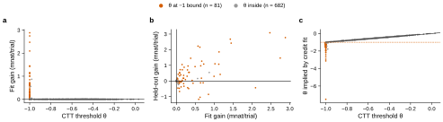

# r2 — CompareToThreshold in stay-credit coordinates vs the original

**Question.** Galen reported that CompareToThreshold (CTT) fits better rewritten in stay credit.
Does it, and on which subjects?

**Method.** In CTT a value V tracks reward on the current side; the subject stays with
probability σ(β(V − θ)), where θ is a threshold and β an inverse temperature. The credit form
(`ForagerCompareThresholdCredit`, variant [`ctt-credit`](../../variants/ctt-credit/notes.md))
fits the stay logit c = β(V − θ) directly: c moves toward c_win after a reward and toward
c_loss after no reward, with c_win = β(1 − θ) and c_loss = −βθ. The likelihood is the same.
Only the parameters and their bounds differ: CTT bounds θ to [−1, 1], while the credit form
bounds both credits to [−20, 20]. θ = −1 means c_loss = c_win / 2. A credit fit with
c_loss > c_win / 2 is therefore a CTT fit with θ < −1, which CTT cannot reach.

One launch refit both forms per subject on all 763 subjects (W&B group
[`ctt-credit@20261102-132626`](https://wandb.ai/NeuralDynamics/aind-dynamic-foraging-model/sweeps/2f26d1qa)).
It used r1's protocol and data (fit on even sessions, scored on odd sessions) and one
foraging-models commit (v0.29.0). r1's CTT fit (v0.26.0) is a second reference.

<!-- BEGIN result-1 -->

*Figure.* One dot per subject (n = 763); gains are credit form − CompareToThreshold from the same launch, in millinats per trial. **a**, Fit gain against CTT's fitted θ. **b**, Held-out gain against fit gain. **c**, The θ the credit fit implies, −c_loss / (c_win − c_loss), against CTT's θ; the dashed line is CTT's bound θ = −1. One seed per fit, so there are no error bars.

| model | pooled held-out, 149 test subjects | pooled odd sessions, 614 training-pool subjects | pooled fit sessions, all 763 |
|---|---|---|---|
| CompareToThreshold-credit | 0.71705 | 0.72107 | 0.71392 |
| CompareToThreshold | 0.71704 | 0.72104 | 0.71389 |
| CompareToThreshold (r1) | 0.71704 | 0.72104 | 0.71389 |

| subjects | n (of them test) | fit gain (mnat/trial), median [IQR] | fit gain > 0.1 mnat/trial | held-out gain (mnat/trial), median [IQR] | held-out up / down |
|---|---|---|---|---|---|
| θ at −1 bound | 81 (15) | +0.157 [+0.038, +0.589] | 47 | +0.046 [−0.055, +0.706] | 46 / 35 |
| θ inside | 682 (134) | +0.000 [−0.000, +0.000] | 2 | −0.000 [−0.000, +0.000] | 339 / 343 |

**Checks.** At the bound means θ within 1e-06 of −1. Inside the bound (682 subjects) the two forms reach the same likelihood: the 99th percentile of |fit difference| is 1.3e-06 nat per trial. 2 subjects differ by more than 0.1 mnat/trial, all with θ below −0.95 and all in the credit form's favour: 641494 (θ = −0.981, fit +0.867, held-out +0.543 mnat/trial), 816992 (θ = −0.990, fit +0.560, held-out +0.155 mnat/trial). The parameters agree less tightly, along flat directions of the likelihood: 99th percentiles of |c_win − β(1 − θ)| 0.016, |c_loss + βθ| 0.007, learning rate 2.7e-04, bias 2.9e-03. The credit form fits worse than CTT by more than 0.1 mnat per trial on 0 subjects. No credit reaches its ±20 bound (0 subjects), no CTT fit reaches θ = +1 (0), and no credit fit implies β < 0 (0). At the bound, the credit fits imply θ of median −1.28 (range −7.51 to −1.02).

**Same-launch CTT (foraging-models v0.29.0) against r1's CTT (v0.26.0).** The largest per-subject held-out difference is 4.8e-04 nat per trial (5 subjects above 0.1 mnat); the pooled scores agree to five decimals (table). 8 subjects sit on the bound in one fit and just inside it in the other, the search stopping at slightly different points: 711256 (θ = −1.000), 713378 (θ = −1.000), 726477 (θ = −1.000), 786866 (θ = −0.998), 787539 (θ = −1.000), 812304 (θ = −0.979), 816992 (θ = −0.990), 843079 (θ = −0.987).
<!-- END result-1 -->

## What it says

- **The credit form does not predict held-out sessions better.** On the 149 test subjects the
  pooled held-out likelihood is 0.71705, against 0.71704 for CTT. The leaderboard does not move.
- **All of its gain comes from CTT's bound on θ.** The credit form never fits worse (by more
  than 0.1 mnat per trial). Where θ is
  inside [−1, 1] it finds the same fit as CTT, apart from 2 subjects just inside the bound. On
  the 81 subjects whose CTT fit stops at θ = −1, the credit fit sits past the bound (median
  implied θ −1.28) and fits better.
- **Those gains carry over to held-out sessions only partly.** On the bound subjects the median
  held-out gain is +0.05 mnat per trial, and 35 of the 81 predict worse. 81 of 763 subjects is too
  few, and each gain too small, to change a pooled score.
- **What θ < −1 means.** After a loss these subjects keep more than half of the stay credit they
  have after a win. CTT cannot fit that, because its threshold stops at −1. Galen's form removes the limit at no cost to the other subjects, but at about 1.8×
  the fit time (launch [results](../../variants/ctt-credit/launch_record/production/results.md)).
