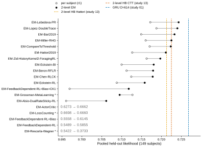

# r3 — Literature models as 2-level EM (session → subject, Laplace-EM; regime 2)

**Question.** Fit as 2-level EM (regime 2: each session's parameters drawn from its subject's
distribution, no population level, fit by Laplace-EM), how do the literature models rank, and
how much of the gap to the 2-level HB baselines (study 13) does that structure close? Models are
labelled EM-<model> (EM-CTT, EM-Hattori2019, ...).

| label | levels | method | where |
|---|---|---|---|
| per subject | none, one parameter set per subject | MLE | r1 (regime 1) |
| 2-level EM | session → subject | Laplace-EM | this report (regime 2) |
| 2-level HB | session → subject | NUTS | study 13 (HB-CTT, HB-Hattori) |

**Method.** All 19 ranked literature models on all 763 subjects, scored with MEvolve's
evaluator at its reported settings (MEvolve ADR 0004, MEvolve main 275158b): Laplace-EM within each
subject under study 13's hyperprior, EM run to convergence (max_em = 100), held-out sessions scored
by the session marginal over 2,048 draws. Gate 1c checks this evaluator against study 13's NUTS fits
for CompareToThreshold and Hattori2019. Study 12 launches it through a MEvolve CLI, as its own
variant with a launch record, and freezes per-subject rows. Because 17 of the 19 models have no HB
reference, this report gives three checks per model:
- median weight ESS of the session marginal;
- the share of subjects whose EM stopped at the iteration cap before converging;
- 2-level EM score minus per-subject score (r1). A negative value flags a failed Laplace fit.

## Leaderboard

<!-- BEGIN result-1 -->

Each line runs from a literature model's per-subject score (open circle, r1) to its 2-level EM score (filled) on the 149 held-out subjects. 2-level EM: Laplace-EM within each subject under study 13's hyperprior, EM to convergence (max_em = 100), held-out sessions scored by the session marginal over 2048 draws (MEvolve `6af7d58`). Dashed lines: 2-level HB (study 13) and the GRU at D≈614 (on its own held-out list). Models whose per-subject score is below 0.69 are written in grey, not drawn. * marks a model whose 2-level EM score falls below its per-subject score over all subjects (a failed Laplace fit; see the checks). One fit per subject and model, so no error bars.

Headline ranking: by the 2-level EM score, except that the 3 models whose 2-level fit failed (*) are placed by their per-subject score.

| rank | literature model | family | headline (149) | 2-level EM | per subject | gain | 2-level EM, GRU's list (149) |
|---:|---|---|---:|---:|---:|---:|---:|
| 1 | Lebedeva-PR | Q-learning + choice history | 0.7243 | 0.7243 | 0.7172 | +0.0071 | 0.7237 |
| 2 | Lopez-DoubleTrace | Q-learning + choice history | 0.7240 | 0.7240 | 0.7187 | +0.0053 | 0.7233 |
| 3 | Bari2019 | Q-learning + choice history | 0.7233 | 0.7233 | 0.7149 | +0.0084 | 0.7226 |
| 4 | Miller-RHG | Q-learning + choice history | 0.7225 | 0.7225 | 0.7160 | +0.0065 | 0.7218 |
| 5 | CompareToThreshold | Foraging and counting heuristics | 0.7223 | 0.7223 | 0.7170 | +0.0053 | 0.7217 |
| 6 | Hattori2019 | Q-learning, value only | 0.7211 | 0.7211 | 0.7127 | +0.0084 | 0.7205 |
| 7 | Zid-HistoryKernel2-ForagingRL | Foraging and counting heuristics | 0.7197 | 0.7197 | 0.7163 | +0.0034 | 0.7190 |
| 8 | Eckstein-BI | Bayesian state inference | 0.7181 | 0.7181 | 0.7100 | +0.0081 | 0.7174 |
| 9 | Beron-RFLR | Choice-history regression | 0.7179 | 0.7179 | 0.7112 | +0.0067 | 0.7172 |
| 10 | Chen-RLCK | Q-learning + choice history | 0.7178 | 0.7178 | 0.7124 | +0.0054 | 0.7172 |
| 11 | Eckstein-RL | Q-learning + choice history | 0.7158 | 0.7158 | 0.7088 | +0.0070 | 0.7151 |
| 12 | Grossman-MetaLearning * | Q-learning, value only | 0.7127 | 0.7095 | 0.7127 | −0.0032 | 0.7094 |
| 13 | FeedbackDependent-RL+Bias+CK1 | Q-learning + choice history | 0.7118 | 0.7118 | 0.6969 | +0.0149 | 0.7111 |
| 14 | Alsio-DualRateSticky-RL | Q-learning + choice history | 0.7061 | 0.7061 | 0.6961 | +0.0101 | 0.7055 |
| 15 | LossCounting * | Foraging and counting heuristics | 0.6698 | 0.6660 | 0.6698 | −0.0038 | 0.6654 |
| 16 | ActorCritic | Actor-critic | 0.6662 | 0.6662 | 0.6273 | +0.0390 | 0.6657 |
| 17 | FeedbackDependent-RL+Bias | Q-learning, value only | 0.6145 | 0.6145 | 0.5558 | +0.0588 | 0.6142 |
| 18 | FeedbackDependent-RL | Q-learning, value only | 0.5855 | 0.5855 | 0.5489 | +0.0366 | 0.5854 |
| 19 | Rescorla-Wagner * | Q-learning, value only | 0.5422 | 0.3733 | 0.5422 | −0.1689 | 0.3731 |
| | *2-level HB CTT (study 13)* | | 0.7225 | | | | |
| | *2-level HB Hattori (study 13)* | | 0.7213 | | | | |
| | *GRU D≈614 (study 01)* | | 0.7268† | | | | 0.7268 |

† On the GRU's own held-out list. Every subject's fit and scored trial counts equal r1's, so the gain compares the same trials.
<!-- END result-1 -->

## Checks (no 2-level HB reference for 17 models)

<!-- BEGIN result-2 -->
On all 763 subjects. Only CompareToThreshold and Hattori2019 have a 2-level HB reference (gate 1c); for the others these checks stand in. A 2-level EM score below the per-subject score would mark a failed Laplace fit.

| 2-level EM model | median weight ESS | subjects at EM cap | 2-level EM − per subject (763) | subjects scoring below per subject |
|---|---:|---:|---:|---:|
| EM-ActorCritic | 267 | 90.3% | +0.0427 | 1.8% |
| EM-Alsio-DualRateSticky-RL | 78 | 7.7% | +0.0103 | 0.9% |
| EM-Bari2019 | 67 | 2.1% | +0.0089 | 0.4% |
| EM-Beron-RFLR | 144 | 0.3% | +0.0068 | 2.4% |
| EM-Chen-RLCK | 135 | 2.1% | +0.0056 | 1.3% |
| EM-CompareToThreshold | 121 | 6.0% | +0.0054 | 2.0% |
| EM-Eckstein-BI | 129 | 80.7% | +0.0082 | 3.3% |
| EM-Eckstein-RL | 100 | 14.7% | +0.0072 | 1.7% |
| EM-FeedbackDependent-RL | 10 | 3.4% | +0.0367 | 0.3% |
| EM-FeedbackDependent-RL+Bias | 3 | 2.1% | +0.0599 | 0.0% |
| EM-FeedbackDependent-RL+Bias+CK1 | 23 | 32.2% | +0.0150 | 0.4% |
| EM-Grossman-MetaLearning | 42 | 37.9% | −0.0045 | 9.2% |
| EM-Hattori2019 | 60 | 4.8% | +0.0088 | 0.3% |
| EM-Lebedeva-PR | 53 | 0.1% | +0.0074 | 0.8% |
| EM-Lopez-DoubleTrace | 86 | 15.2% | +0.0056 | 3.8% |
| EM-LossCounting | 2048 | 35.5% | −0.0035 | 53.3% |
| EM-Miller-RHG | 27 | 14.8% | +0.0075 | 4.3% |
| EM-Rescorla-Wagner | 80 | 96.1% | −0.0899 | 57.5% |
| EM-Zid-HistoryKernel2-ForagingRL | 231 | 45.0% | +0.0036 | 5.4% |

EM-Rescorla-Wagner: its epsilon-greedy likelihood is flat or stepped in some parameters, and the per-session Laplace step uses gradients, so it can report convergence while poorly fitted. Read its row with that caveat.
<!-- END result-2 -->

## What it says

- **This is study 12's headline ranking** (Han, 2026-11-02): literature models ranked by 2-level EM, like for like with 2-level HB and with how study 40 scores programs. The three failed fits are placed by their per-subject score. r1 stays the per-subject reference and each model's twin.
- **Session-to-session variation lifts almost every literature model.** 16 of the 19 gain on the held-out
  subjects (median +0.0076 among those not flagged), on exactly the same trials as r1.
- **The best literature models now beat 2-level HB CTT.** EM-Lebedeva-PR (0.7243), EM-Lopez-DoubleTrace
  (0.7240) and EM-Bari2019 (0.7233) all score above study 13's best hierarchical baseline, HB-CTT (0.7225).
  EM-CompareToThreshold (0.7223) lands on HB-CTT and EM-Hattori2019 (0.7211) on HB-Hattori (0.7213), as gate 1c
  found for the same two models.
- **About two-thirds of the gap to the GRU closes.** On the GRU's own 149-subject list, the best per-subject
  model (Lopez-DoubleTrace, 0.7181) sits 0.0087 below the GRU (0.7268). The best 2-level EM model
  (EM-Lebedeva-PR, 0.7237) sits 0.0031 below it: 64% of the gap closed. The GRU still wins.
- **The ranking reshuffles.** Models gain by different amounts. Bari2019 moves from 6th to 3rd and Hattori2019
  from 8th to 6th; Zid-HistoryKernel2 drops from 4th to 7th. Structure and session-level flexibility are
  not separable from one per-subject ranking.
- **Three fits failed, and are flagged, not ranked as findings.** EM-Rescorla-Wagner (96% of subjects at the
  EM cap; its stepped likelihood defeats the gradient-based per-session step), EM-LossCounting and
  EM-Grossman-MetaLearning all score below their own per-subject fits, which a model with more freedom
  should not do. Their 2-level EM values say nothing about the models themselves.
- **Some gains are probably underestimates.** EM-ActorCritic (90% of subjects at the EM cap),
  EM-Eckstein-BI (81%) and EM-Zid-HistoryKernel2 (45%) often stopped before converging. Their scores still
  beat their per-subject fits, but a longer EM could raise them.
- **Caveats.** Only CompareToThreshold and Hattori2019 have a 2-level HB reference (gate 1c); for the rest,
  the checks above stand in. One fit per subject and model, so no error bars.
