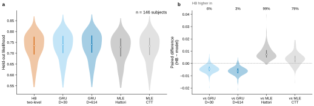

# r2 — Per-subject held-out likelihood: HB vs GRU vs per-subject MLE

**Question.** Is r1's pooled ordering (GRU > HB two-level > per-subject MLE) a few subjects
pulling the average, or does it hold subject by subject?

**Method.** Per held-out subject:
- **HB:** the run's `heldout/eval_likelihood` (session-marginal, trial-weighted within the subject),
  from the same frozen runs as r1.
- **GRU:** H128 v1, the curve r1 quotes, averaged over its 3 seeds, from study 01's
  `per_subject_rows.json`.
- **MLE:** the per-subject MLE from study 01 r8.

Comparisons are paired by subject, because between-subject spread is an order of magnitude
larger than the gaps between models.

<!-- BEGIN result-1 -->

| HB − arm | median | mean | subjects where HB is higher |
|---|---|---|---|
| GRU D≈30 | -0.0045 | -0.0045 | 6% (9/146) |
| GRU D≈614 | -0.0061 | -0.0061 | 3% (5/146) |
| MLE Hattori | +0.0073 | +0.0083 | 99% (145/146) |
| MLE CTT | +0.0037 | +0.0037 | 79% (115/146) |

Per-subject medians: HB two-level 0.7347, GRU D≈30 0.7393, GRU D≈614 0.7407, MLE Hattori 0.7285, MLE CTT 0.7330.
Paired over the 146 subjects every arm scored. Study 01's GRU held-out cohort differs from its per-subject MLE cohort (which HB shares) by three subjects each way, left out here: HB two-level only: 722683, 795395, 820243; GRU D≈30 only: 764791, 808057, 823164; GRU D≈614 only: 764791, 808057, 823164; MLE Hattori only: 722683, 795395, 820243; MLE CTT only: 722683, 795395, 820243.
Shared subjects whose scored-trial count differs between HB and GRU: none.
<!-- END result-1 -->

## What it says

- **The ordering holds subject by subject.** The GRU is higher than the HB for almost every
  subject, at D≈30 and at D≈614. The HB is higher than the per-subject MLE Hattori for all but
  one subject, and higher than MLE CTT for about four in five. r1's pooled gaps are not carried
  by a few subjects.
- **The left panel hides this.** Per-subject likelihoods range from about 0.55 to 0.87 in every
  arm, so the distributions overlap almost completely. The model differences show only when each
  subject is compared with itself (right panel).
- **Cohort note.** Study 01's GRU and MLE were scored on held-out cohorts that differ by three
  subjects each way (listed above). r1's pooled comparison mixes the two cohorts; this paired view
  uses only the 146 subjects every arm scored.
- Same caveats as r1: 12% of sessions fail the k̂ gate (HB likely understated), some subjects
  miss the convergence gates, and there is one seed per HB subject.
