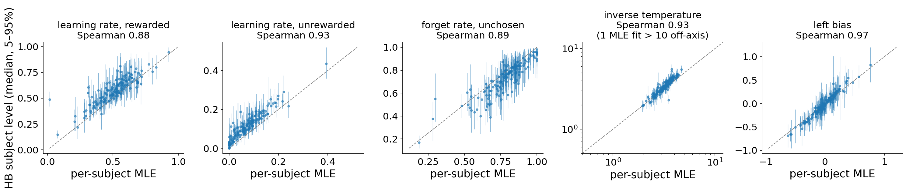
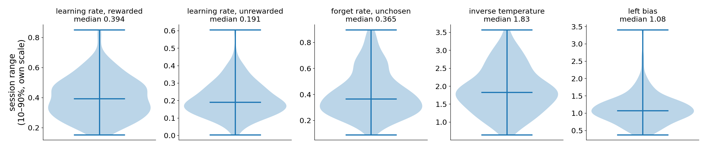
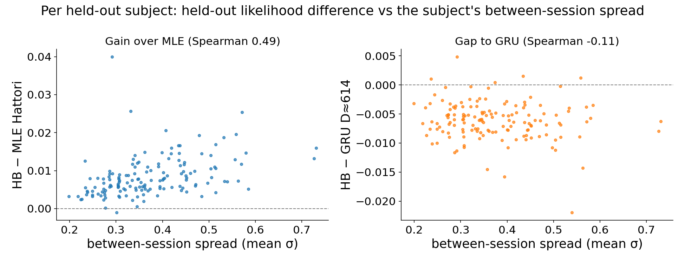

# r3 — What the HB learns: session-to-session variability and parameters vs per-subject MLE

**Question.** r1 and r2 show the two-level HB beats the per-subject MLE for almost every subject
and closes much of the gap to the GRU. What does the HB learn that the MLE cannot, and is that why
it does better?

**Method.** Posteriors are summarized per subject from each run's saved draws
(`freeze_posteriors.py`, keyed by each draws file's sha256), and mapped to each parameter's own scale
with foraging-models' `hattori2019_session_params`. MLE parameters are study 08's frozen copy of the
per-subject fits (`ml_hattori_heldout.csv`, study 01's run `unhmbrk4`; its held-out likelihoods match
study 01 r8 exactly). Both were fitted on the same even-indexed context sessions.

<!-- BEGIN result-1 -->

| parameter | Spearman HB vs MLE | median HB | median MLE | median between-session range (10–90%) |
|---|---|---|---|---|
| learning rate, rewarded | 0.88 | 0.58 | 0.526 | 0.394 |
| learning rate, unrewarded | 0.93 | 0.111 | 0.0662 | 0.191 |
| forget rate, unchosen | 0.89 | 0.764 | 0.798 | 0.365 |
| inverse temperature | 0.93 | 3.45 | 3.27 | 1.83 |
| left bias | 0.97 | -0.036 | -0.037 | 1.08 |

- HB − MLE Hattori per subject: median +0.0074; Spearman with the subject's between-session spread +0.49 (n=149).
- HB − GRU D≈614 per subject: median -0.0061; Spearman with the same spread -0.11 (n=146, subjects in both cohorts).
<!-- END result-1 -->

## What it says

- **HB and MLE agree on what each mouse is like.** Subject-level parameters rank-correlate
  0.88–0.97 with the MLE, with similar medians. The HB is not finding a different mouse.
- **But a mouse is not the same mouse every session.** Within one subject, the typical session's
  rewarded learning rate spans ~0.4 (10th to 90th percentile session), forget rate ~0.37, inverse
  temperature ~1.8, and bias ~1.1 logit units. The MLE fits one value per subject, so it must use a
  compromise that is wrong for most sessions. The HB keeps the whole range and, scored by the
  session-marginal, effectively works out from a session's early trials which part of that range
  the session is in.
- **That is where the gain comes from.** A subject's gain over the MLE rises with its between-session
  spread (Spearman ≈ +0.5): mice whose parameters move most between sessions gain most. It is not the
  whole story; the prior and posterior averaging also differ from the MLE (r1's caveat).
- **The remaining gap to the GRU is something else.** The HB's shortfall against the GRU does not
  track the same spread (Spearman ≈ −0.1). Session variability within the Hattori model is now
  accounted for; what the GRU still captures beyond it is outside that model, for example trial-level
  dynamics the forager's update rule cannot express.
- **Shrinkage.** For forget rates near 1 the HB sits below the MLE. That fits the fixed prior (uniform
  on the bounded scale) and posterior averaging pulling extreme point estimates inward, not a
  disagreement about the mouse. The MLE inverse temperature is unbounded; one fit is above the HB's
  cap of 10.

Caveats: draft for the same reasons as r1 (k̂, convergence). σ is summarized by its posterior median.
"Mean σ" averages across parameters on the unconstrained scale, a rough index of how much a subject
varies, not a calibrated quantity.
