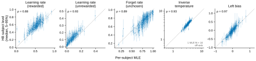
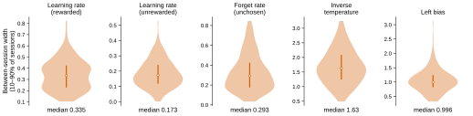
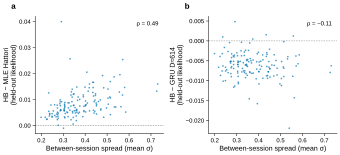
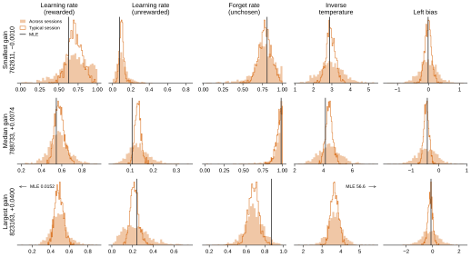

# r3 — What the HB learns: session-to-session variability and parameters vs per-subject MLE

**Question.** r1 and r2 show the two-level HB beats the per-subject MLE for almost every subject
and closes much of the gap to the GRU. What does the HB learn that the MLE cannot, and is that why
it does better?

**Method.** Posteriors are summarized per subject from each run's saved draws
(`freeze_posteriors.py`, keyed by each draws file's sha256), and mapped to each parameter's own scale
with foraging-models' `hattori2019_session_params`. MLE parameters are study 08's frozen copy of the
per-subject fits (`ml_hattori_heldout.csv`, study 01's run `unhmbrk4`; its held-out likelihoods match
study 01 r8 exactly). Both were fitted on the same even-indexed context sessions.

<!-- BEGIN result-1 -->

*HB subject-level posterior (median, 5–95%) against the per-subject MLE, one dot per subject; dashed line = identity; ρ = Spearman.*

| parameter | Spearman HB vs MLE | median HB | median MLE | median between-session width (10–90% session) |
|---|---|---|---|---|
| learning rate, rewarded | 0.88 | 0.58 | 0.526 | 0.335 |
| learning rate, unrewarded | 0.93 | 0.111 | 0.0662 | 0.173 |
| forget rate, unchosen | 0.89 | 0.764 | 0.798 | 0.293 |
| inverse temperature | 0.93 | 3.45 | 3.27 | 1.63 |
| left bias | 0.97 | -0.036 | -0.037 | 0.996 |

*How far each parameter moves between a subject’s sessions (10–90% session width, own scale), one value per subject.*

*Per held-out subject: held-out likelihood difference against the subject’s between-session spread; a, vs MLE Hattori; b, vs GRU D≈614.*

*HB posterior for the subjects with the smallest, median and largest gain over the MLE: the typical session (outline) vs across sessions (filled), against the single MLE value.*

- HB − MLE Hattori per subject: median +0.0074; Spearman with the subject's between-session spread +0.49 (n=149).
- HB − GRU D≈614 per subject: median -0.0061; Spearman with the same spread -0.11 (n=146, subjects in both cohorts).
<!-- END result-1 -->

## What it says

- **HB and MLE agree on what each mouse is like.** Subject-level parameters rank-correlate
  0.88–0.97 with the MLE, with similar medians. The HB is not finding a different mouse.
- **But a mouse is not the same mouse every session.** Within one subject, the width between the
  10th and 90th percentile session (posterior median, conditional on each posterior draw so that
  uncertainty about the subject's mean does not inflate it) is substantial for every parameter; the
  table gives the medians across subjects. The MLE fits one value per subject, a compromise across
  all of them. The HB keeps the range and, scored by the session-marginal, effectively infers from a
  session's early trials where in that range the session sits.
- **The gain tracks that spread.** A subject's gain over the MLE rises with its between-session spread
  (Spearman ≈ +0.5): mice whose parameters move most between sessions gain most. This is an
  association across subjects with one aggregate spread index, consistent with session variability
  being a main source of the gain. It doesn't exclude the other differences from the MLE, the prior
  and posterior averaging (r1's caveat).
- **The gap to the GRU is not explained by the same spread.** The HB's shortfall against the GRU shows
  no clear association with that index (Spearman ≈ −0.1). One hypothesis is that the GRU captures
  trial-level dynamics the Hattori update rule cannot express. This analysis doesn't separate that
  from prior effects, estimation error, or r1's open convergence and k̂ issues.
- **Three subjects up close** (example-subject figure: smallest, median and largest gain over the
  MLE). For each parameter it shows the posterior of the subject's typical session (orange), the
  distribution across its sessions (blue), and the single MLE value (black). In the first two, the
  MLE sits inside the typical-session posterior while sessions spread well beyond it: the two fits
  agree on the mouse, but only the HB represents how much it moves. The largest-gain subject's
  MLE is degenerate: a rewarded learning rate of 0.015 and an inverse temperature of 56.6, far
  outside where any of its sessions lie. The HB's prior keeps it in a sensible range. So part of
  the gain over the MLE is regularizing pathological per-subject fits, not session variability.
- **Shrinkage.** For forget rates near 1 the HB sits below the MLE. That fits the fixed prior (uniform
  on the bounded scale) and posterior averaging pulling extreme point estimates inward, not a
  disagreement about the mouse. The MLE inverse temperature is unbounded; one fit is above the HB's
  cap of 10.

Caveats: draft for the same reasons as r1 (k̂, convergence). σ is summarized by its posterior median.
"Mean σ" averages across parameters on the unconstrained scale, a rough index of how much a subject
varies, not a calibrated quantity.
