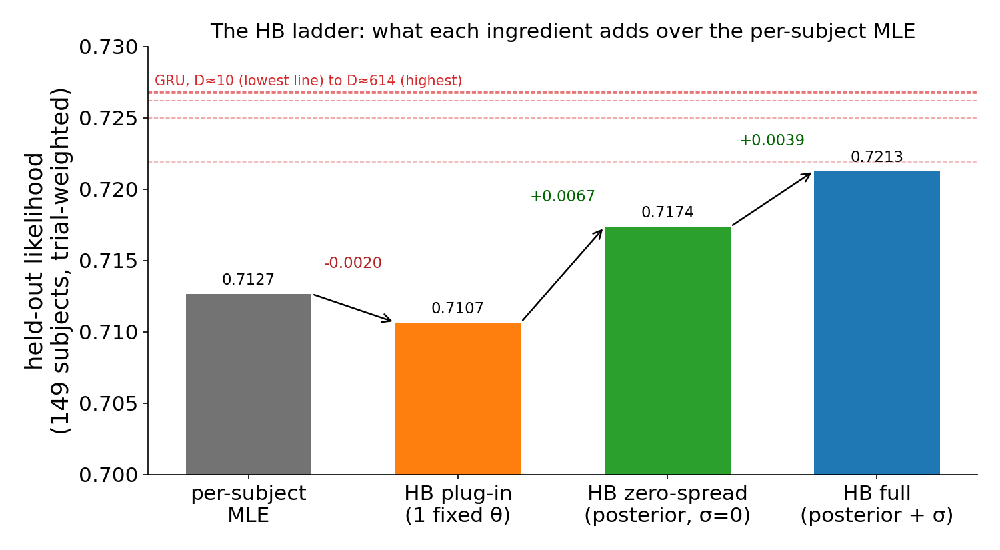
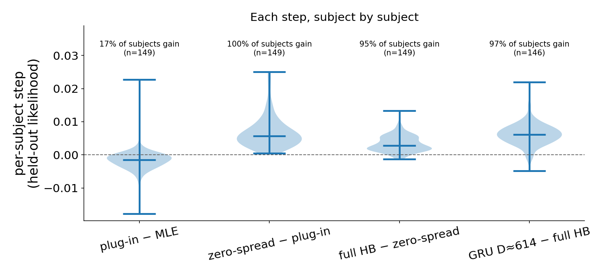
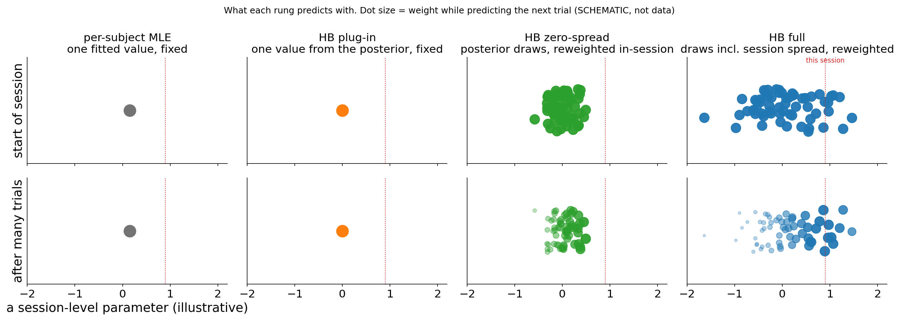

# r4 — The HB ladder: from per-subject MLE to the full two-level HB, step by step

**Question.** The two-level HB beats the per-subject MLE and comes close to the GRU (r1). Which
ingredient of the HB does that, and how much does each add?

**Method.** Four predictors of the same forager (Hattori2019), all scored on the same held-out eval
sessions of the same 149 subjects, each adding one ingredient:

| rung | parameters used to predict a held-out session | within-session inference |
|---|---|---|
| per-subject MLE | one maximum-likelihood set per subject | none |
| HB plug-in | one set: the median of the subject's typical-session posterior | none |
| HB zero-spread | every posterior draw of the typical session; no between-session spread | yes: draws reweighted by the session's earlier trials |
| HB full | draws include between-session spread (the r1 headline) | yes |

An interactive walk-through of the sampling, for readers new to hierarchical Bayes (simulated toy mouse, same computation): [HB sampling explainer](../explainers/hb_sampling_explainer.html).

The zero-spread and full rungs are scored by the session-marginal, which is a particle filter over
the draws: predicting each trial, every draw is weighted by how well it explained the session's
earlier trials (schematic below). Neither rung refits anything on the scored session or uses its
later trials.

<!-- BEGIN result-1 -->

| rung | pooled held-out likelihood | step |
|---|---|---|
| MLE | 0.7127 |  |
| plug-in | 0.7107 | -0.0020 |
| zero-spread | 0.7174 | +0.0067 |
| full HB | 0.7213 | +0.0039 |
| GRU H128 (study 01 r1) | D≈10 0.7219, D≈30 0.7250, D≈100 0.7262, D≈300 0.7267, D≈614 0.7268 | |

MLE pooled from study 08's per-subject table: 0.7127 (study 01 r8 publishes 0.7127).

| step, per subject | median | subjects with a gain |
|---|---|---|
| plug-in − MLE | -0.0015 | 17% (26/149) |
| zero-spread − plug-in | +0.0056 | 100% (149/149) |
| full HB − zero-spread | +0.0028 | 95% (142/149) |
| GRU D≈614 − full HB | +0.0061 | 97% (141/146) |

<!-- END result-1 -->

## What it says

- **One HB point estimate doesn't beat the MLE.** The plug-in, a single parameter set from the HB
  (the typical-session posterior median), scores below the per-subject MLE for most subjects. That
  step changes the prior, the pooling across sessions and the point estimator all at once, so it
  doesn't isolate any one of them. In particular, it doesn't show that the prior contributes nothing
  to the higher rungs. What it does show is that the HB's gain needs more than a single point summary.
- **The big step is within-session inference over posterior draws.** Keeping every posterior draw
  and letting each held-out session reweight them by its own earlier trials improves every one of
  the 149 subjects. Even without any between-session spread, this already matches the best
  per-subject MLE family (CTT, r1).
- **Between-session spread adds a further, smaller step** for nearly every subject: more room for a
  session to sit away from the subject's typical session, which within-session inference then finds.
- **The GRU is still ahead of the full HB** for nearly every subject. Both now combine fixed
  knowledge from the context sessions with within-session inference, so this residual is closer to
  what the GRU's structure buys. It is not purely that: the HB assumes a session's parameters are
  constant within the session, and the GRU's hidden state doesn't (see the discussion on #27).
- Same caveats as r1: the k̂ gate, the convergence gates, one seed per HB subject.
