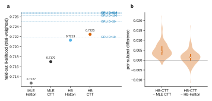

# r5 — HB-CTT two-level vs HB-Hattori, per-subject MLE and GRU on held-out subjects

**Question.** TODO: the sub-question this report answers.

<!-- BEGIN result-1 -->

*(a) Pooled held-out likelihood. Dashed lines: the GRU H128 curve (study 01 r1); darker means more training subjects. (b) Per-subject difference of HB-CTT from the per-subject MLE CTT and from HB-Hattori.*

| model | held-out likelihood (trial-weighted) |
|---|---|
| HB-CTT two-level, session-marginal (headline) | **0.7225** ± 1.0e-06 (MC) |
| HB-Hattori2019 two-level (r1) | 0.7213 |
| per-subject MLE CTT (study 01 r8) | 0.7170 |
| per-subject MLE Hattori (study 01 r8) | 0.7127 |
| GRU H128 (study 01 r1) | D≈10 0.7219, D≈30 0.7250, D≈100 0.7262, D≈300 0.7267, D≈614 0.7268 |

- Per subject: HB-CTT beats the MLE CTT for 145 of 149 subjects (median +0.0043), and HB-Hattori for 100 (median +0.0014).
- Subjects 149; scored trials 1,013,172 (comparators: 1,013,172).
- Convergence gates (R-hat < 1.01, bulk ESS ≥ 400, no divergences): 107 of 149 pass; worst R-hat 1.115, lowest ESS 23; 1189 divergences. Converged only: 0.7260.
- Pareto k̂: 107 of 2138 sessions failed on the plain draw-average and were importance-sampled; 13 still fail. All-plain 0.722466; headline 0.722467.
- Trial-marginal (study 08's score): 0.7128.
<!-- END result-1 -->

## What it says

TODO
