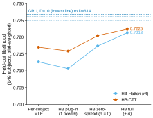
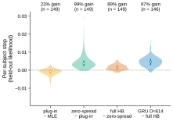
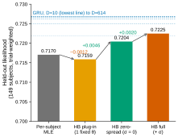

# r6 — The HB-CTT ladder: from per-subject MLE to the full two-level HB, beside HB-Hattori

**Question.** r4 split HB-Hattori's gain over its per-subject MLE into steps. Does HB-CTT gain in
the same way?

**Method.** The four rungs of r4, for the CTT forager, on the same subjects and eval sessions:

- **MLE:** one best-fit parameter set per subject (study 08's per-subject MLE CTT table).
- **plug-in:** one fixed parameter set per subject, the median of the HB posterior for its typical
  session. Same shape of predictor as the MLE; only the fitting differs.
- **zero-spread:** every posterior draw of the typical session, with no session-to-session spread.
  Each session is scored by the session-marginal, so within a session the draws that predict the
  earlier trials well get more weight.
- **full HB:** adds the between-session spread (r5's headline).

The controls are `make freeze-plugin-ctt`; the computation is r4's own code.

<!-- BEGIN result-1 -->

*Both ladders, rung by rung, on the same subjects and sessions; dashed lines, the GRU H128 curve (study 01 r1).*

| rung | HB-CTT | step | HB-Hattori (r4) | step |
|---|---|---|---|---|
| MLE | 0.7170 |  | 0.7127 |  |
| plug-in | 0.7159 | -0.0012 | 0.7107 | -0.0020 |
| zero-spread | 0.7204 | +0.0046 | 0.7174 | +0.0067 |
| full HB | 0.7225 | +0.0020 | 0.7213 | +0.0039 |

MLE CTT pooled from study 08's per-subject table: 0.7170 (study 01 r8 publishes 0.7170).

*Each HB-CTT step, subject by subject (paired), with the share of subjects that gain.*

| HB-CTT step, per subject | median | subjects with a gain |
|---|---|---|
| plug-in − MLE | -0.0006 | 23% (35/149) |
| zero-spread − plug-in | +0.0036 | 99% (148/149) |
| full HB − zero-spread | +0.0013 | 89% (132/149) |
| GRU D≈614 − full HB | +0.0046 | 97% (141/146) |

*The HB-CTT ladder alone, in r4's layout.*
<!-- END result-1 -->

## What it says

- **Same shape as HB-Hattori, smaller steps.** For both foragers, the single HB point estimate
  (plug-in) scores slightly below the MLE. Averaging over the posterior with in-session reweighting
  (zero-spread) is the largest step and helps almost every subject. The session-to-session spread
  (full HB) adds a smaller further step.
- **CTT starts higher and gains less.** Its MLE is already 0.004 above Hattori's, and each HB step is
  smaller, so the two HB headlines end only about 0.001 apart. Much of what the HB adds to Hattori,
  CTT's structure already captures.
- **The GRU stays ahead per subject.** The largest GRU beats full HB-CTT for nearly every subject.

Caveats:

- **What the plug-in step mixes.** Plug-in minus MLE changes the prior, the pooling across sessions
  and the point estimator together, so it does not isolate any one of them (as in r4).
- **Uncertainty.** One seed per subject; no run-to-run variance is measured.
