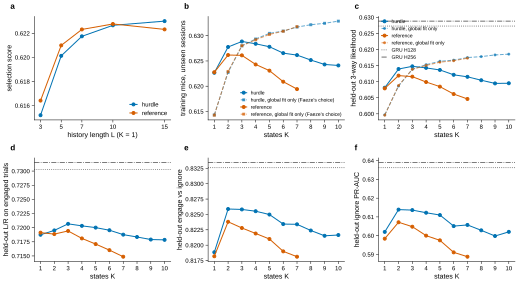
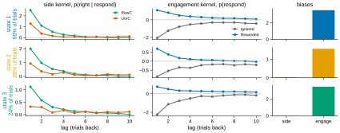
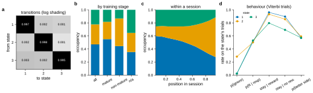
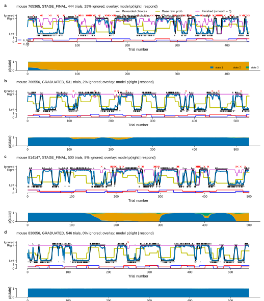
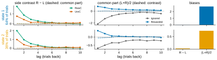
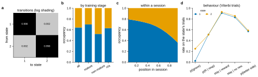
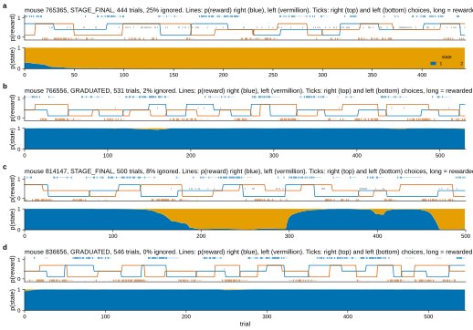
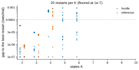

# r1 — GLM-HMM round 1: held-out score vs K, and what the states are

**Question.** We fit a GLM-HMM to the GRU's own mice, sessions and metric code. How well does it
predict new sessions as the number of states K grows? Which of its two emissions does better?
How close does it get to the 3-way GRU? And what do its states look like?

**The model.** A GLM-HMM assumes the mouse is in one of K hidden *states* on every trial. In
each state it chooses left, right or ignore by its own logistic regression on the last
L = 10 trials. From one trial to the next it stays in its state or moves to another, by a
fixed *transition matrix* A.
- The **hurdle** emission splits each choice into two decisions. First, respond or not, from
  unsigned history (past ignores and rewards). Then left or right, from signed history (past
  rewarded and unrewarded choices).
- The **reference** emission is one three-way regression on all the history, with ignore as the
  baseline class. It is the form Faeze used.

**How it is fitted.** Snapshot 20260603, ignores included (study 02's 3-way setup).
1. **Global fit:** one model for all 614 training mice, on their even-numbered sessions
   (4,887,818 trials). EM is run from 20 random starts and the best fit is kept.
2. **Per-mouse refit:** each mouse's own model, started from the global fit and fitted to its
   even sessions. A prior keeps each weight near 0 (Gaussian, SD 2) and each transition row
   near uniform (Dirichlet, α = 2).

**Three scores.** Each predicts every trial of a mouse's odd-numbered sessions (never fitted)
from the trials before it, and averages the probability given to the mouse's actual choice
(a geometric mean; chance is 1/3).
- **Refit score:** training mice, after the per-mouse refit. This is study 14's selection
  score, and it chose L (lag scan) and K.
- **Global-fit score, same mice:** training mice, global fit only. This is how Faeze chose K.
- **Held-out scores:** the 149 held-out mice, with refit ("matched", the GRU's protocol) and with
  the global fit only ("zero-shot"). Reported, never used to choose.

**Comparator:** study 02 r1's 3-way GRU at D = 614, read from its committed `frozen_runs.json`.
Its raw 3-way score (≈ 0.63) is on the same scale as ours. Its headline 0.73 is `LR_engaged`,
left vs right on the trials the mouse responded, with chance 1/2.

**States.** For each held-out session, the *posterior* gives the probability of each state on
each trial, given the whole session. The *Viterbi path* is the single most likely state
sequence. The state figures use posteriors under the **global fit**, so a state label means the
same thing in every mouse. Per-mouse refits do not keep the global states in order as K grows
(result-3), so pooling their labels across mice would mix different states.

<!-- BEGIN result-1 -->
Each score is the geometric-mean probability given to the mouse's actual choice on sessions never fitted (chance 1/3). *Refit*: training mice, after the per-mouse refit (study 14's selection score; bold = each emission's best). *Global fit, same mice*: training mice, global fit only (Faeze's way of choosing K). *Held-out*: 149 new mice, with refit (matched, the GRU's protocol) and global fit only (zero-shot). GRU = study 02 r1's 3-way GRU at D = 614, mean of 3 seeds. One seed per GLM-HMM cell, so no error bars.

| emission | K | refit (selection) | global fit, same mice | held-out, refit | held-out, global fit | held-out refit: L/R engaged | engage | ignore PR-AUC |
|---|---|---|---|---|---|---|---|---|
| hurdle | 1 | 0.6227 | 0.6143 | 0.6081 | 0.5997 | 0.7187 | 0.8188 | 0.6020 |
| hurdle | 2 | 0.6278 | 0.6228 | 0.6139 | 0.6086 | 0.7195 | 0.8259 | 0.6139 |
| hurdle | 3 | **0.6289** | 0.6280 | 0.6148 | 0.6139 | 0.7207 | 0.8258 | 0.6136 |
| hurdle | 4 | 0.6284 | 0.6294 | 0.6143 | 0.6153 | 0.7203 | 0.8255 | 0.6122 |
| hurdle | 5 | 0.6278 | 0.6305 | 0.6136 | 0.6163 | 0.7200 | 0.8250 | 0.6110 |
| hurdle | 6 | 0.6266 | 0.6309 | 0.6121 | 0.6167 | 0.7195 | 0.8234 | 0.6051 |
| hurdle | 7 | 0.6262 | 0.6317 | 0.6115 | 0.6175 | 0.7188 | 0.8234 | 0.6057 |
| hurdle | 8 | 0.6252 | 0.6322 | 0.6104 | 0.6178 | 0.7184 | 0.8224 | 0.6029 |
| hurdle | 9 | 0.6243 | 0.6325 | 0.6095 | 0.6183 | 0.7179 | 0.8215 | 0.5998 |
| hurdle | 10 | 0.6241 | 0.6329 | 0.6095 | 0.6186 | 0.7178 | 0.8217 | 0.6020 |
| reference | 1 | 0.6228 | 0.6143 | 0.6079 | 0.5996 | 0.7191 | 0.8182 | 0.5984 |
| reference | 2 | **0.6262** | 0.6229 | 0.6119 | 0.6088 | 0.7189 | 0.8238 | 0.6072 |
| reference | 3 | 0.6261 | 0.6280 | 0.6116 | 0.6138 | 0.7194 | 0.8228 | 0.6048 |
| reference | 4 | 0.6243 | 0.6292 | 0.6099 | 0.6151 | 0.7181 | 0.8219 | 0.6000 |
| reference | 5 | 0.6231 | 0.6303 | 0.6085 | 0.6161 | 0.7171 | 0.8210 | 0.5975 |
| reference | 6 | 0.6209 | 0.6309 | 0.6062 | 0.6165 | 0.7160 | 0.8190 | 0.5911 |
| reference | 7 | 0.6194 | 0.6318 | 0.6046 | 0.6173 | 0.7149 | 0.8181 | 0.5888 |
| reference | 8 | 0.6182 | 0.6325 | 0.6029 | 0.6181 | 0.7140 | 0.8167 | 0.5836 |
| reference | 9 | 0.6170 | 0.6331 | 0.6014 | 0.6186 | 0.7125 | 0.8163 | 0.5819 |
| reference | 10 | 0.6159 | 0.6335 | 0.6006 | 0.6190 | 0.7120 | 0.8156 | 0.5808 |
| GRU H64 (study 02) | — | — | — | 0.6249 | — | 0.7282 | 0.8316 | 0.6320 |
| GRU H128 (study 02) | — | — | — | 0.6273 | — | 0.7303 | 0.8326 | 0.6362 |
| GRU H256 (study 02) | — | — | — | 0.6288 | — | 0.7315 | 0.8334 | 0.6389 |

**Lag scan** (K = 1, selection score; L = 15 from the follow-up launch):

| emission | L = 3 | L = 5 | L = 7 | L = 10 | L = 15 |
|---|---|---|---|---|---|
| hurdle | 0.6152 | 0.6201 | 0.6217 | 0.6227 | 0.6230 |
| reference | 0.6164 | 0.6210 | 0.6223 | 0.6228 | 0.6223 |

<!-- END result-1 -->

<!-- BEGIN result-2 -->
**hurdle, K = 3** (run [u4j7ukti](https://wandb.ai/AIND-disRNN/mice_glmhmm/runs/u4j7ukti)). States ordered by occupancy: the mean smoothed posterior, under the global fit, over the held-out mice's trials (both splits). Dwell: expected 1/(1 − A_kk) from the global transitions, and the mean Viterbi run. *Predicted*: the global model's p(left, right, ignore), averaged over the state's posterior weight. *Observed*: rates on the trials Viterbi assigns to the state.

| state | occupancy | mature / non-mature / n.a. | dwell exp. / obs. | predicted L / R / I | obs. p(ignore) | obs. p(R \| resp) | stay after rew. / no rew. | p(better side) | sessions using ≥10% |
|---|---|---|---|---|---|---|---|---|---|
| 1 | 0.470 | 0.55 / 0.44 / 0.35 | 331 / 385 | 0.48 / 0.49 / 0.02 | 0.02 | 0.51 | 0.96 / 0.90 | 0.57 | 0.62 |
| 2 | 0.307 | 0.27 / 0.42 / 0.29 | 472 / 249 | 0.36 / 0.36 / 0.28 | 0.28 | 0.50 | 0.93 / 0.86 | 0.59 | 0.57 |
| 3 | 0.223 | 0.18 / 0.13 / 0.35 | 210 / 327 | 0.47 / 0.51 / 0.02 | 0.02 | 0.53 | 0.80 / 0.69 | 0.57 | 0.33 |

**reference, K = 2** (run [74wl3w23](https://wandb.ai/AIND-disRNN/mice_glmhmm/runs/74wl3w23)). States ordered by occupancy: the mean smoothed posterior, under the global fit, over the held-out mice's trials (both splits). Dwell: expected 1/(1 − A_kk) from the global transitions, and the mean Viterbi run. *Predicted*: the global model's p(left, right, ignore), averaged over the state's posterior weight. *Observed*: rates on the trials Viterbi assigns to the state.

| state | occupancy | mature / non-mature / n.a. | dwell exp. / obs. | predicted L / R / I | obs. p(ignore) | obs. p(R \| resp) | stay after rew. / no rew. | p(better side) | sessions using ≥10% |
|---|---|---|---|---|---|---|---|---|---|
| 1 | 0.638 | 0.69 / 0.51 / 0.65 | 509 / 414 | 0.48 / 0.50 / 0.02 | 0.02 | 0.52 | 0.91 / 0.83 | 0.57 | 0.79 |
| 2 | 0.362 | 0.31 / 0.49 / 0.35 | 598 / 276 | 0.37 / 0.38 / 0.25 | 0.26 | 0.50 | 0.94 / 0.87 | 0.59 | 0.61 |

<!-- END result-2 -->

<!-- BEGIN result-3 -->
*Restarts at best*: final log joint within 0.0001 nats/trial of the best restart. *Aligned subjects*: held-out mice whose refit states still match the global states, by weight distance, in the same order. As K grows the refits reorder or repurpose states, which is why the state summaries use the global fit.

| emission | K | restarts at best | median gap (nats/trial) | restarts converged | EM iters (best) | aligned subjects | run time (h) |
|---|---|---|---|---|---|---|---|
| hurdle | 1 | 1/1 | 0.0e+00 | 1/1 | 2 | 149/149 | 0.1 |
| hurdle | 2 | 20/20 | 1.7e-05 | 20/20 | 30 | 147/149 | 0.3 |
| hurdle | 3 | 20/20 | 9.0e-06 | 20/20 | 32 | 141/149 | 0.4 |
| hurdle | 4 | 2/20 | 4.5e-04 | 20/20 | 48 | 122/149 | 1.3 |
| hurdle | 5 | 12/20 | 4.2e-05 | 20/20 | 66 | 94/149 | 1.9 |
| hurdle | 6 | 8/20 | 1.2e-04 | 20/20 | 109 | 31/149 | 2.9 |
| hurdle | 7 | 5/20 | 4.4e-04 | 20/20 | 180 | 42/149 | 4.1 |
| hurdle | 8 | 2/20 | 4.1e-04 | 20/20 | 295 | 20/149 | 5.2 |
| hurdle | 9 | 4/20 | 3.0e-04 | 19/20 | 281 | 6/149 | 7.8 |
| hurdle | 10 | 1/20 | 6.7e-04 | 18/20 | 371 | 6/149 | 9.5 |
| reference | 1 | 1/1 | 0.0e+00 | 1/1 | 2 | 149/149 | 0.1 |
| reference | 2 | 20/20 | 6.6e-07 | 20/20 | 34 | 148/149 | 1.2 |
| reference | 3 | 20/20 | 5.9e-06 | 20/20 | 27 | 132/149 | 1.4 |
| reference | 4 | 8/20 | 2.0e-04 | 20/20 | 65 | 116/149 | 2.6 |
| reference | 5 | 3/20 | 4.0e-04 | 20/20 | 136 | 75/149 | 4.4 |
| reference | 6 | 8/20 | 4.4e-04 | 20/20 | 384 | 51/149 | 7.8 |
| reference | 7 | 5/20 | 4.1e-04 | 20/20 | 126 | 27/149 | 9.4 |
| reference | 8 | 6/20 | 4.0e-04 | 20/20 | 355 | 18/149 | 12.9 |
| reference | 9 | 4/20 | 3.7e-04 | 20/20 | 270 | 6/149 | 16.9 |
| reference | 10 | 6/20 | 1.6e-04 | 20/20 | 294 | 1/149 | 22.7 |

<!-- END result-3 -->

## What it says

1. **The GLM-HMM does not reach the GRU.** The best model, hurdle K = 3, scores 0.6148 on
   held-out mice. The 3-way GRU scores 0.6273 (H128) and 0.6288 (H256) on the same trials. The
   gap shows on every part: left vs right on engaged trials (0.7207 vs 0.7303), engage vs
   ignore (0.8258 vs 0.8326) and ignore detection (PR-AUC 0.614 vs 0.636).
2. **Hurdle beats reference.** It scores higher at every K ≥ 2, with half the weights per state.
   It is better for 127 of 149 held-out mice (hurdle K = 3 against reference K = 2).
3. **The best K depends on how K is scored.**
   - With the per-mouse refit (study 14's rule), the score peaks at K = 3 for hurdle and K = 2
     for reference, then falls.
   - With the global fit alone (Faeze's rule), it rises at every K up to 10, on the training
     mice and on new mice.
   - The refit overfits: its gap between fitted and unseen sessions grows from 0.005 at K = 3 to
     0.028 at K = 10 (hurdle). From K = 4, a refitted new mouse scores below the unrefitted
     global fit. So the refit rule likely picks too few states.
4. **The K = 3 states have a clear reading.**
   - *Engaged and sticky* (47% of trials): ignores 2.5% and repeats an unrewarded choice 90% of
     the time.
   - *Disengaged* (31%): ignores 28%. It grows from 15% of trials early in a session to 61% at
     the end, and is more common before the final training stage (42% vs 27% of trials).
   - *Engaged and flexible* (22%): ignores 2%, but repeats an unrewarded choice only 69% of the
     time.

   All three choose the better side about equally often (57–59%). They differ in strategy, not
   in accuracy. These summaries use the global fit's posteriors, so each state means the same
   thing in every mouse.
5. **States last about a session, at every K.** Under the global fit a state's Viterbi stay
   averages 250–400 trials at K = 3. As K grows, the states split along two axes, how often the
   mouse ignores and how strongly it perseveres, but they stay long. Even at K = 10 only 71% of
   held-out sessions switch state at all, about once per session on average.
6. **Side-biased states appear at K ≥ 8, and span whole sessions.** At K = 8 and 10 there are
   left-biased (side bias −0.56, −0.61) and right-biased (+0.22 to +0.33) states. Their stays
   average 310–350 trials, and each is used in 14–23% of sessions. So the global model describes
   side bias as a property of whole sessions, not as episodes within one. Within-session bias
   swings, visible by eye, are not what these states capture. Shorter states would have to be
   forced (next step 2), or the swings may be a drifting bias rather than discrete states.

7. **The history length is about right.** L = 10 scored best in the lag scan. At L = 15 the
   hurdle score rises by only 0.0004 and the reference score falls by 0.0005.
8. **Fits at large K are harder.** From K = 4, few of the 20 restarts reach the best fit (1 of
   20 at hurdle K = 10). The large-K global fits may sit below their optimum.
9. **Per-mouse refits reorder the states at large K.** The share of held-out mice whose refit
   keeps the global states in order falls from 141/149 at K = 3 to 6/149 at K = 10 (hurdle;
   reference 132 → 1). The refits repurpose states to fit each mouse's own sessions, which
   agrees with the overfitting in finding 3. It is also why every state summary here uses the
   global fit.

**Engineering.** The K ≥ 5 runs were killed at the end by the kernel's memory-map limit
(AllenNeuralDynamics/aind-dynamic-foraging-bfm-wrapper#119). Their scores and parameters were
saved first. This freeze recomputes their posteriors from `fit.json`, and the recomputed values
match the trainer's to 4e-6 where both exist. The fix is wrapper#120.

## Next steps

1. **Refit with a prior centred on the global fit (round 2).** Rescore K = 1–10 with the
   per-mouse prior centred on the global weights instead of zero. Sweep its SD (0.25, 0.5, 1, 2)
   and keep a zero-centred arm for comparison. Reuse the saved global fits, so only the refits
   rerun. Choose K, SD and centre together by the refit score, and report the whole surface.
   As the SD goes to 0, this score becomes Faeze's, which never drops. So a later peak at small
   SD is partly the prior, not proof of more states. Code: models#89, wrapper#121,
   dispatcher#213.
2. **Probe short states directly.** Fix the transition matrix so a state lasts D trials
   (D = 20, 50, 100, 200, free) and compare scores and states. Also try a per-session or
   per-mouse side bias inside the global fit, so states no longer need to carry it, and
   input-driven transitions (models#84).
3. **Test K selection under known heterogeneity (study 15).** Simulate a 3-state truth with a
   growing spread of per-mouse weights. Then see which scoring rule recovers K = 3.
4. **More restarts at K ≥ 4.** Run 40–60 starts, or seed each K from the K − 1 states, so the
   large-K fits reach their optimum.
5. **Faeze cross-check.** Fit her data scope (mature sessions only, reference emission, L = 7)
   and score it her way, to confirm that her K curve and states come out the same.
