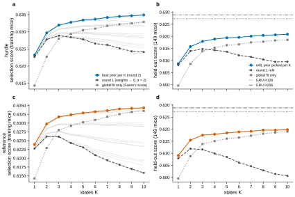
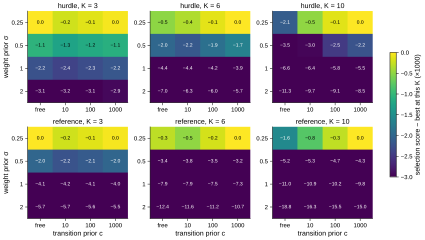

# r2 — Round 2: per-mouse refits pooled toward the global fit

**Question.** In round 1 (r1) each mouse's refit was pulled toward zero weights, and its
transition matrix was nearly free. From K = 4 on, that refit scored *below* the global fit alone
on held-out mice. Its selection score peaked at K = 3 (hurdle) and K = 2 (reference), while
the global fit alone kept improving up to K = 10. Does a refit pooled toward the global fit
stop losing to no refit? Which kind of pooling matters? And where does K peak then?

**What changed.** Only the per-mouse refits. Every cell loads round 1's global fit for its
emission and K, so the global model, the data and the zero-shot score are round 1's. The freeze
checks both for every cell. Two priors, crossed (variant `refit-prior`, 320 cells):
- **Weights:** a Gaussian prior centred on the global fit's weights, with SD σ ∈ {0.25, 0.5, 1, 2}.
  A small σ holds a mouse near the population; a large σ lets its own data decide.
- **Transitions:** off (round 1's Dirichlet α = 2, centred on uniform rows), or centred on the
  global transition matrix with c ∈ {10, 100, 1000} pseudo-transitions per row. A mouse has
  about 800 transitions per row at K = 10, so c = 1000 weighs the global row about as much as
  the mouse's data.

Round 1's refit (weights → 0, σ = 2, transitions free) is the 17th prior setting.

**Selection rule (stated in the variant's notes before launch).** K, σ, c and the weight centre
are chosen together by the selection score: the training mice refitted on their even sessions
and scored on their odd sessions. Held-out mice are never used to choose.

## Selection

<!-- BEGIN result-1 -->
**hurdle: the rule picks K = 10, weights → global, σ = 0.25; transitions c = 1000** (selection score 0.6349; round 1 picked K = 3, 0.6289).

| K | best prior (by selection score) | selection | − round 1 (×1000) | global fit only |
|---|---|---|---|---|
| 1 | weights → global, σ = 0.25; transitions fixed (K = 1) | 0.6232 | +0.6 | 0.6143 |
| 2 | weights → global, σ = 0.25; transitions free | 0.6297 | +1.9 | 0.6228 |
| 3 | weights → global, σ = 0.25; transitions free | 0.6320 | +3.1 | 0.6280 |
| 4 | weights → global, σ = 0.25; transitions c = 1000 | 0.6328 | +4.4 | 0.6294 |
| 5 | weights → global, σ = 0.25; transitions c = 1000 | 0.6334 | +5.6 | 0.6305 |
| 6 | weights → global, σ = 0.25; transitions c = 1000 | 0.6337 | +7.1 | 0.6309 |
| 7 | weights → global, σ = 0.25; transitions c = 1000 | 0.6342 | +8.0 | 0.6317 |
| 8 | weights → global, σ = 0.25; transitions c = 1000 | 0.6345 | +9.3 | 0.6322 |
| 9 | weights → global, σ = 0.25; transitions c = 1000 | 0.6347 | +10.4 | 0.6325 |
| **10** | weights → global, σ = 0.25; transitions c = 1000 | 0.6349 | +10.8 | 0.6329 |

**reference: the rule picks K = 10, weights → global, σ = 0.25; transitions c = 1000** (selection score 0.6343; round 1 picked K = 2, 0.6262).

| K | best prior (by selection score) | selection | − round 1 (×1000) | global fit only |
|---|---|---|---|---|
| 1 | weights → global, σ = 0.25; transitions fixed (K = 1) | 0.6239 | +1.1 | 0.6143 |
| 2 | weights → global, σ = 0.25; transitions free | 0.6298 | +3.6 | 0.6229 |
| 3 | weights → global, σ = 0.25; transitions free | 0.6318 | +5.7 | 0.6280 |
| 4 | weights → global, σ = 0.25; transitions free | 0.6324 | +8.1 | 0.6292 |
| 5 | weights → global, σ = 0.25; transitions c = 1000 | 0.6329 | +9.8 | 0.6303 |
| 6 | weights → global, σ = 0.25; transitions c = 1000 | 0.6332 | +12.4 | 0.6309 |
| 7 | weights → global, σ = 0.25; transitions c = 1000 | 0.6336 | +14.1 | 0.6318 |
| 8 | weights → global, σ = 0.25; transitions c = 1000 | 0.6340 | +15.9 | 0.6325 |
| 9 | weights → global, σ = 0.25; transitions c = 1000 | 0.6342 | +17.2 | 0.6331 |
| **10** | weights → global, σ = 0.25; transitions c = 1000 | 0.6343 | +18.5 | 0.6335 |

Selection score over the prior grid at K = 3, 6 and 10, relative to the best prior at that K:

<!-- END result-1 -->

## Held-out mice

<!-- BEGIN result-2 -->
Held-out scores (149 mice, eval sessions) of the prior the selection score picks at each K. *Refit − global* > 0 means the refit beats the global fit alone.

**hurdle**

| K | refit (round 2) | round 1 refit | global fit only | refit − global (×1000) | LR engaged (round 2) |
|---|---|---|---|---|---|
| 1 | 0.6087 | 0.6081 | 0.5997 | +9.0 | 0.7190 |
| 2 | 0.6158 | 0.6139 | 0.6086 | +7.1 | 0.7202 |
| 3 | 0.6179 | 0.6148 | 0.6139 | +4.1 | 0.7227 |
| 4 | 0.6189 | 0.6143 | 0.6153 | +3.6 | 0.7228 |
| 5 | 0.6194 | 0.6136 | 0.6163 | +3.0 | 0.7235 |
| 6 | 0.6196 | 0.6121 | 0.6167 | +2.9 | 0.7239 |
| 7 | 0.6201 | 0.6115 | 0.6175 | +2.6 | 0.7240 |
| 8 | 0.6204 | 0.6104 | 0.6178 | +2.6 | 0.7244 |
| 9 | 0.6206 | 0.6095 | 0.6183 | +2.3 | 0.7245 |
| 10 | 0.6208 | 0.6095 | 0.6186 | +2.3 | 0.7247 |

The picked refit beats the global fit alone at 10 of 10 K.

**reference**

| K | refit (round 2) | round 1 refit | global fit only | refit − global (×1000) | LR engaged (round 2) |
|---|---|---|---|---|---|
| 1 | 0.6091 | 0.6079 | 0.5996 | +9.5 | 0.7195 |
| 2 | 0.6154 | 0.6119 | 0.6088 | +6.6 | 0.7205 |
| 3 | 0.6175 | 0.6116 | 0.6138 | +3.7 | 0.7227 |
| 4 | 0.6179 | 0.6099 | 0.6151 | +2.9 | 0.7227 |
| 5 | 0.6184 | 0.6085 | 0.6161 | +2.4 | 0.7232 |
| 6 | 0.6189 | 0.6062 | 0.6165 | +2.4 | 0.7234 |
| 7 | 0.6191 | 0.6046 | 0.6173 | +1.8 | 0.7239 |
| 8 | 0.6196 | 0.6029 | 0.6181 | +1.5 | 0.7241 |
| 9 | 0.6196 | 0.6014 | 0.6186 | +1.0 | 0.7241 |
| 10 | 0.6198 | 0.6006 | 0.6190 | +0.8 | 0.7243 |

The picked refit beats the global fit alone at 10 of 10 K.

Study 02's 3-way GRU at D = 614 (mean of 3 seeds): H64 0.6249 (LR engaged 0.7282); H128 0.6273 (LR engaged 0.7303); H256 0.6288 (LR engaged 0.7315).
<!-- END result-2 -->

## What it says

1. **Round 1's early peak came from the refit, not from the data.** With each mouse pooled
   toward the global fit, the selection score rises through K = 10 for both emissions, the
   same shape as the global fit alone (Faeze's score). Round 1's peaks at K = 3 and K = 2 were
   the zero-centred refit overfitting each mouse, which grows with K.
2. **A pooled refit now beats no refit at every K.** On the 149 held-out mice, the refit the
   selection score picks scores above the global fit alone at all ten K, for both emissions.
   The margin shrinks as K grows: the larger the model, the closer the best refit stays to the
   global fit.
3. **The weight prior matters most; the transition prior matters at large K.** A tighter
   weight prior (σ = 0.25) is best at every K, and its advantage grows with K. Centring the
   transitions on the global matrix changes the selection score by under 0.3 per mille at
   K ≤ 3, and by 1.6 (reference) to 2.1 (hurdle) per mille at K = 10, where each mouse has 90
   transition values to fit.
4. **The rule picks a corner of the grid.** K = 10, σ = 0.25 and c = 1000 are each the most
   extreme value tried. The best setting may lie beyond the grid: more states, a tighter weight
   prior, a stronger transition prior. "K = 10" is therefore a lower bound on what the score
   prefers, not a chosen K.
5. **The gap to the GRU narrows but stays.** The best GLM-HMM held-out score (hurdle, K = 10)
   is about 0.008 below study 02's 3-way GRU H256, and about 0.007 below on left/right choices
   of engaged trials.

**Caveats.**
- **One seed.** Each cell is one run, and the global fits are round 1's single best restarts.
  Differences of a few ten-thousandths between neighbouring cells are within what a different
  restart could move.
- **Small σ with large c is close to no refit.** The picked refits stay near the global fit, so
  part of their score is the global fit's. They still beat it on held-out mice at every K.
- **K-selection by refit score and by global-fit score now agree** in shape (both still rising at
  K = 10); neither yet shows where the curve flattens.

## Next steps

1. **Extend the grid past its edges:** σ ∈ {0.05, 0.1}, c ∈ {10⁴, 10⁵}, and K = 12–15 (which
   needs new global fits). Stop when the selection score turns down on each axis.
2. **Fit σ instead of searching it:** a hierarchical prior whose spread is estimated from how much
   mice actually differ, with separate spreads for the bias, side and engagement weights.
3. **States of the pooled refits:** with refits held near the global fit, per-mouse state labels
   should stay aligned. Check alignment against r1 (where refits reordered states at large K)
   before using per-mouse state sequences.
