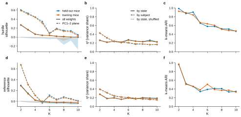
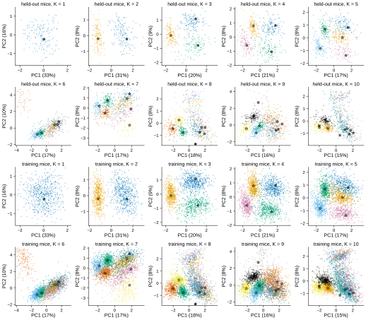
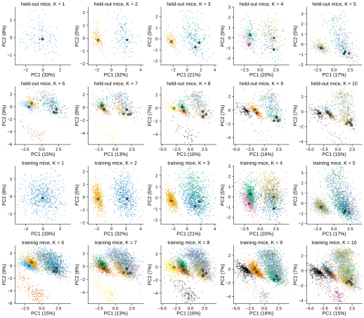

# r2 — How each state spreads across subjects

**Question.** The global GLM-HMM gives each state one set of weights for all mice (r1). Is a
state one strategy that every mouse shares, or a label over strategies that differ from mouse
to mouse? If the states are shared, each mouse's own version of a state should sit near the
other mice's versions of the same state, and away from the other states. Does that hold, and
how does it change with K?

**Method.** For each emission and each K = 1–10 (the r1 K grids, L = 10):
1. **Assign trials to states.** The Viterbi path (the most likely state sequence) of every
   session under the global fit. The global fit gives a state the same meaning in every mouse;
   per-mouse refits reorder states (r1 result-3).
2. **One GLM per {subject, state}.** Take the subject's trials on that state's path. Fit the
   state's own emission GLM to them, with the per-mouse refit's prior (Gaussian, SD 2, centred
   at 0), starting from the global state's weights. History lags come from the whole session,
   so no lag crosses a cut between epochs.
3. **Two cohorts, shown apart.**
   - *Held-out mice* (149): the global fit never saw them.
   - *Training mice* (614): they shaped the global states, so some clustering is expected by
     construction.

   Every session of each mouse is used.
4. **Cluster scores.**
   - *Silhouette*: for each dot, the mean distance to the nearest other state's dots minus the
     mean distance to its own state's dots, divided by the larger of the two, then averaged. It
     is 1 for tight, separate clusters and 0 for clusters that overlap.
   - *Null*: the same score with the state labels shuffled among each mouse's own dots. This
     keeps the mouse-to-mouse spread and breaks only the state labels.
   - *η² by state*: the share of the weight variance that lies between state means.
     *η² by subject*: the same for subject means.
   - *k-means ARI*: cluster the dots into K groups without labels, then compare the groups to
     the states (0 = chance, 1 = the same partition).

<!-- BEGIN result-1 -->
One dot = one {subject, state} GLM, fitted to the subject's trials on that state's Viterbi path under the global fit (MAP, prior SD 2). Cells with fewer than 200 trials are dropped. Distances are Euclidean in the raw weight space. *Silhouette*: how much closer a dot is to its own state's dots than to the nearest other state's (1 = tight separate clusters, 0 = overlapping). *Null*: the same with state labels shuffled among each mouse's own dots (100 shuffles; 95% range). *Silhouette, PC1–2*: the same on the plane of result-2's scatter (the first two principal components of the training cells). *Cells ≥ 1000 trials*: the all-weights silhouette on large cells only, a check on estimation noise. *η²*: share of the weight variance between states, or between subjects. *ARI*: agreement of k-means with K clusters with the state labels (0 = chance, 1 = identical). One global fit per K, so no error bars across fits.

| emission | K | cohort | cells (dropped) | silhouette | null (95%) | silhouette, PC1–2 | silhouette, cells ≥ 1000 trials | η² state | η² state, null | η² subject | k-means ARI |
|---|---|---|---|---|---|---|---|---|---|---|---|
| hurdle | 1 | heldout | 149 (0) | — | — | — | — | 0.00 | — | 1.00 | — |
| hurdle | 1 | training | 614 (0) | — | — | — | — | 0.00 | — | 1.00 | — |
| hurdle | 2 | heldout | 297 (1) | 0.27 | 0.00 (-0.00–0.01) | 0.60 | 0.28 | 0.26 | 0.00 | 0.43 | 0.99 |
| hurdle | 2 | training | 1219 (9) | 0.27 | 0.00 (-0.00–0.00) | 0.59 | 0.28 | 0.26 | 0.00 | 0.43 | 0.93 |
| hurdle | 3 | heldout | 425 (22) | 0.17 | -0.01 (-0.02–-0.01) | 0.53 | 0.21 | 0.22 | 0.01 | 0.32 | 0.87 |
| hurdle | 3 | training | 1744 (98) | 0.16 | -0.01 (-0.01–-0.00) | 0.51 | 0.19 | 0.21 | 0.00 | 0.31 | 0.89 |
| hurdle | 4 | heldout | 571 (25) | 0.06 | -0.02 (-0.03–-0.01) | 0.44 | 0.09 | 0.24 | 0.01 | 0.23 | 0.91 |
| hurdle | 4 | training | 2295 (161) | 0.07 | -0.01 (-0.02–-0.01) | 0.44 | 0.08 | 0.24 | 0.00 | 0.24 | 0.84 |
| hurdle | 5 | heldout | 676 (69) | 0.04 | -0.02 (-0.03–-0.01) | 0.35 | 0.06 | 0.22 | 0.01 | 0.21 | 0.65 |
| hurdle | 5 | training | 2773 (297) | 0.04 | -0.01 (-0.02–-0.01) | 0.31 | 0.05 | 0.21 | 0.00 | 0.22 | 0.67 |
| hurdle | 6 | heldout | 716 (178) | 0.04 | -0.03 (-0.05–-0.02) | 0.09 | 0.06 | 0.27 | 0.01 | 0.20 | 0.58 |
| hurdle | 6 | training | 2925 (759) | 0.04 | -0.02 (-0.02–-0.01) | 0.08 | 0.04 | 0.26 | 0.00 | 0.21 | 0.64 |
| hurdle | 7 | heldout | 845 (198) | 0.02 | -0.03 (-0.04–-0.02) | 0.19 | 0.05 | 0.24 | 0.01 | 0.17 | 0.58 |
| hurdle | 7 | training | 3421 (877) | 0.02 | -0.02 (-0.03–-0.01) | 0.18 | 0.03 | 0.24 | 0.00 | 0.18 | 0.60 |
| hurdle | 8 | heldout | 887 (305) | 0.01 | -0.06 (-0.17–-0.02) | 0.15 | 0.02 | 0.23 | 0.01 | 0.18 | 0.52 |
| hurdle | 8 | training | 3603 (1309) | 0.02 | -0.02 (-0.08–-0.01) | 0.13 | 0.02 | 0.23 | 0.00 | 0.18 | 0.51 |
| hurdle | 9 | heldout | 992 (349) | -0.00 | -0.03 (-0.08–-0.02) | 0.14 | 0.02 | 0.26 | 0.01 | 0.16 | 0.52 |
| hurdle | 9 | training | 4068 (1458) | -0.00 | -0.02 (-0.03–-0.02) | 0.12 | 0.00 | 0.24 | 0.00 | 0.16 | 0.48 |
| hurdle | 10 | heldout | 984 (506) | -0.00 | -0.13 (-0.28–-0.03) | 0.05 | 0.01 | 0.23 | 0.01 | 0.16 | 0.47 |
| hurdle | 10 | training | 4011 (2129) | 0.00 | -0.02 (-0.03–-0.01) | 0.03 | 0.00 | 0.22 | 0.00 | 0.17 | 0.47 |
| reference | 1 | heldout | 149 (0) | — | — | — | — | 0.00 | — | 1.00 | — |
| reference | 1 | training | 614 (0) | — | — | — | — | 0.00 | — | 1.00 | — |
| reference | 2 | heldout | 297 (1) | 0.29 | 0.00 (-0.00–0.01) | 0.67 | 0.30 | 0.28 | 0.00 | 0.39 | 0.96 |
| reference | 2 | training | 1218 (10) | 0.29 | 0.00 (-0.00–0.00) | 0.67 | 0.30 | 0.28 | 0.00 | 0.40 | 0.97 |
| reference | 3 | heldout | 427 (20) | 0.15 | -0.01 (-0.02–-0.01) | 0.31 | 0.19 | 0.19 | 0.01 | 0.32 | 0.52 |
| reference | 3 | training | 1750 (92) | 0.14 | -0.01 (-0.01–-0.00) | 0.31 | 0.17 | 0.18 | 0.00 | 0.31 | 0.51 |
| reference | 4 | heldout | 569 (27) | 0.02 | -0.02 (-0.03–-0.01) | 0.11 | 0.03 | 0.20 | 0.01 | 0.24 | 0.46 |
| reference | 4 | training | 2302 (154) | 0.02 | -0.01 (-0.02–-0.01) | 0.11 | 0.02 | 0.19 | 0.00 | 0.25 | 0.46 |
| reference | 5 | heldout | 680 (65) | -0.01 | -0.02 (-0.03–-0.01) | -0.03 | -0.01 | 0.16 | 0.01 | 0.22 | 0.34 |
| reference | 5 | training | 2752 (318) | 0.00 | -0.01 (-0.02–-0.01) | -0.01 | -0.01 | 0.16 | 0.00 | 0.22 | 0.38 |
| reference | 6 | heldout | 731 (163) | -0.01 | -0.03 (-0.04–-0.02) | 0.11 | -0.01 | 0.20 | 0.01 | 0.21 | 0.39 |
| reference | 6 | training | 2954 (730) | -0.01 | -0.01 (-0.03–-0.01) | 0.09 | -0.01 | 0.19 | 0.00 | 0.21 | 0.51 |
| reference | 7 | heldout | 827 (216) | -0.02 | -0.02 (-0.05–-0.01) | 0.04 | -0.02 | 0.18 | 0.01 | 0.19 | 0.41 |
| reference | 7 | training | 3360 (938) | -0.02 | -0.01 (-0.02–-0.01) | 0.03 | -0.02 | 0.17 | 0.00 | 0.19 | 0.39 |
| reference | 8 | heldout | 914 (278) | -0.02 | -0.03 (-0.04–-0.02) | 0.08 | -0.01 | 0.20 | 0.01 | 0.17 | 0.41 |
| reference | 8 | training | 3742 (1170) | -0.02 | -0.02 (-0.03–-0.01) | 0.07 | -0.02 | 0.19 | 0.00 | 0.17 | 0.37 |
| reference | 9 | heldout | 989 (352) | -0.03 | -0.03 (-0.06–-0.02) | 0.05 | -0.02 | 0.19 | 0.01 | 0.16 | 0.33 |
| reference | 9 | training | 4045 (1481) | -0.02 | -0.02 (-0.03–-0.01) | 0.04 | -0.03 | 0.18 | 0.00 | 0.16 | 0.37 |
| reference | 10 | heldout | 1057 (433) | -0.03 | -0.03 (-0.06–-0.02) | 0.01 | -0.02 | 0.19 | 0.01 | 0.15 | 0.35 |
| reference | 10 | training | 4367 (1773) | -0.03 | -0.02 (-0.03–-0.01) | 0.00 | -0.03 | 0.18 | 0.00 | 0.15 | 0.33 |

**Check: hurdle, side weights only** (the 21 left-vs-right weights, which every state constrains; engagement weights left out).

| K | held-out silhouette | held-out k-means ARI | training silhouette | training k-means ARI |
|---|---|---|---|---|
| 2 | 0.04 | -0.00 | 0.04 | -0.00 |
| 3 | 0.12 | 0.46 | 0.13 | 0.44 |
| 4 | 0.04 | 0.42 | 0.04 | 0.36 |
| 5 | 0.04 | 0.34 | 0.04 | 0.38 |
| 6 | 0.03 | 0.37 | 0.04 | 0.40 |
| 7 | -0.02 | 0.35 | -0.00 | 0.38 |
| 8 | -0.01 | 0.27 | 0.00 | 0.37 |
| 9 | -0.06 | 0.26 | -0.05 | 0.32 |
| 10 | -0.00 | 0.37 | 0.01 | 0.39 |

<!-- END result-1 -->

<!-- BEGIN result-2 -->
Each panel: every {subject, state} GLM of one cohort at one K, on the first two principal components of that K's training-mouse dots (both cohorts share the axes). Colour = state, ranked by trials (state 1, blue, is the most used); colours match only within a K, because states are not matched across K. Stars: the global fit's own state weights (fitted with a weak prior, SD 100); axes span 99% of the dots, so a far star is not shown.

**hurdle**

**reference**

<!-- END result-2 -->

## What it says

TODO after the full freeze.

## Next steps

1. **Q-learning parameters per {subject, state}** (deferred, #70): the same cells in the
   space of a Q-learning model's parameters.
