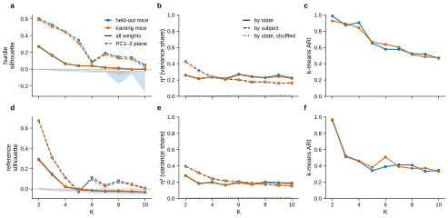
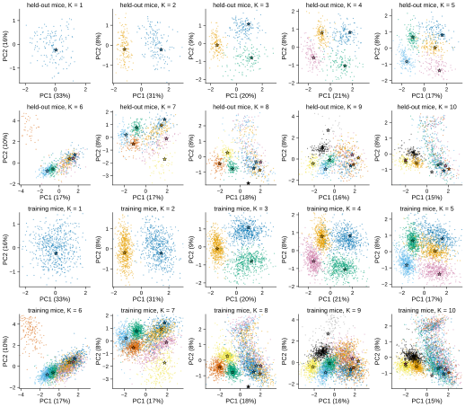
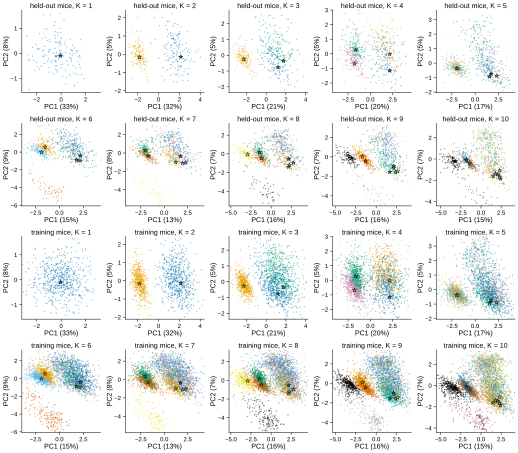
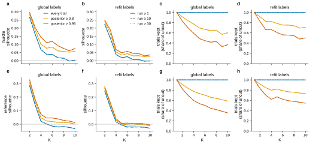

# r3 — How each state spreads across subjects

**Question.** The global GLM-HMM gives each state one set of weights for all mice (r1). Is a
state one strategy that every mouse shares, or a label over strategies that differ from mouse
to mouse? If the states are shared, each mouse's own version of a state should sit near the
other mice's versions of the same state, and away from the other states. Does that hold, and
how does it change with K?

**Method.** For each emission and each K = 1–10 (the r1 K grids, L = 10):
1. **Assign trials to states.** The Viterbi path (the most likely state sequence) of every
   session under the global fit. The global fit gives a state the same meaning in every mouse;
   per-mouse refits reorder states (r1 result-3).
2. **One GLM per {subject, state}.** Take the subject's trials on that state's path. Fit the
   state's own emission GLM to them, with the per-mouse refit's prior (Gaussian, SD 2, centred
   at 0), starting from the global state's weights. History lags come from the whole session,
   so no lag crosses a cut between epochs.
3. **Other ways to cut trials into states** (result-3). Step 1 counts every trial for its
   Viterbi state. Two changes, crossed into 18 settings:
   - *Labels from each mouse's own refit*: the Viterbi path and posteriors under the mouse's
     round-2 refit (r2: EM from the global fit on the mouse's train sessions, with r2's picked
     prior at that K, weights centred on the global fit). With that prior the refit keeps the
     global states' order (checked, result-4), so state k still means the same state.
   - *Cuts*: keep a trial only if its state's smoothed posterior is at least p ∈ {0.8, 0.95}
     and it lies in a same-state run of at least m ∈ {10, 30} trials (each also off).
   Each cell is refitted to its kept trials. A cut keeps the trials that best fit a state, so
   tighter clusters after a cut are partly selection.
4. **Two cohorts, shown apart.**
   - *Held-out mice* (149): the global fit never saw them.
   - *Training mice* (614): they shaped the global states, so some clustering is expected by
     construction.

   Every session of each mouse is used.
5. **Cluster scores.**
   - *Silhouette*: for each dot, the mean distance to the nearest other state's dots minus the
     mean distance to its own state's dots, divided by the larger of the two, then averaged. It
     is 1 for tight, separate clusters and 0 for clusters that overlap.
   - *Null*: the same score with the state labels shuffled among each mouse's own dots. This
     keeps the mouse-to-mouse spread and breaks only the state labels.
   - *η² by state*: the share of the weight variance that lies between state means.
     *η² by subject*: the same for subject means.
   - *k-means ARI*: cluster the dots into K groups without labels, then compare the groups to
     the states (0 = chance, 1 = the same partition).

<!-- BEGIN result-1 -->
One dot = one {subject, state} GLM, fitted to the subject's trials on that state's Viterbi path under the global fit (MAP, prior SD 2); every trial counts (setting `global_p0_m1`; result-3 cuts them). Cells with fewer than 200 trials are dropped. Distances are Euclidean in the raw weight space. *Silhouette*: how much closer a dot is to its own state's dots than to the nearest other state's (1 = tight separate clusters, 0 = overlapping). *Null*: the same with state labels shuffled among each mouse's own dots (100 shuffles; 95% range). *Silhouette, PC1–2*: the same on the plane of result-2's scatter (the first two principal components of the training cells). *Cells ≥ 1000 trials*: the all-weights silhouette on large cells only, a check on estimation noise. *η²*: share of the weight variance between states, or between subjects. *ARI*: agreement of k-means with K clusters with the state labels (0 = chance, 1 = identical). One global fit per K, so no error bars across fits.

| emission | K | cohort | cells (dropped) | silhouette | null (95%) | silhouette, PC1–2 | silhouette, cells ≥ 1000 trials | η² state | η² state, null | η² subject | k-means ARI |
|---|---|---|---|---|---|---|---|---|---|---|---|
| hurdle | 1 | heldout | 149 (0) | — | — | — | — | 0.00 | — | 1.00 | — |
| hurdle | 1 | training | 614 (0) | — | — | — | — | 0.00 | — | 1.00 | — |
| hurdle | 2 | heldout | 297 (1) | 0.27 | 0.00 (-0.00–0.01) | 0.60 | 0.28 | 0.26 | 0.00 | 0.43 | 0.99 |
| hurdle | 2 | training | 1219 (9) | 0.27 | 0.00 (-0.00–0.00) | 0.59 | 0.28 | 0.26 | 0.00 | 0.43 | 0.93 |
| hurdle | 3 | heldout | 425 (22) | 0.17 | -0.01 (-0.02–-0.01) | 0.53 | 0.21 | 0.22 | 0.01 | 0.32 | 0.87 |
| hurdle | 3 | training | 1744 (98) | 0.16 | -0.01 (-0.01–-0.00) | 0.51 | 0.19 | 0.21 | 0.00 | 0.31 | 0.89 |
| hurdle | 4 | heldout | 571 (25) | 0.06 | -0.02 (-0.03–-0.01) | 0.44 | 0.09 | 0.24 | 0.01 | 0.23 | 0.91 |
| hurdle | 4 | training | 2295 (161) | 0.07 | -0.01 (-0.02–-0.01) | 0.44 | 0.08 | 0.24 | 0.00 | 0.24 | 0.84 |
| hurdle | 5 | heldout | 676 (69) | 0.04 | -0.02 (-0.03–-0.01) | 0.35 | 0.06 | 0.22 | 0.01 | 0.21 | 0.65 |
| hurdle | 5 | training | 2773 (297) | 0.04 | -0.01 (-0.02–-0.01) | 0.31 | 0.05 | 0.21 | 0.00 | 0.22 | 0.67 |
| hurdle | 6 | heldout | 716 (178) | 0.04 | -0.03 (-0.04–-0.02) | 0.09 | 0.06 | 0.27 | 0.01 | 0.20 | 0.58 |
| hurdle | 6 | training | 2925 (759) | 0.04 | -0.02 (-0.02–-0.01) | 0.08 | 0.04 | 0.26 | 0.00 | 0.21 | 0.64 |
| hurdle | 7 | heldout | 845 (198) | 0.02 | -0.03 (-0.04–-0.02) | 0.19 | 0.05 | 0.24 | 0.01 | 0.17 | 0.58 |
| hurdle | 7 | training | 3421 (877) | 0.02 | -0.02 (-0.03–-0.01) | 0.18 | 0.03 | 0.24 | 0.00 | 0.18 | 0.60 |
| hurdle | 8 | heldout | 887 (305) | 0.01 | -0.07 (-0.18–-0.02) | 0.15 | 0.02 | 0.23 | 0.01 | 0.18 | 0.52 |
| hurdle | 8 | training | 3603 (1309) | 0.02 | -0.03 (-0.07–-0.01) | 0.13 | 0.02 | 0.23 | 0.00 | 0.18 | 0.51 |
| hurdle | 9 | heldout | 992 (349) | -0.00 | -0.03 (-0.06–-0.02) | 0.14 | 0.02 | 0.26 | 0.01 | 0.16 | 0.52 |
| hurdle | 9 | training | 4068 (1458) | -0.00 | -0.02 (-0.04–-0.02) | 0.12 | 0.00 | 0.24 | 0.00 | 0.16 | 0.48 |
| hurdle | 10 | heldout | 984 (506) | -0.00 | -0.13 (-0.28–-0.02) | 0.05 | 0.01 | 0.23 | 0.01 | 0.16 | 0.47 |
| hurdle | 10 | training | 4011 (2129) | 0.00 | -0.02 (-0.03–-0.01) | 0.03 | 0.00 | 0.22 | 0.00 | 0.17 | 0.47 |
| reference | 1 | heldout | 149 (0) | — | — | — | — | 0.00 | — | 1.00 | — |
| reference | 1 | training | 614 (0) | — | — | — | — | 0.00 | — | 1.00 | — |
| reference | 2 | heldout | 297 (1) | 0.29 | 0.00 (-0.00–0.02) | 0.67 | 0.30 | 0.28 | 0.00 | 0.39 | 0.96 |
| reference | 2 | training | 1218 (10) | 0.29 | 0.00 (-0.00–0.00) | 0.67 | 0.30 | 0.28 | 0.00 | 0.40 | 0.97 |
| reference | 3 | heldout | 427 (20) | 0.15 | -0.01 (-0.02–-0.01) | 0.31 | 0.19 | 0.19 | 0.01 | 0.32 | 0.52 |
| reference | 3 | training | 1750 (92) | 0.14 | -0.01 (-0.01–-0.00) | 0.31 | 0.17 | 0.18 | 0.00 | 0.31 | 0.51 |
| reference | 4 | heldout | 569 (27) | 0.02 | -0.02 (-0.03–-0.01) | 0.11 | 0.03 | 0.20 | 0.01 | 0.24 | 0.46 |
| reference | 4 | training | 2302 (154) | 0.02 | -0.01 (-0.02–-0.01) | 0.11 | 0.02 | 0.19 | 0.00 | 0.25 | 0.46 |
| reference | 5 | heldout | 680 (65) | -0.01 | -0.02 (-0.03–-0.01) | -0.03 | -0.01 | 0.16 | 0.01 | 0.22 | 0.34 |
| reference | 5 | training | 2752 (318) | 0.00 | -0.01 (-0.02–-0.01) | -0.01 | -0.01 | 0.16 | 0.00 | 0.22 | 0.38 |
| reference | 6 | heldout | 731 (163) | -0.01 | -0.02 (-0.04–-0.02) | 0.11 | -0.01 | 0.20 | 0.01 | 0.21 | 0.39 |
| reference | 6 | training | 2954 (730) | -0.01 | -0.01 (-0.02–-0.01) | 0.09 | -0.01 | 0.19 | 0.00 | 0.21 | 0.51 |
| reference | 7 | heldout | 827 (216) | -0.02 | -0.03 (-0.05–-0.02) | 0.04 | -0.02 | 0.18 | 0.01 | 0.19 | 0.41 |
| reference | 7 | training | 3360 (938) | -0.02 | -0.02 (-0.03–-0.01) | 0.03 | -0.02 | 0.17 | 0.00 | 0.19 | 0.39 |
| reference | 8 | heldout | 914 (278) | -0.02 | -0.03 (-0.05–-0.02) | 0.08 | -0.01 | 0.20 | 0.01 | 0.17 | 0.41 |
| reference | 8 | training | 3742 (1170) | -0.02 | -0.02 (-0.03–-0.01) | 0.07 | -0.02 | 0.19 | 0.00 | 0.17 | 0.37 |
| reference | 9 | heldout | 989 (352) | -0.03 | -0.03 (-0.06–-0.02) | 0.05 | -0.02 | 0.19 | 0.01 | 0.16 | 0.33 |
| reference | 9 | training | 4045 (1481) | -0.02 | -0.02 (-0.03–-0.01) | 0.04 | -0.03 | 0.18 | 0.00 | 0.16 | 0.37 |
| reference | 10 | heldout | 1057 (433) | -0.03 | -0.03 (-0.05–-0.02) | 0.01 | -0.02 | 0.19 | 0.01 | 0.15 | 0.35 |
| reference | 10 | training | 4367 (1773) | -0.03 | -0.02 (-0.03–-0.01) | 0.00 | -0.03 | 0.18 | 0.00 | 0.15 | 0.33 |

**Check: hurdle, side weights only** (the 21 left-vs-right weights, which every state constrains; engagement weights left out).

| K | held-out silhouette | held-out k-means ARI | training silhouette | training k-means ARI |
|---|---|---|---|---|
| 2 | 0.04 | -0.00 | 0.04 | -0.00 |
| 3 | 0.12 | 0.46 | 0.13 | 0.44 |
| 4 | 0.04 | 0.42 | 0.04 | 0.36 |
| 5 | 0.04 | 0.34 | 0.04 | 0.38 |
| 6 | 0.03 | 0.37 | 0.04 | 0.40 |
| 7 | -0.02 | 0.35 | -0.00 | 0.38 |
| 8 | -0.01 | 0.27 | 0.00 | 0.37 |
| 9 | -0.06 | 0.26 | -0.05 | 0.32 |
| 10 | -0.00 | 0.37 | 0.01 | 0.39 |

<!-- END result-1 -->

<!-- BEGIN result-2 -->
Each panel: every {subject, state} GLM of one cohort at one K (every trial, global Viterbi), on the first two principal components of that K's training-mouse dots (both cohorts share the axes). Colour = state, ranked by trials (state 1, blue, is the most used); colours match only within a K, because states are not matched across K. Stars: the global fit's own state weights (fitted with a weak prior, SD 100); axes span 99% of the dots, so a far star is not shown.

**hurdle**

**reference**

<!-- END result-2 -->

<!-- BEGIN result-3 -->
The same cells, cut and labelled 18 ways. *Labels*: the Viterbi path and smoothed posteriors under the global fit (`global`, as in result-1) or under each mouse's own round-2 refit (`refit`: r2's pick at that K, centred on the global fit). *Cuts*: a trial counts for its Viterbi state only if that state's smoothed posterior is at least p (p ∈ {0, 0.8, 0.95}) and it lies in a same-state run of at least m trials within its session (m ∈ {1, 10, 30}). Each cell is refitted to its kept trials; states keep result-1's ranks and the plotted axes stay the uncut global setting's. Cutting keeps the trials that best fit a state's weights, so a higher silhouette after a cut is partly selection, not evidence.

Silhouette (all weights, training mice) by K, and the trials kept as a share of the uncut setting's:

**hurdle**

| setting | K = 2 | K = 3 | K = 4 | K = 5 | K = 6 | K = 7 | K = 8 | K = 9 | K = 10 | trials kept, K = 2 | trials kept, K = 10 |
|---|---|---|---|---|---|---|---|---|---|---|---|
| `global_p0_m1` | 0.27 | 0.16 | 0.07 | 0.04 | 0.04 | 0.02 | 0.02 | -0.00 | 0.00 | 100% | 100% |
| `global_p0_m10` | 0.27 | 0.16 | 0.07 | 0.04 | 0.04 | 0.02 | 0.02 | -0.00 | 0.00 | 100% | 100% |
| `global_p0_m30` | 0.27 | 0.16 | 0.07 | 0.04 | 0.04 | 0.02 | 0.01 | -0.00 | 0.00 | 100% | 100% |
| `global_p80_m1` | 0.28 | 0.19 | 0.10 | 0.08 | 0.08 | 0.06 | 0.06 | 0.05 | 0.06 | 91% | 60% |
| `global_p80_m10` | 0.28 | 0.19 | 0.10 | 0.08 | 0.08 | 0.06 | 0.06 | 0.05 | 0.06 | 91% | 60% |
| `global_p80_m30` | 0.28 | 0.19 | 0.10 | 0.08 | 0.08 | 0.06 | 0.06 | 0.05 | 0.06 | 91% | 60% |
| `global_p95_m1` | 0.30 | 0.20 | 0.14 | 0.11 | 0.12 | 0.09 | 0.08 | 0.06 | 0.07 | 83% | 36% |
| `global_p95_m10` | 0.30 | 0.20 | 0.14 | 0.11 | 0.12 | 0.09 | 0.08 | 0.06 | 0.07 | 83% | 36% |
| `global_p95_m30` | 0.30 | 0.20 | 0.14 | 0.11 | 0.12 | 0.09 | 0.08 | 0.06 | 0.07 | 83% | 36% |
| `refit_p0_m1` | 0.22 | 0.14 | 0.04 | 0.02 | 0.02 | 0.01 | 0.01 | -0.00 | -0.00 | 100% | 100% |
| `refit_p0_m10` | 0.22 | 0.14 | 0.04 | 0.02 | 0.02 | 0.01 | 0.01 | -0.00 | -0.00 | 100% | 100% |
| `refit_p0_m30` | 0.22 | 0.14 | 0.04 | 0.02 | 0.02 | 0.01 | 0.01 | -0.00 | -0.00 | 100% | 100% |
| `refit_p80_m1` | 0.24 | 0.17 | 0.05 | 0.03 | 0.04 | 0.03 | 0.03 | 0.02 | 0.03 | 92% | 71% |
| `refit_p80_m10` | 0.24 | 0.17 | 0.05 | 0.03 | 0.04 | 0.03 | 0.03 | 0.02 | 0.03 | 92% | 71% |
| `refit_p80_m30` | 0.24 | 0.17 | 0.05 | 0.03 | 0.04 | 0.03 | 0.03 | 0.02 | 0.03 | 91% | 71% |
| `refit_p95_m1` | 0.25 | 0.19 | 0.07 | 0.05 | 0.06 | 0.05 | 0.04 | 0.03 | 0.04 | 83% | 50% |
| `refit_p95_m10` | 0.25 | 0.19 | 0.07 | 0.05 | 0.06 | 0.05 | 0.04 | 0.03 | 0.04 | 83% | 50% |
| `refit_p95_m30` | 0.25 | 0.19 | 0.07 | 0.05 | 0.06 | 0.04 | 0.04 | 0.03 | 0.04 | 83% | 50% |

**reference**

| setting | K = 2 | K = 3 | K = 4 | K = 5 | K = 6 | K = 7 | K = 8 | K = 9 | K = 10 | trials kept, K = 2 | trials kept, K = 10 |
|---|---|---|---|---|---|---|---|---|---|---|---|
| `global_p0_m1` | 0.29 | 0.14 | 0.02 | 0.00 | -0.01 | -0.02 | -0.02 | -0.02 | -0.03 | 100% | 100% |
| `global_p0_m10` | 0.29 | 0.14 | 0.02 | 0.00 | -0.01 | -0.02 | -0.02 | -0.02 | -0.03 | 100% | 100% |
| `global_p0_m30` | 0.28 | 0.14 | 0.02 | 0.00 | -0.02 | -0.02 | -0.02 | -0.02 | -0.03 | 100% | 100% |
| `global_p80_m1` | 0.31 | 0.16 | 0.05 | 0.02 | 0.02 | 0.01 | 0.01 | 0.01 | 0.00 | 91% | 58% |
| `global_p80_m10` | 0.31 | 0.16 | 0.05 | 0.02 | 0.02 | 0.01 | 0.01 | 0.01 | 0.00 | 91% | 58% |
| `global_p80_m30` | 0.31 | 0.16 | 0.05 | 0.02 | 0.02 | 0.01 | 0.01 | 0.01 | 0.00 | 91% | 58% |
| `global_p95_m1` | 0.33 | 0.18 | 0.07 | 0.05 | 0.05 | 0.04 | 0.03 | 0.02 | 0.01 | 82% | 34% |
| `global_p95_m10` | 0.33 | 0.18 | 0.07 | 0.05 | 0.05 | 0.04 | 0.03 | 0.02 | 0.01 | 82% | 34% |
| `global_p95_m30` | 0.33 | 0.18 | 0.07 | 0.05 | 0.05 | 0.04 | 0.03 | 0.02 | 0.01 | 82% | 34% |
| `refit_p0_m1` | 0.25 | 0.13 | 0.02 | -0.01 | -0.02 | -0.02 | -0.02 | -0.02 | -0.03 | 100% | 100% |
| `refit_p0_m10` | 0.25 | 0.12 | 0.02 | -0.01 | -0.02 | -0.02 | -0.02 | -0.02 | -0.03 | 100% | 100% |
| `refit_p0_m30` | 0.25 | 0.12 | 0.02 | -0.01 | -0.02 | -0.02 | -0.02 | -0.02 | -0.03 | 100% | 99% |
| `refit_p80_m1` | 0.27 | 0.15 | 0.03 | 0.00 | -0.00 | -0.01 | -0.00 | -0.00 | -0.01 | 92% | 73% |
| `refit_p80_m10` | 0.27 | 0.15 | 0.03 | 0.00 | -0.00 | -0.01 | -0.00 | -0.00 | -0.01 | 92% | 73% |
| `refit_p80_m30` | 0.26 | 0.15 | 0.03 | 0.00 | -0.01 | -0.01 | -0.00 | -0.00 | -0.01 | 92% | 72% |
| `refit_p95_m1` | 0.28 | 0.16 | 0.04 | 0.01 | 0.01 | 0.00 | 0.01 | 0.00 | -0.01 | 83% | 54% |
| `refit_p95_m10` | 0.28 | 0.16 | 0.04 | 0.01 | 0.01 | 0.00 | 0.01 | 0.00 | -0.01 | 83% | 54% |
| `refit_p95_m30` | 0.28 | 0.16 | 0.04 | 0.01 | 0.01 | 0.00 | 0.01 | 0.00 | -0.01 | 83% | 53% |

<!-- END result-3 -->

<!-- BEGIN result-4 -->
Each mouse's round-2 refit, recomputed by the freeze (EM from the global fit on the mouse's train sessions, r2's picked prior at that K). *Held-out check*: largest difference from the refits round 2 saved for the 149 held-out mice (weights and transitions; training-mouse refits were not saved). *Not aligned*: refits whose states match the global states other than one to one in order (least-squares weight matching). *Second step*: the largest change of a second M-step from any {subject, state} fit, a convergence check. It covers every cell with a kept trial, including cells under the freeze's 50-trial floor that are never frozen, so it only bounds the frozen cells' change from above.

| emission | K | σ | c | round-2 run | refits | held-out check | not aligned | not converged | second step |
|---|---|---|---|---|---|---|---|---|---|
| hurdle | 1 | 0.25 | off | 9as0x8ab | 763 | 149 mice, ≤ 1e-08 | 0 | 0 | 8e-09 |
| hurdle | 2 | 0.25 | off | cp89pveg | 763 | 149 mice, ≤ 2e-08 | 0 | 0 | 3e-08 |
| hurdle | 3 | 0.25 | off | jkpx7cwn | 763 | 149 mice, ≤ 2e-08 | 0 | 0 | 1e-07 |
| hurdle | 4 | 0.25 | 1000 | f3xdpnwy | 763 | 149 mice, ≤ 3e-08 | 0 | 0 | 3e-07 |
| hurdle | 5 | 0.25 | 1000 | v0q28x0e | 763 | 149 mice, ≤ 2e-08 | 0 | 0 | 4e-07 |
| hurdle | 6 | 0.25 | 1000 | xpdgnjgm | 763 | 149 mice, ≤ 5e-08 | 0 | 0 | 9e-08 |
| hurdle | 7 | 0.25 | 1000 | pkobiude | 763 | 149 mice, ≤ 2e-08 | 0 | 0 | 2e-07 |
| hurdle | 8 | 0.25 | 1000 | is1htdih | 763 | 149 mice, ≤ 3e-08 | 0 | 0 | 9e-08 |
| hurdle | 9 | 0.25 | 1000 | mmdq3fk5 | 763 | 149 mice, ≤ 3e-08 | 0 | 0 | 4e-02 |
| hurdle | 10 | 0.25 | 1000 | pk5tuq2s | 763 | 149 mice, ≤ 1e-07 | 0 | 0 | 1e-07 |
| reference | 1 | 0.25 | 10 | ncnqbfwp | 763 | 149 mice, ≤ 4e-09 | 0 | 0 | 1e-08 |
| reference | 2 | 0.25 | off | 8vhp92xu | 763 | 149 mice, ≤ 3e-08 | 0 | 0 | 1e-07 |
| reference | 3 | 0.25 | off | 0svgwbzt | 763 | 149 mice, ≤ 2e-08 | 0 | 0 | 8e-08 |
| reference | 4 | 0.25 | off | zwpqfv04 | 763 | 149 mice, ≤ 2e-08 | 0 | 0 | 2e-07 |
| reference | 5 | 0.25 | 1000 | itytk3db | 763 | 149 mice, ≤ 5e-08 | 0 | 0 | 2e-02 |
| reference | 6 | 0.25 | 1000 | tkoz22oa | 763 | 149 mice, ≤ 6e-08 | 0 | 0 | 3e-01 |
| reference | 7 | 0.25 | 1000 | 2tiiuvik | 763 | 149 mice, ≤ 6e-08 | 0 | 0 | 1e-03 |
| reference | 8 | 0.25 | 1000 | vfaac2bm | 763 | 149 mice, ≤ 2e-08 | 0 | 0 | 8e-05 |
| reference | 9 | 0.25 | 1000 | x7u2hkyn | 763 | 149 mice, ≤ 2e-08 | 0 | 0 | 5e-05 |
| reference | 10 | 0.25 | 1000 | jhpe53no | 763 | 149 mice, ≤ 1e-08 | 0 | 0 | 3e-02 |
<!-- END result-4 -->

## What it says

Numbers below are training mice unless named; held-out mice agree to within 0.01 (result-1),
so the separation does not come from fitting on the same mice. To explore every setting, run
`make r3-explorer` (it downloads the freeze's W&B archive, `archives_r3.json`) and open
`analysis/interactive/r3_state_spread.html`.

1. **States form clear clusters only at K = 2–3.** With every trial and global labels, the
   silhouette is 0.27 (hurdle) and 0.29 (reference) at K = 2, and 0.16 and 0.14 at K = 3. From
   K = 4 it is 0.07 or less, and about 0 from K = 9 (hurdle) and K = 5 (reference). The
   within-mouse shuffle null stays near 0 at every K (result-1).
2. **The K = 2 split is engagement, not side choice.** On the hurdle side weights alone, the
   K = 2 silhouette is 0.04 and k-means does not find the states (ARI 0). A side split first
   shows at K = 3 (silhouette 0.13, ARI 0.44; result-1 check).
3. **A state moves the mean, but the clusters overlap.** The state explains 0.16–0.28 of the
   weight variance at every K (η² by state), well above its shuffle value. The mouse explains
   0.40–0.43 at K = 2 and falls to 0.15–0.17 at K = 10. From K = 4 the two are about equal. So at larger K a
   mouse's version of a state differs from other mice's versions about as much as the states
   differ from each other.
4. **Estimation noise does not explain the overlap.** Cells with at least 1,000 trials give
   about the same silhouette as all cells (result-1).
5. **Dropping uncertain trials sharpens the clusters a little, at a high cost.** With trials kept
   only where the state's posterior is at least 0.95, the hurdle silhouette at K = 4 goes from
   0.07 to 0.14 with 59% of the trials, and at K = 10 from 0.00 to 0.07 with 36% (result-3). Part
   of this rise is selection: the cut keeps the trials that already fit a state's weights.
6. **Run-length cuts change nothing.** At least 99% of trials lie in same-state runs of 30
   trials or more, because the states usually last whole sessions (r1).
7. **Labels from each mouse's own refit lower the separation.** Under the round-2 refit, the
   silhouette is lower than under global labels at every K (hurdle: 0.22 against 0.27 at
   K = 2, 0.04 against 0.07 at K = 4). With global labels, one model cuts every mouse, which
   pulls each mouse's cells toward the global states. The refit labels remove part of that
   pull, so the global-label scores are an upper bound. The refits keep the global states'
   order in all 763 mice at every K (result-4), so the comparison is state for state.

**Reading.** At K = 2–3 the states are distinct strategies that the mice share: engaged against
disengaged, then a side-bias split. Beyond about K = 4 the extra states are not separate
clusters in weight space. They describe real shifts in the weights, but a mouse's version of a
state lies about as close to other states as to the same state in other mice. This tests the
per-mouse GLMs, not whether behaviour switches discretely within a session; a continuous model
of the weights is the direct test of that (Next steps).

**Caveats.**
- *Circularity.* The labels come from the same GLM family as the cells, so some clustering is
  built in (point 7). The shuffle null keeps each mouse's cells and only breaks the labels, so
  it does not remove this part.
- *Convergence check (result-4).* The second-step column covers every cell with a kept trial,
  including cells under 50 trials that are never frozen, so it only bounds the frozen cells.
  For the uncut global setting, the frozen cells were compared by hand with r3's first freeze
  (30 Newton steps instead of 12) and agree to within 5 × 10⁻⁷; that comparison is not part of
  the committed pipeline.
- *Engagement weights.* In a state that almost never ignores, the engagement weights are poorly
  constrained (PLAN.md). Point 2 shows the K = 2 split rests on them.
- *One global fit per K*, so there are no error bars across fits.

## Next steps

1. **Q-learning parameters per {subject, state}** (deferred, #70): the same cells in the
   space of a Q-learning model's parameters.
2. **Discrete against continuous within a session:** compare the GLM-HMM's held-out score with
   a model whose weights drift continuously within a session (a random-walk GLM). This asks
   whether the behaviour switches between states, which these cluster scores cannot.
3. **Longer run-length cuts** (for example 100 and 300 trials) if short epochs matter: the
   cuts tried here removed under 1% of trials.
