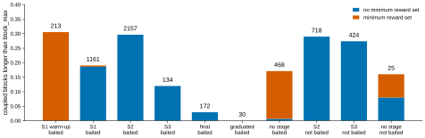

# r1 — P0: the fingerprint library against the wrapper and MEvolve, and the task checks

**Question.** Does the fingerprint library (ADR 0002, 0004) compute the same statistics as the
two older implementations, and how closely can the gym reproduce the real task's blocks and
reward pairs for parameter-matched rollouts (ADR 0006)?

*Share of coupled blocks that ran past their recorded `block_max`, in the score sessions of
study 12's 149 test subjects, by task and stage (`S2` = `STAGE_2`; "no stage" = none recorded).
The number over each bar is its block count. The gym cannot make such a block: its block length
is capped at `block_max`, and it has neither of the real task's holds. Blue: the session set no
minimum reward, so only the auto-block rule (not recorded) or the experimenter can have held the
block. Vermillion: the session set a minimum reward per block.*

<!-- BEGIN result-1 -->
**Library against MEvolve's replay fingerprints** (gate-1b per-subject fits, 19 literature programs × 149 test subjects, score sessions; library `f554270`, MEvolve `30ae4f3`):

| check | max \|difference\| | pass |
|---|---|---|
| library vs MEvolve's `fingerprints()`, same p(right) | 1.4e-14 | yes |
| library vs the stored fingerprints, subjects whose replay reproduces the stored log likelihood | 1.4e-14 | yes |

Subjects whose replay from the stored parameters does not reproduce the stored log likelihood (not compared): none.

**Library against the wrapper's committed rollout numbers** (study 05 `generative-rl-baseline`, 614 subjects, 18,124 sessions per alias; abstract history patterns at 1–3 trials back, their summaries, and the post-switch summary):

| alias | max \|difference\| | subject-count mismatches |
|---|---|---|
| ctt | 3.3e-16 | 0 |
| bari | 3.3e-16 | 0 |
| hattori | 3.3e-16 | 0 |

**Held coupled blocks** (study 12's test subjects, score sessions; 5502 blocks with a recorded `block_max`, last block of each session left out): 24.6% ran past `block_max`; 1205 of 1354 were in sessions that set no minimum reward.

| task | stage | sessions | blocks | past block_max | share |
|---|---|---|---|---|---|
| Coupled Baiting | STAGE_1_WARMUP | 4 | 213 | 65 | 30.5% |
| Coupled Baiting | STAGE_1 | 49 | 1161 | 221 | 19.0% |
| Coupled Baiting | STAGE_2 | 120 | 2157 | 639 | 29.6% |
| Coupled Baiting | STAGE_3 | 12 | 134 | 16 | 11.9% |
| Coupled Baiting | STAGE_FINAL | 22 | 172 | 5 | 2.9% |
| Coupled Baiting | GRADUATED | 2 | 30 | 0 | 0.0% |
| Coupled Baiting | None | 346 | 468 | 80 | 17.1% |
| Coupled Without Baiting | STAGE_2 | 38 | 718 | 208 | 29.0% |
| Coupled Without Baiting | STAGE_3 | 24 | 424 | 116 | 27.4% |
| Coupled Without Baiting | None | 4 | 25 | 4 | 16.0% |

**Reward pairs and coverage** (2138 score sessions):

| check | result |
|---|---|
| sessions with no `block_min` / `block_max` / `block_beta` | 368 |
| sessions whose probabilities are only 0 and 1 | 21 |
| coupled score sessions whose pairs fit one GUI reward family | 541 of 600 |
| (subject, task, stage) pools equal to a family prefix | 307 of 331 |
| share of its pool a coupled score session shows | mean 0.84; all of it in 57% |
| coupled score sessions where a block's pair does not sum to the recorded base sum | 3 of 621 |
<!-- END result-1 -->

## What it says

- **The library computes the same statistics as both older implementations.** Given the same
  p(right), it matches MEvolve's `fingerprints()` on 19 programs × 149 subjects to about 1e-14
  (summation order only). From the cached rollout histories it rebuilds the wrapper's committed
  subject-mean history-pattern rows, their summaries and the post-switch summary, for all three
  RL baselines, to about 3e-16, with every subject count equal. So MEvolve's gate and the
  wrapper's old numbers can move onto the library without changing.
- **This check found a bug in MEvolve's parameter conversion.** Its first run, at MEvolve
  2eef359, could not compare 12 subjects (9 Grossman-MetaLearning, 3 ActorCritic): a replay
  through `fitting.from_params` did not reproduce MEvolve's stored log likelihood, because it
  clipped every parameter 1e-12 inside its bounds and these models are sensitive near a bound.
  The stored parameters were right. MEvolve fixed it (its PR #31); rerun at the fixed 30ae4f3,
  every subject is compared and the library matches the stored fingerprints to about 1e-14.
- **Real coupled blocks are often held, and the gym cannot hold them.** About a quarter of the
  measurable coupled blocks ran past `block_max`, about 30% in `STAGE_2` but 3% in
  `STAGE_FINAL`. Most were in sessions with no minimum reward set, so the unrecorded auto-block
  rule did it. Rollouts of early-stage coupled sessions will therefore have shorter blocks than
  the real ones. Fingerprints that depend on block length (run lengths, the hazard at long runs)
  should be read by stage group, and the final stages are where rollouts match the task best.
- **Reward pairs can mostly be pooled.** Most coupled score sessions show pairs that fit one of
  the GUI's reward families, and a session shows on average most of its subject's pool for that
  task and stage. About a sixth of the score sessions (older ones) have no recorded block
  parameters, and a few record only 0 and 1 as probabilities; those fall back to the gym's
  defaults.

## Methods

The three numbers above come from three freezes, each run once on a compute node; this report
reads only their committed JSON.

- `freeze_p0_golden_mevolve.py`: for each of MEvolve's gate-1b per-subject fits
  (`/allen/aind/scratch/han.hou/mevolve/gate1b/final_888c4ea`, data freeze `cfea3d1e`), replay
  the program at the subject's stored parameters with MEvolve's scoring code, then compute the
  replay fingerprints with MEvolve's function and with the library.
- `freeze_p0_golden_wrapper.py`: tally study 05's cached animal and rollout histories
  (`/allen/aind/scratch/han.hou/tmp/rlgen`) with the library, rebuild the wrapper's subject-mean
  rows by its own rule (at least 5 trials per subject on both sides), and compare with the
  committed `rl_rollout_summaries`.
- `freeze_p0_task_checks.py`: read the trial table (snapshot 20260603) for the 149 test
  subjects. A block is a run of trials with the same (p left, p right); the last block of a
  session is left out because it did not end. Reward pairs are compared as the larger
  probability's share of the pair, rounded to 2 decimals, against `RewardFamilies` in
  `dynamic-foraging-task` `Foraging.py`.
