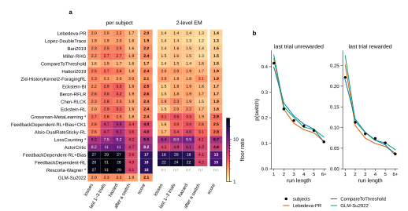
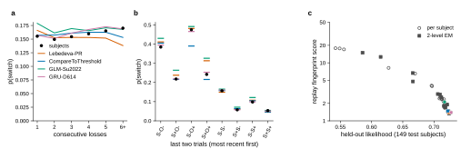
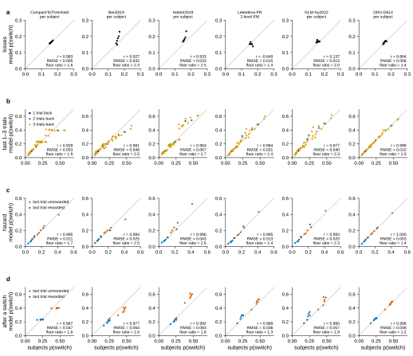

# r2 — P1: replay fingerprints of the literature models and the GRU

**Question.** When each literature model predicts the subjects' own held-out trials, how close
are its switch probabilities to the subjects' in each history bin, as a multiple of what the
subjects' finite trials allow?

**Design.** Study 12's 19 ranked models, with its fitted parameters per subject (r1) and as
2-level EM (r3), plus a per-subject GLM with
the Su2022 design (fit here on the even sessions; `freeze_p1_glm.py`), and study 01's v1 GRU at
D = 614 (three seeds), re-fine-tuned on the test subjects' even sessions with study 01's held-out
config (variant `gru-heldout-replay`; `freeze_p1_gru.py`). Each model replays the
held-out (odd) sessions of the 149 test subjects (ADR 0007); a 2-level model replays with the
session marginal's predictions (ADR 0005). Each replay first reproduces study 12's stored
held-out score for that subject (study 01 r2's, for the GRU), so the grid describes the models
those studies ranked. The gap is
compared with the binomial floor (ADR 0008). Warm-up sessions are left out (ADR 0004).

<!-- BEGIN result-1 -->

**a**, floor ratio (replay gap ÷ binomial floor, each averaged over the 149 test subjects) per model, regime and statistic, on the subjects' held-out sessions except warm-ups (set `non-warm-up`). 1 means as close as the subjects' own trials allow. **score** is the replay fingerprint score, the geometric mean of the four ratios (ADR 0009). The GRU's row is the mean over its three seeds. \* the 2-level fit failed, so study 12 r3 places the model by its per-subject score; n.r., not reproduced (see the gates). **b**, p(switch) by the last trial's reward and the current run length (the hazard): the subjects' mean and four models' replayed predictions, over the 146 subjects every model holds out that keep the bin (2-level EM where the model has it).

| model | per subject: score | worst statistic | its floor ratio | 2-level EM: score | worst statistic | its floor ratio |
|---|---|---|---|---|---|---|
| Lebedeva-PR | **2.0** | hazard | 2.2 | **1.4** | last 1–3 trials | 1.4 |
| Lopez-DoubleTrace | **1.9** | hazard | 2.0 | **1.3** | last 1–3 trials | 1.4 |
| Bari2019 | **2.2** | hazard | 2.5 | **1.5** | last 1–3 trials | 1.6 |
| Miller-RHG | **2.4** | last 1–3 trials | 2.7 | **1.5** | last 1–3 trials | 1.6 |
| CompareToThreshold | **1.7** | last 1–3 trials | 1.9 | **1.5** | after a switch | 1.6 |
| Hattori2019 | **2.4** | last 1–3 trials | 2.7 | **1.9** | last 1–3 trials | 2.0 |
| Zid-HistoryKernel2-ForagingRL | **2.1** | losses | 2.3 | **1.9** | after a switch | 2.1 |
| Eckstein-BI | **2.5** | hazard | 3.3 | **1.7** | hazard | 1.9 |
| Beron-RFLR | **2.6** | hazard | 3.2 | **1.7** | hazard | 1.9 |
| Chen-RLCK | **2.4** | last 1–3 trials | 2.8 | **1.9** | last 1–3 trials | 2.3 |
| Eckstein-RL | **2.4** | hazard | 3.1 | **1.8** | hazard | 2.2 |
| Grossman-MetaLearning \* | **2.4** | last 1–3 trials | 2.8 | **2.9** | last 1–3 trials | 3.5 |
| FeedbackDependent-RL+Bias+CK1 | **4.0** | hazard | 5.9 | **2.5** | hazard | 3.4 |
| Alsio-DualRateSticky-RL | **4.0** | hazard | 6.1 | **2.9** | hazard | 4.0 |
| LossCounting \* | **6.5** | hazard | 9.2 | **6.7** | hazard | 9.5 |
| ActorCritic | **8.2** | hazard | 11.0 | **4.8** | hazard | 6.1 |
| FeedbackDependent-RL+Bias | **17.0** | last 1–3 trials | 29.5 | **12.7** | last 1–3 trials | 19.5 |
| FeedbackDependent-RL | **17.7** | last 1–3 trials | 30.9 | **14.9** | last 1–3 trials | 24.4 |
| Rescorla-Wagner \* | **17.9** | last 1–3 trials | 31.4 | — | — | — |
| GLM-Su2022 | **2.1** | last 1–3 trials | 2.3 | — | — | — |
| GRU-D614 | **1.4** | last 1–3 trials | 1.5 | — | — | — |

**a**, p(switch) by the count of consecutive unrewarded trials on the current side, and **b**, by the last two trials (S same side, O other side, + rewarded, − not; most recent first): subjects and the same four models as above, over the same subjects. **c**, each model's pooled held-out likelihood on the 149 test subjects (study 12's per-subject scores, re-pooled; the GLM's own; the GRU's mean over seeds) against its replay fingerprint score (the geometric mean of its four floor ratios, ADR 0009), per regime; the models of the curves are coloured as in **a**, in the regime drawn there.

Study 01 r9's view, here in replay, for each statistic (rows **a** to **d**): each point is one bin, the subjects' mean p(switch) against the model's replayed prediction, over subjects that keep the bin. Each panel prints r and RMSE over the bins and the model's floor ratio for that statistic (the first figure's cell): the floor ratio weights each bin by its trials and compares with what the subjects' data allow; r and RMSE count every bin once. Patterns are coloured by depth, hazard and after-a-switch bins by the last trial's reward.

**Gates** (library `286692d`, MEvolve `30ae4f3`). Every replay shown (19 of study 12's models × 149 subjects) reproduces the held-out log likelihood study 12 stored for the subject: largest difference per subject 1.8e-11, 2-level EM 3.6e-12 (tolerance 1e-06). Left out: Rescorla-Wagner (2-level EM; 2 subjects differ): study 12 r3 marks this 2-level fit failed, and its replay from the stored typical values does not reproduce the stored score. MEvolve's `replay_gap`, rebuilt from the 2-level tallies, equals the stored one to 1.1e-14. The GLM's replay equals scikit-learn's prediction to 2.2e-16; its pooled held-out likelihood is 0.7169. The GRU (study 01's v1 GRU at D = 614, re-fine-tuned on the held-out subjects, launch `gru-heldout-replay@20261104-150009`, which logs no W&B runs) scores exactly the freeze's sessions and choices; on the 146 subjects study 01 r2 also scored, each seed's likelihood equals study 01's to 9.8e-06 (tolerance 1e-04; study 01 scored on GPUs, this re-fine-tune on CPUs). Its 3 other subjects (722683, 795395, 820243) were among the 614 its checkpoint was trained on, so the GRU's numbers leave them out: its cells and score are over 146 subjects, every other model's over 149. Replay scores per seed: 1.39, 1.40, 1.40.
<!-- END result-1 -->

## What it says

- **The best models come within 1.2 to 1.6 times the floor, as 2-level EM;** their replay
  fingerprint scores are 1.3 to 1.5 (ADR 0009), against 13 to 18 for the weakest models.
  Lopez-DoubleTrace,
  Lebedeva-PR, Bari2019, Miller-RHG and CompareToThreshold miss the subjects' p(switch) by about
  0.013 to 0.018 per bin on the local statistics, against a floor of 0.009 to 0.012. No model
  reaches the floor, so every statistic still has a measurable error to find.
- **The GRU is close to the best 2-level models, and closest bin by bin.** Over the 146 test
  subjects it holds out (3 of the 149 trained its checkpoint), its replay score is 1.40 (seeds
  1.39 to 1.40; floor ratios 1.2 to 1.5), beside 1.33 for Lopez-DoubleTrace and 1.39 for
  Lebedeva-PR as 2-level EM (on all 149), and well below every per-subject fit (1.7 at best). On
  the subject-mean curves it is the closest of all (third figure): RMSE 0.003 to 0.010 per
  statistic, against 0.013 to 0.037 for Lebedeva-PR, and it gets both post-switch histories the
  literature models split on (`S-O+` 0.47 against the subjects' 0.48, `S+O+` 0.25 against 0.24).
  So its remaining gap is mostly within subjects, not in the average behaviour. It also has the
  best held-out likelihood here (0.7268, the mean over seeds).
- **2-level EM lowers the ratio for almost every model,** typically from about 2 to 3 per subject
  to 1.4 to 2. A 2-level replay lets each session have its own parameters, and the subjects'
  switching changes from session to session. The exceptions are the fits study 12 r3 marks
  failed (Grossman-MetaLearning, LossCounting).
- **Per subject, CompareToThreshold is the closest (1.6 to 1.9, at or below every other model on
  each statistic),** although study 12 r1 ranks it third by per-subject likelihood. The
  per-subject GLM (1.9 to 2.3) is close to the best per-subject literature models (1.6 to 2.2),
  which fits its held-out likelihood (0.7169, near study 12's best per-subject scores).
- **The likelihood ranking holds at the extremes.** Models with poor likelihood also miss the
  switching statistics by far: FeedbackDependent-RL and Rescorla-Wagner at 20 to 31 times the
  floor on the local statistics. The good models follow the subjects' hazard at every run
  length (first figure, b).
- **Behaviour tracks likelihood across models** (second figure, c): the replay score falls
  steadily as held-out likelihood rises, from about 18 to 1.3. Near the top the relation
  flattens, which is where the order differs (CompareToThreshold, above).
- **The subjects do not switch more after more losses** (second figure, a). Their p(switch) is
  0.15 to 0.17 after 1 to 6 or more consecutive losses, and the good models reproduce the flat
  curve.
- **The good models miss different histories right after a switch** (second figure, b). After a
  switch that lost (`S-O+`), the subjects switch back at 0.48; CompareToThreshold predicts 0.39,
  while Lebedeva-PR and the GLM get it. After a switch that won (`S+O+`), the subjects stay
  (0.24); Lebedeva-PR and the GLM predict too many switches (0.31, 0.33), CompareToThreshold
  does not.
- **Correlation over bins, study 01 r9's measure, can mislead** (third figure). Where the
  subjects' rates barely vary across bins, r says nothing: on consecutive losses (subjects 0.15
  to 0.17) Lebedeva-PR has r = −0.65 with RMSE 0.015 and a floor ratio of 1.4. Where they vary
  a lot, r is high for any model that orders the bins: after a switch, Hattori2019 has the
  highest r (0.992) and the largest RMSE (0.083), because it overshoots every bin that follows
  an unrewarded trial by about the same amount. The floor ratio has neither problem, which is
  why the grid uses it (ADR 0003). The scatter still shows what the ratio hides:
  CompareToThreshold flattens at p(switch) 0.40 on the last 1–3 trials and after a switch, the
  saturation r9 found in rollouts.
- **"After a switch" separates the models least** (1.2 to 4.7 for all of them). Its bins hold
  few trials, so its floor is about 4 times the others'.
- **A floor ratio depends on how much data the subject has.** With more trials per bin the floor
  shrinks and the same model error becomes a larger multiple: Lopez-DoubleTrace's 2-level
  ratios on the three local statistics are 1.1 to 1.5 within single session groups (those with
  at least 14 subjects) and 1.3 to 1.4 when the groups are pooled (`r2_replay_grid.json`,
  `floor_ratio_by_set`). Compare models within a column, not columns with each other.
- **Rescorla-Wagner's 2-level cell is left out.** Its 2-level fit diverged: for 11 of the 149
  test subjects a typical value sits on a parameter bound, with spreads up to e^10, and the
  stored values cannot rebuild the fit's draws. Two subjects miss the stored score; on subjects
  whose score matches, MEvolve's stored fingerprints still differ by up to 0.019
  (`p1_replay.json`). Study 12 r3 already ranks the model by its per-subject score.

Rollouts (P2) test whether these per-trial errors add up over a session.
