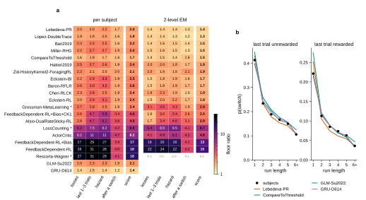
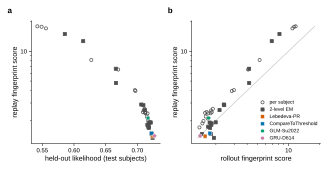
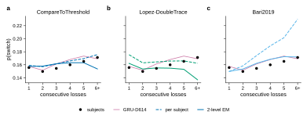
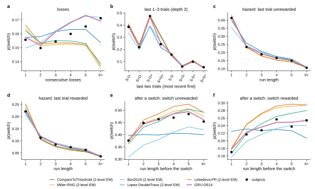
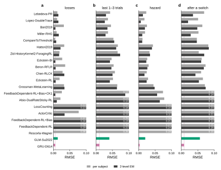
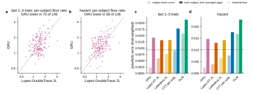
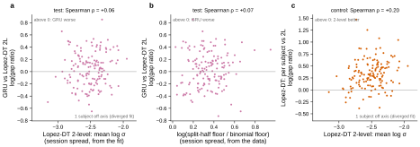
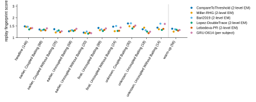

# r2 — P1: how closely do the models replay the mice's own switching?

## Summary

When a model predicts each held-out trial from the mouse's real history, its switch
probabilities miss the mouse's by more than the mouse's finite trials explain: no model reaches
that floor. The best cognitive models, fitted as 2-level EM, miss by 1.3 to 1.5 times the floor,
and the GRU by 1.4 (Figure 1). How far a model misses tracks its held-out likelihood closely, even
among the good models (Figure 2a). Per-session parameters (2-level EM) help almost every model,
though their losses curves dip at six or more losses where the mice's rise (Figure 3), and the
good models get different histories wrong (Figure 4). The GRU matches the average mouse better
than any model, tying only on the losses (Figures 5 and 6), but on each mouse it is only as close as the
best 2-level models (Figure 7). That per-mouse error is not tied to how much a mouse's sessions
differ (Figure 8), and the ranking holds within each session group (Figure 9). r3 makes the same
figures in rollout, where each model plays the task itself.

## Question

When each model predicts the mice's own held-out trials, how close are its switch probabilities
to the mice's in each history bin, as a multiple of what the mice's finite trials allow?

## Approach

**Models.** Study 12's 19 ranked literature models, with its fitted parameters per subject (r1)
and as 2-level EM (r3); a per-subject GLM with the Su2022 design, fit here on the even sessions
(`freeze_p1_glm.py`); and study 01's v1 GRU at D = 614 (three seeds), re-fine-tuned on the test
subjects' even sessions with study 01's held-out config (variant `gru-heldout-replay`;
`freeze_p1_gru.py`). Each model replays the held-out (odd) sessions of the 149 test subjects
(ADR 0007), outside warm-up sessions (ADR 0004); a 2-level model replays with the session
marginal's predictions (ADR 0005). Before it counts, every replay reproduces the held-out score
study 12 (or, for the GRU, study 01 r2) stored for that subject (Gates, below), so these are the
models those studies ranked. The GRU's checkpoint was trained on 3 of the 149, so its numbers are
over the other 146.

**Statistics** (fingerprint spec v1, ADR 0004). Each asks whether trial *t* is a switch (its
choice differs from trial *t* − 1's), binned by the history before *t*:

- **losses**: the number of consecutive unrewarded trials on the current side just before *t*
  (1 to 5, 6 or more); trials after a rewarded trial have no bin.
- **last 1–3 trials** (`pattern`): the last 1, 2 and 3 trials, each coded relative to the last
  choice as S (same side) or O (other side) and + or − (rewarded or not), most recent first:
  2 + 8 + 32 bins, and every trial falls in one bin at each depth.
- **hazard**: the last trial's reward by the length of the current same-side run (1 to 5,
  6 or more), so 12 bins. The name is from survival analysis: the chance the run ends now, given
  it has lasted this long.
- **after a switch** (`post_switch`): only trials right after a switch, by the switch trial's
  reward and the length of the run before the switch (12 bins; study 01 r9's headline statistic,
  with finer run bins).

**Measures.** For subject *s* and bin *b*, let *n* be the subject's trials in the bin, *o* its
observed switch rate and *p* the model's replayed rate (the mean, over those trials, of the
model's probability of switching, predicted from the real trials before each one). A subject
keeps a bin with at least 5 trials. Two comparisons follow, and they answer different questions:

- **Each mouse (the gap and the floor ratio, the headline).** Per subject, the gap is
  Σ_b *n*·|*p* − *o*| ÷ Σ_b *n* over its kept bins (`replay_gap`). Its floor is the gap a model
  with the subject's own switch rates would still have from finite trials:
  Σ_b *n*·E|X/*n* − *o*| ÷ Σ_b *n* with X binomial(*n*, *o*) (ADR 0008). The floor ratio is the
  mean gap over subjects divided by the mean floor; 1 is as close as the data allow. The replay
  fingerprint score is the geometric mean of a model's four floor ratios (ADR 0009).
- **The average mouse (the subject-mean curve).** For each bin, average *p* and *o* over the
  subjects that keep it, each subject once: *P*(b) and *O*(b). Figures 4 and 5 plot these; their
  RMSE (Figures 5 and 6) is over bins, unweighted. Figure 7's curve error weights bins by their trials pooled over
  subjects: Σ_b N(b)·|*P*(b) − *O*(b)| ÷ Σ_b N(b).

The two differ mainly in when the absolute value is taken: on the average mouse, a model's errors
of opposite sign in different mice cancel; on each mouse they cannot. They also weight bins
differently (pooled trials, against each subject's own), so their difference is not cancellation
alone.

## Results

### 1. Every model misses the mice by more than their trials allow

<!-- BEGIN result-1 -->

**Figure 1.** **a**, floor ratio (replay gap ÷ binomial floor, each averaged over the 149 test subjects) per model, regime and statistic, on the subjects' held-out sessions except warm-ups (set `non-warm-up`). 1 means as close as the subjects' own data allow. **score** is the replay fingerprint score, the geometric mean of the four ratios (ADR 0009). The GRU's row is the mean over its three seeds, on the 146 subjects it holds out. \* the 2-level fit failed, so study 12 r3 places the model by its per-subject score; n.r., not reproduced in replay (r2 gates). **b**, p(switch) by the last trial's reward and the current run length (the hazard): the subjects' mean and the model's replayed prediction for four models, over the 146 subjects every model holds out that keep the bin (2-level EM where the model has it).

| model | per subject: score | worst statistic | its floor ratio | 2-level EM: score | worst statistic | its floor ratio |
|---|---|---|---|---|---|---|
| Lebedeva-PR | **2.0** | hazard | 2.2 | **1.4** | last 1–3 trials | 1.4 |
| Lopez-DoubleTrace | **1.9** | hazard | 2.0 | **1.3** | last 1–3 trials | 1.4 |
| Bari2019 | **2.2** | hazard | 2.5 | **1.5** | last 1–3 trials | 1.6 |
| Miller-RHG | **2.4** | last 1–3 trials | 2.7 | **1.5** | last 1–3 trials | 1.6 |
| CompareToThreshold | **1.7** | last 1–3 trials | 1.9 | **1.5** | after a switch | 1.6 |
| Hattori2019 | **2.4** | last 1–3 trials | 2.7 | **1.9** | last 1–3 trials | 2.0 |
| Zid-HistoryKernel2-ForagingRL | **2.1** | losses | 2.3 | **1.9** | after a switch | 2.1 |
| Eckstein-BI | **2.5** | hazard | 3.3 | **1.7** | hazard | 1.9 |
| Beron-RFLR | **2.6** | hazard | 3.2 | **1.7** | hazard | 1.9 |
| Chen-RLCK | **2.4** | last 1–3 trials | 2.8 | **1.9** | last 1–3 trials | 2.3 |
| Eckstein-RL | **2.4** | hazard | 3.1 | **1.8** | hazard | 2.2 |
| Grossman-MetaLearning \* | **2.4** | last 1–3 trials | 2.8 | **2.9** | last 1–3 trials | 3.5 |
| FeedbackDependent-RL+Bias+CK1 | **4.0** | hazard | 5.9 | **2.5** | hazard | 3.4 |
| Alsio-DualRateSticky-RL | **4.0** | hazard | 6.1 | **2.9** | hazard | 4.0 |
| LossCounting \* | **6.5** | hazard | 9.2 | **6.7** | hazard | 9.5 |
| ActorCritic | **8.2** | hazard | 11.0 | **4.8** | hazard | 6.1 |
| FeedbackDependent-RL+Bias | **17.0** | last 1–3 trials | 29.5 | **12.7** | last 1–3 trials | 19.5 |
| FeedbackDependent-RL | **17.7** | last 1–3 trials | 30.9 | **14.9** | last 1–3 trials | 24.4 |
| Rescorla-Wagner \* | **17.9** | last 1–3 trials | 31.4 | — | — | — |
| GLM-Su2022 | **2.1** | last 1–3 trials | 2.3 | — | — | — |
| GRU-D614 | **1.4** | last 1–3 trials | 1.5 | — | — | — |
<!-- END result-1 -->

- **The best models come within 1.3 to 1.5 times the floor, as 2-level EM** (replay scores of
  Lopez-DoubleTrace, Lebedeva-PR, Bari2019, Miller-RHG and CompareToThreshold), against 13 to 18
  for the weakest. No model reaches the floor, so every statistic still has a measurable error.
- **Per-session parameters help almost every model.** 2-level EM lowers the score for 16 of the
  18 models fitted both ways; for the eleven best, from 1.7–2.6 per subject to 1.3–1.9. A 2-level replay lets
  each session have its own parameters, and the mice's switching changes from session to session.
  The exceptions are the fits study 12 r3 marks failed (Grossman-MetaLearning, LossCounting).
- **Per subject, CompareToThreshold is the closest (1.7),** although study 12 r1 ranks it third by
  per-subject likelihood. The per-subject GLM (2.1) sits beside the best per-subject literature
  models, as its held-out likelihood (0.7169) does.

### 2. The replay score tracks likelihood, even among the good models

<!-- BEGIN result-2 -->

**Figure 2.** Each model's replay fingerprint score (Figure 1a) against **a**, its pooled held-out likelihood on the 149 test subjects (study 12's per-subject scores, re-pooled; the GLM's own; the GRU's mean over seeds, on its 146), and **b**, its rollout fingerprint score (r3), per regime; the grey line marks equal scores. The models of Figure 1b are coloured.
<!-- END result-2 -->

The replay score falls as held-out likelihood rises (Spearman ρ = −0.97 over all cells), and the
relation holds among the 28 cells with likelihood above 0.70 (ρ = −0.93). So in replay, likelihood
and behaviour agree on which models are good. Against the rollout score (panel b), the ranking is
broadly the same (ρ = 0.79), but the regimes split: almost every per-subject model replays worse
than it plays (20 of 21 cells sit above the line), while the 2-level fits sit on both sides of
it (8 of 18 below). r3 follows this split.

### 3. Where the 2-level fits miss: the longest loss runs and right after a switch

<!-- BEGIN result-3 -->

**Figure 3.** p(switch) by the count of consecutive unrewarded trials on the current side, in replay: the subjects' mean (dots), three literature models with their per-subject parameters (dashed) and as 2-level EM, each session with its own parameters (solid), and the GRU, over the subjects every model holds out that keep the bin. Floor ratios of this statistic: CompareToThreshold per subject 1.6; CompareToThreshold 2-level EM 1.4; Lopez-DoubleTrace per subject 1.9; Lopez-DoubleTrace 2-level EM 1.4; Bari2019 per subject 2.3; Bari2019 2-level EM 1.4.
<!-- END result-3 -->

<!-- BEGIN result-4 -->

**Figure 4.** The four switch statistics as curves, in replay: the subjects' mean (dots), the five literature models of Figure 5 as 2-level EM (thin) and the GRU (thick, the mean of its three seeds), over the subjects every model holds out that keep the bin. **a**, by consecutive losses; **b**, by the last two trials (S same side, O other side, + rewarded, − not; most recent first); **c**, **d**, the hazard, by the current run's length after an unrewarded or a rewarded trial; **e**, **f**, right after a switch, by the length of the run before it and the switch trial's reward.
<!-- END result-4 -->

- **The mice switch only a little more after more losses** (Figures 3 and 4a): p(switch) rises
  from 0.156 after one loss to 0.171 after six or more. Per subject, Lopez-DoubleTrace sits above
  the mice and flat, and Bari2019 rises far too steeply (0.15 to 0.23). As 2-level EM, both follow
  the mice up to five losses, and the losses floor ratios fall (Lopez-DoubleTrace from 1.9 to 1.4,
  Bari2019 from 2.3 to 1.4); but CompareToThreshold, Miller-RHG, Lopez-DoubleTrace and Lebedeva-PR
  then dip at six or more losses (Lopez-DoubleTrace 0.137). The dip costs little here, because few trials
  follow six losses; in rollout (r3) it grows into the largest miss.
- **The good models follow the hazard at every run length** (Figures 1b, 4c, d).
- **They split right after a switch** (Figure 4b, e, f). After a switch that lost (`S-O+`), the
  mice switch back at 0.48; CompareToThreshold and Bari2019 predict 0.39, while Lopez-DoubleTrace,
  Lebedeva-PR and Miller-RHG get it. After a switch that won (`S+O+`), the mice stay (0.24);
  Lebedeva-PR, Miller-RHG and Lopez-DoubleTrace predict too many switches (0.31), and Bari2019 and
  the GRU do not. CompareToThreshold stays flat after a switch where the mice rise with the run
  before it (Figure 4e, f). So no single literature model is closest on every history, and the score's ranking
  hides which history each one gets wrong.

### 4. The GRU matches the average mouse best, on every statistic

<!-- BEGIN result-5 -->

**Figure 5.** Study 01 r9's view, in replay, for each statistic (rows **a** to **d**): each point is one bin, the subjects' mean against the model's replayed prediction, over the subjects every model holds out that keep the bin. Columns: the five literature models with the best 2-level EM likelihood, as 2-level EM, from the lowest likelihood to the highest, then the GRU. Each panel prints r and RMSE over the bins (each bin once) and the model's floor ratio for the statistic (its cell in Figure 1a, trial-weighted).
<!-- END result-5 -->

<!-- BEGIN result-6 -->

**Figure 6.** Figure 5's per-bin RMSE for every model and statistic: per subject (light) and as 2-level EM (dark); the GLM in green and the GRU in purple (dashed line: the GRU's value). The axis stops at 0.1; a longer bar is cut and labelled. Models in Figure 1's order.
<!-- END result-6 -->

- **On the average mouse, the GRU is the closest model** (Figures 5 and 6). Over all 39 model
  cells it has the smallest per-bin RMSE on three statistics (0.003 to 0.010) and ties
  CompareToThreshold per subject on the losses (0.006 both). On the last 1–3 trials, the hazard
  and after a switch, the next best (Lopez-DoubleTrace as 2-level EM) has 2.3 to 2.6 times its
  error. It also has the best held-out likelihood here (0.7268, the mean over seeds).
- **Yet its replay score, 1.40 (seeds 1.39 to 1.40), is beside the best 2-level models'** (1.33
  for Lopez-DoubleTrace, 1.39 for Lebedeva-PR; Figure 1), not below them.
- **r over bins, study 01 r9's measure, cannot show this** (Figure 5). Where the mice's rates
  barely vary across bins, r says nothing: on the losses Lebedeva-PR has r = −0.65 with RMSE 0.015
  and a floor ratio of 1.4. Where they vary a lot, any model that orders the bins has a high r:
  after a switch every model shown has r of 0.96 or more, yet Bari2019's RMSE (0.049) is six
  times the GRU's, because it undershoots every bin that follows an unrewarded trial.

### 5. On each mouse, the GRU is only as close as the best 2-level models

<!-- BEGIN result-7 -->

**Figure 7.** On the 146 test subjects every model holds out. **a**, **b**, each subject's floor ratio in replay, the GRU against Lopez-DoubleTrace as 2-level EM (the diagonal is a tie). **c**, **d**, two errors per model, both trial-weighted over the same kept bins: of the subject-mean curve (light; what Figure 5 compares) and of each subject, then averaged (dark; the gap the floor ratio divides). The dashed line is the mean binomial floor.

| | GRU | Lopez-DoubleTrace 2L |
|---|---|---|
| subject-mean curve error: last 1–3 trials, hazard | 0.0024, 0.0025 | 0.0059, 0.0038 |
| mean per-subject gap: last 1–3 trials, hazard (floors 0.0093, 0.0101) | 0.0142, 0.0147 | 0.0131, 0.0131 |
| subjects where the GRU's gap is larger (four statistics) | 80 of 146 (sign test p = 0.28; Wilcoxon p = 0.15) | |
| median per-subject gap ratio, GRU ÷ Lopez 2L | 1.05 [0.96, 1.12] | |
<!-- END result-7 -->

- **The two results agree once each mouse is scored on its own** (Figure 7). The GRU's error on
  the average mouse is the smallest of all (light bars), but its error on each mouse is no smaller
  than the best 2-level models' (dark bars). Its misses differ in sign between mice, so they
  largely cancel on the average mouse but not in the gap.
- **Per mouse, the GRU and Lopez-DoubleTrace (2-level) are tied within the noise** (Figure 7a, b).
  The paired test does not separate them, and the interval of the median per-mouse ratio
  includes 1. In rollout (r3), the same test favours the GRU.

<!-- BEGIN result-8 -->

**Figure 8.** Per subject, the GRU's log gap ratio to Lopez-DoubleTrace (2-level) in replay, mean over the four rate statistics, against **a**, the subject's session spread from Lopez-DoubleTrace's 2-level fit (mean log σ), and **b**, from the data (log of the split-half floor, which includes the differences between sessions, over the binomial floor, which does not; both from the replay sessions, as they describe the mouse and the fit, not the mode). **c**, control: the same spread against Lopez-DoubleTrace's own gain from per-session parameters in replay (log per-subject gap over 2-level gap). Spearman ρ with 95% bootstrap intervals:

| | ρ |
|---|---|
| GRU's ratio to Lopez 2L vs spread from the fit (a) | ρ = +0.06 [−0.12, +0.22] |
| GRU's ratio to Lopez 2L vs spread from the data (b) | ρ = +0.07 [−0.11, +0.25] |
| GRU's ratio to Lopez 2L vs trials; vs sessions | ρ = −0.03 [−0.20, +0.14]; ρ = −0.04 [−0.20, +0.13] |
| control: Lopez's 2-level gain vs spread from the fit (c); from the data | ρ = +0.20 [+0.02, +0.36]; ρ = +0.12 [−0.05, +0.29] |
| the two spread measures, against each other | ρ = +0.14 [−0.03, +0.31] |

Lopez-DoubleTrace's median gain from per-session parameters: its per-subject gap is 1.37 times its 2-level gap.
<!-- END result-8 -->

Per-session parameters help the cognitive models (Result 1), so a natural guess is that the GRU,
with one embedding per mouse, falls behind on mice whose sessions differ most. Figure 8 tests
this, and finds no relation with either measure of session spread (a, b), nor with a mouse's
trial or session count. The test is weak, though. In the control (c), per-session parameters help
Lopez-DoubleTrace on almost every mouse, yet its fitted spread predicts that gain only weakly,
and the two spread measures barely agree. Per-mouse spread is measured too noisily here to rule
the idea in or out (exploratory).

### 6. The ranking holds within each session group

<!-- BEGIN result-9 -->

**Figure 9.** Replay fingerprint score per session group, for the models of Figure 5, on groups where at least 8 subjects have a floor (in brackets: the GRU's count). Left of the line: the headline and its groups. Right: the warm-ups.
<!-- END result-9 -->

Within every session group with enough subjects, the best models score 1.15 to 1.65, and no group
reorders them much (Figure 9). The warm-ups, outside the headline, score like the other groups in
replay. Scores within single groups are lower than the headline's because a group has fewer trials
per bin, so its floor is higher (Caveats).

## Caveats

- **"After a switch" separates the models least** (1.2 to 4.7 for all of them). Its bins hold
  few trials, so its floor is about 4 times the others'.
- **A floor ratio depends on how much data a subject has.** With more trials per bin the floor
  shrinks and the same model error becomes a larger multiple: Lopez-DoubleTrace's 2-level ratios
  on the three local statistics are 1.1 to 1.5 within single session groups (those with at least
  14 subjects) and 1.3 to 1.4 when the groups are pooled (`r2_replay_grid.json`,
  `floor_ratio_by_set`; Figure 9). Compare models within a column, not columns with each other.
- **Rescorla-Wagner's 2-level cell is left out.** Its 2-level fit diverged: for 11 of the 149 test
  subjects a typical value sits on a parameter bound, with spreads up to e^10, and the stored
  values cannot rebuild the fit's draws. Two subjects miss the stored score; on subjects whose
  score matches, MEvolve's stored fingerprints still differ by up to 0.019 (`p1_replay.json`).
  Study 12 r3 already ranks the model by its per-subject score.
- **The GRU is over 146 subjects, the other models over 149.** On the same 146 the two best
  2-level models score 1.32 and 1.38, against 1.33 and 1.39.
- **Figure 8's spread measures come from the replay sessions** and Lopez-DoubleTrace's fit;
  r3 reuses them, as they describe the mouse, not the mode.

## Gates

<!-- BEGIN result-11 -->
**Gates** (library `286692d`, MEvolve `30ae4f3`). Every replay shown (19 of study 12's models × 149 subjects) reproduces the held-out log likelihood study 12 stored for the subject: largest difference per subject 1.8e-11, 2-level EM 3.6e-12 (tolerance 1e-06). Left out: Rescorla-Wagner (2-level EM; 2 subjects differ): study 12 r3 marks this 2-level fit failed, and its replay from the stored typical values does not reproduce the stored score. MEvolve's `replay_gap`, rebuilt from the 2-level tallies, equals the stored one to 1.1e-14. The GLM's replay equals scikit-learn's prediction to 2.2e-16; its pooled held-out likelihood is 0.7169. The GRU (study 01's v1 GRU at D = 614, re-fine-tuned on the held-out subjects, launch `gru-heldout-replay@20261104-150009`, which logs no W&B runs) scores exactly the freeze's sessions and choices; on the 146 subjects study 01 r2 also scored, each seed's likelihood equals study 01's to 9.8e-06 (tolerance 1e-04; study 01 scored on GPUs, this re-fine-tune on CPUs). Its 3 other subjects (722683, 795395, 820243) were among the 614 its checkpoint was trained on, so the GRU's numbers leave them out: its cells and score are over 146 subjects, every other model's over 149. Replay scores per seed: 1.39, 1.40, 1.40.
<!-- END result-11 -->

## Next

Rollouts (P2) let each model play the task on its own, from each session's recorded task
parameters (ADR 0006), and compare the same statistics plus the run-length distribution against a
split-half floor (ADR 0003). They test whether the per-trial errors above add up over a session,
and whether the GRU's lead on the average mouse survives when it makes its own choices.
