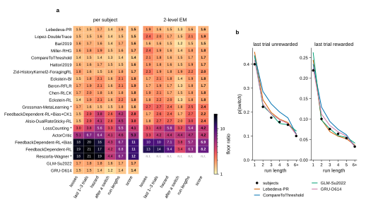
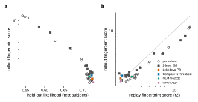
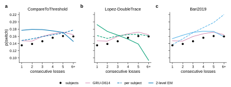
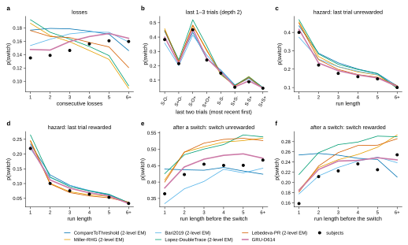
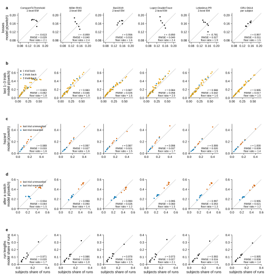
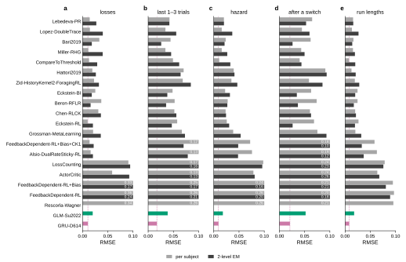
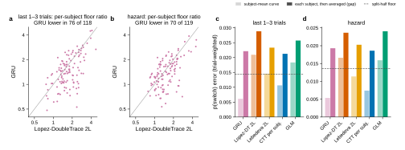
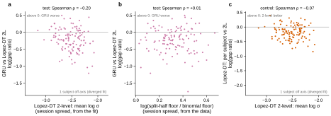
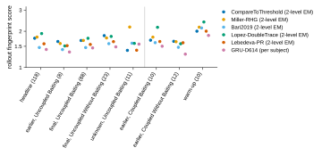
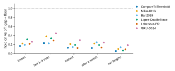

# r3 — P2: when the models play the task, do their sessions look like the mice's?

## Summary

When each model plays the task itself, in gym sessions built from the mice's own sessions, no
model's switching comes as close to a mouse as that mouse's own sessions come to each other. The
best are about 1.4 times that split-half floor (Figure 1). Three models tie: CompareToThreshold
with its per-subject parameters, the GRU, and Bari2019 as 2-level EM. Across all models the
rollout ranking follows likelihood and the replay ranking (Figure 2), but among the good models it
follows likelihood only weakly, because the fit that wins replay often loses rollout. 2-level EM
improves replay for 16 of 18 models but rollout for only 9. For the best models it bends the
losses curve the wrong way: after more consecutive losses the mice switch more, but the 2-level
models switch less, and several switch back too often right after a switch (Figures 3 and 4).
These misses are already in replay, smaller (r2 Figure 4); rollout makes them larger. The GRU
follows the mice's curves (Figures 4 to 6), and unlike in replay it is also closer than the best
2-level model on most mice (Figure 7). Its lead per mouse is larger for mice whose fitted 2-level
spread is larger (Figure 8). Two limits of the simulator do not explain these results: the early
coupled stages, where the gym cannot hold a block, score like the headline sessions (Figure 9),
and the one recorded hold moves the fingerprints by less than half the floor (Figure 10). r2 has
the same figures in replay.

## Question

Replay (r2) asks how well a model predicts each trial from the mouse's real history. A model can
pass that test and still drift away from the mice when it makes its own history, because its
small errors then feed back into its next choices. So, when each model plays session-matched
tasks from scratch, how close are the switching statistics of its sessions to the mice's, as a
multiple of how much the mice's own sessions differ from each other?

## Approach

**Models.** The same models as r2: study 12's 19 ranked literature models, each with its
per-subject parameters and as 2-level EM (except Rescorla-Wagner, whose 2-level replay did not
reproduce), the per-subject GLM, and the GRU (three seeds, on the 122 test subjects with a gym
task that its checkpoint did not train on).

**Tasks** (ADR 0006). Each of a subject's score sessions becomes one gym task with the session's
recorded block parameters, baiting, reward probabilities and engaged-trial count. A model plays
each task 10 times. A 2-level model draws new session parameters for every rollout from its fitted
subject distribution (ADR 0005). A task needs recorded block parameters, so 373 of 2,138 score
sessions are left out, and with them every score session of 24 of the 149 test subjects: 125
subjects remain.

**Statistics and the floor.** The five statistics of fingerprint spec v1: r2's four
switch-probability statistics, and the distribution of run lengths (how many trials a mouse
stays on one side). For each subject and statistic, the gap is the trial-weighted mean |model −
mouse| over the subject's bins, as in r2. In rollout, a model cannot track the mouse's particular
sessions, only its typical one. So the floor is no longer the binomial noise of r2: it is the
split-half floor (ADR 0003), the gap between two random halves of the subject's own sessions,
scaled to the full data. It contains trial noise and real session-to-session change. The floor
ratio is the mean gap over subjects divided by the mean floor: 1 means the model's sessions are as
close to the mouse's as the mouse's own sessions are to each other. The rollout fingerprint score is
the geometric mean of the five ratios (ADR 0009). The headline uses uncoupled and final-stage
coupled sessions, where the gym's task rules are the real ones (ADR 0006).

## Results

### 1. No model plays like the mice yet; the best come within 1.4 times the floor

<!-- BEGIN result-1 -->

**Figure 1.** **a**, floor ratio (rollout gap ÷ split-half floor, each averaged over the 125 test subjects) per model, regime and statistic, on the headline sessions (set `headline`: uncoupled and final-stage coupled, ADR 0006). 1 means as close as the subjects' own data allow. **score** is the rollout fingerprint score, the geometric mean of the five ratios (ADR 0009). The GRU's row is the mean over its three seeds, on the 122 subjects it holds out. ▾ the rollouts visit less than 95% of the subjects' bin weight. \* the 2-level fit failed, so study 12 r3 places the model by its per-subject score; n.r., not reproduced in replay (r2 gates). **b**, p(switch) by the last trial's reward and the current run length (the hazard): the subjects' mean and the mean of the model's rollouts for four models, over the 122 subjects every model holds out that keep the bin (2-level EM where the model has it).

| model | per subject: score | worst statistic | its floor ratio | 2-level EM: score | worst statistic | its floor ratio |
|---|---|---|---|---|---|---|
| Lebedeva-PR | **1.5** | hazard | 1.7 | **1.6** | losses | 1.9 |
| Lopez-DoubleTrace | **1.5** | hazard | 1.6 | **1.9** | losses | 2.4 |
| Bari2019 | **1.6** | run lengths | 1.7 | **1.5** | last 1–3 trials | 1.6 |
| Miller-RHG | **1.7** | hazard | 1.9 | **1.8** | losses | 2.4 |
| CompareToThreshold | **1.4** | last 1–3 trials | 1.5 | **1.7** | losses | 2.1 |
| Hattori2019 | **1.6** | hazard | 1.7 | **1.7** | losses | 1.9 |
| Zid-HistoryKernel2-ForagingRL | **1.7** | losses | 1.8 | **2.0** | losses | 2.3 |
| Eckstein-BI | **1.8** | run lengths | 2.1 | **1.8** | last 1–3 trials | 2.1 |
| Beron-RFLR | **1.9** | run lengths | 2.1 | **1.7** | last 1–3 trials | 1.9 |
| Chen-RLCK | **1.8** | last 1–3 trials | 2.0 | **1.8** | last 1–3 trials | 2.1 |
| Eckstein-RL | **1.8** | run lengths | 2.2 | **1.8** | last 1–3 trials | 2.2 |
| Grossman-MetaLearning \* | **1.6** | run lengths | 1.8 | **2.4** | last 1–3 trials | 2.7 |
| FeedbackDependent-RL+Bias+CK1 | **2.8** | run lengths | 4.2 | **2.2** | run lengths | 2.7 |
| Alsio-DualRateSticky-RL | **3.0** | run lengths | 4.5 | **2.4** | run lengths | 3.0 |
| LossCounting \* | **4.1** | hazard | 5.6 | **4.2** | hazard | 5.8 |
| ActorCritic | **5.3** | last 1–3 trials | 6.7 | **4.2** | run lengths | 4.7 |
| FeedbackDependent-RL+Bias | **10.9** | last 1–3 trials | 19.6 | **6.9** | last 1–3 trials | 10.1 |
| FeedbackDependent-RL | **11.3** | last 1–3 trials | 20.9 | **8.2** | last 1–3 trials | 13.7 |
| Rescorla-Wagner \* | **11.7** | last 1–3 trials | 21.1 | — | — | — |
| GLM-Su2022 | **1.7** | last 1–3 trials | 1.8 | — | — | — |
| GRU-D614 | **1.4** | last 1–3 trials | 1.5 | — | — | — |
<!-- END result-1 -->

The good models fall short in every statistic, not just one: their worst ratio is about 1.5 to 2.
The poor models fail mainly on the losses and on the last trials. The single-learning-rate models
(Rescorla-Wagner and FeedbackDependent-RL) reach 11 to 21 there, as in replay.

### 2. Rollout broadly agrees with replay and likelihood, but not among the good models

<!-- BEGIN result-2 -->

**Figure 2.** Each model's rollout fingerprint score (Figure 1a) against **a**, its pooled held-out likelihood on the 149 test subjects (study 12's per-subject scores, re-pooled; the GLM's own; the GRU's mean over seeds, on its 146), and **b**, its replay fingerprint score (r2), per regime; the grey line marks equal scores. The models of Figure 1b are coloured.
<!-- END result-2 -->

Over all cells, the rollout score ranks the models much as the replay score does (Spearman
ρ = 0.79) and as the likelihood does (ρ = −0.79). But among the 28 cells with likelihood above
0.70, the agreement with likelihood is weak (ρ = −0.43), where in replay it stays strong (−0.93,
r2). The clearest disagreement is the fitting regime. Below the grey line in panel b, a model's
rollout score is better than its replay score: 20 of 21 per-subject cells sit there, against 10 of
18 2-level cells. So a 2-level fit gains much less from replay to rollout, and for the best models
it loses its replay lead.

### 3. 2-level EM's misses are already in replay; rollout makes them larger

<!-- BEGIN result-3 -->

**Figure 3.** p(switch) by the count of consecutive unrewarded trials on the current side, in rollout: the subjects' mean (dots), three literature models with their per-subject parameters (dashed) and as 2-level EM, each session with its own parameters (solid), and the GRU, over the subjects every model holds out that keep the bin. Floor ratios of this statistic: CompareToThreshold per subject 1.4; CompareToThreshold 2-level EM 2.1; Lopez-DoubleTrace per subject 1.5; Lopez-DoubleTrace 2-level EM 2.4; Bari2019 per subject 1.6; Bari2019 2-level EM 1.6.
<!-- END result-3 -->

<!-- BEGIN result-4 -->

**Figure 4.** The four switch statistics as curves, in rollout: the subjects' mean (dots), the five literature models of Figure 5 as 2-level EM (thin) and the GRU (thick, the mean of its three seeds), over the subjects every model holds out that keep the bin. **a**, by consecutive losses; **b**, by the last two trials (S same side, O other side, + rewarded, − not; most recent first); **c**, **d**, the hazard, by the current run's length after an unrewarded or a rewarded trial; **e**, **f**, right after a switch, by the length of the run before it and the switch trial's reward.
<!-- END result-4 -->

- **The losses.** In the rollout sessions, the mice switch a little more after each further loss,
  from 0.135 after one loss to 0.16 after five or more. With per-subject parameters, the three
  models of Figure 3 rise too (CompareToThreshold a little above the mice, Bari2019 too steeply).
  As 2-level EM, CompareToThreshold falls instead, and Lopez-DoubleTrace falls from 0.19 to 0.09;
  their floor ratios on this statistic grow from 1.4 to 2.1 and from 1.5 to 2.4. Bari2019's
  2-level curve rises up to five losses, and its ratio does not grow.
- **Right after a switch** (Figure 4e, f), Lopez-DoubleTrace, Lebedeva-PR and Miller-RHG as
  2-level EM switch back too often, by about 0.05 to 0.08, and CompareToThreshold stays flat where
  the mice rise with the length of the run before the switch. On the hazard and the last two
  trials (Figure 4b–d), every model is close to the mice.
- **Replay shows the same misses, smaller** (r2 Figures 3 and 4). As 2-level EM, the losses curves
  are flat and dip only at six or more losses (Lopez-DoubleTrace from 0.162 to 0.137, where the
  mice rise from 0.156 to 0.171), and Lebedeva-PR and Miller-RHG already switch back too often
  after a switch. The per-subject curves, by contrast, are nearly the same in replay and rollout,
  though the two use different sessions and subjects (Lopez-DoubleTrace's losses curve within
  0.013 in every bin). So what changes between the two modes comes with the session-to-session
  spread of parameters, which only 2-level EM has. In replay that spread enters through the
  session marginal, which follows the mouse's real trials; in rollout each session draws its
  parameters and then makes its own history.

One explanation, not yet tested: a long run of losses is most likely in a rollout session that
drew low switching parameters, so the long-loss bins over-sample those sessions, and the short
ones over-sample the high switchers. The mice have session-to-session change too, but the result
suggests the fitted 2-level spread is larger than theirs, or of a different shape. The test is to
compare the spread of per-session switch rates between the rollouts and the mice.

### 4. The GRU matches the average mouse best

<!-- BEGIN result-5 -->

**Figure 5.** Study 01 r9's view, in rollout, for each statistic (rows **a** to **e**): each point is one bin, the subjects' mean against the mean of the model's rollouts, over the subjects every model holds out that keep the bin. Columns: the five literature models with the best 2-level EM likelihood, as 2-level EM, from the lowest likelihood to the highest, then the GRU. Each panel prints r and RMSE over the bins (each bin once) and the model's floor ratio for the statistic (its cell in Figure 1a, trial-weighted). Run lengths are shares of runs, not p(switch).
<!-- END result-5 -->

<!-- BEGIN result-6 -->

**Figure 6.** Figure 5's per-bin RMSE for every model and statistic: per subject (light) and as 2-level EM (dark); the GLM in green and the GRU in purple (dashed line: the GRU's value). The axis stops at 0.1; a longer bar is cut and labelled. Models in Figure 1's order.
<!-- END result-6 -->

In rollout, the GRU (score 1.41; seeds 1.38 to 1.43) ties the best literature cell
(CompareToThreshold per subject, 1.39). Over all 39 model cells (Figure 6), it has the smallest
per-bin RMSE on three statistics (last 1–3 trials, hazard, after a switch) and ties the best on
the other two: Eckstein-RL per subject on the losses (0.010 against 0.011) and CompareToThreshold
per subject on run lengths (0.008 for both). Its lead is largest on the last trials and after a
switch, where the next best (Bari2019 as 2-level EM) has 1.25 to 1.5 times its error. Among the
six models of Figure 5, it is the only one whose losses curve rises with the mice's (r = 0.96).
The bars also show the regime split of Result 3 across all models: the per-subject fit has the
smaller losses error for 13 of the 18 models fitted both ways.

### 5. On each mouse, the GRU is closer than the best 2-level model

<!-- BEGIN result-7 -->

**Figure 7.** On the 122 test subjects every model holds out. **a**, **b**, each subject's floor ratio in rollout, the GRU against Lopez-DoubleTrace as 2-level EM (the diagonal is a tie). **c**, **d**, two errors per model, both trial-weighted over the same kept bins: of the subject-mean curve (light; what Figure 5 compares) and of each subject, then averaged (dark; the gap the floor ratio divides). The dashed line is the mean split-half floor.

| | GRU | Lopez-DoubleTrace 2L |
|---|---|---|
| subject-mean curve error: last 1–3 trials, hazard | 0.0061, 0.0054 | 0.0209, 0.0166 |
| mean per-subject gap: last 1–3 trials, hazard (floors 0.0145, 0.0136) | 0.0221, 0.0193 | 0.0288, 0.0236 |
| subjects where the GRU's gap is larger (four statistics) | 31 of 119 (sign test p = 1.7e−07; Wilcoxon p = 2e−10) | |
| median per-subject gap ratio, GRU ÷ Lopez 2L | 0.80 [0.77, 0.86] | |
<!-- END result-7 -->

In replay, the GRU and Lopez-DoubleTrace (2-level) were tied per mouse (r2 Figure 7). In rollout
they are not: the GRU's gap is smaller on 88 of 119 mice, and its median per-mouse gap is 0.80
times Lopez-DoubleTrace's (95% interval 0.77 to 0.86). Its lead on the average mouse (light bars)
is larger still, as in replay, because some of its per-mouse misses cancel across mice.

<!-- BEGIN result-8 -->

**Figure 8.** Per subject, the GRU's log gap ratio to Lopez-DoubleTrace (2-level) in rollout, mean over the four rate statistics, against **a**, the subject's session spread from Lopez-DoubleTrace's 2-level fit (mean log σ), and **b**, from the data (log of the split-half floor, which includes the differences between sessions, over the binomial floor, which does not; both from the replay sessions, as they describe the mouse and the fit, not the mode). **c**, control: the same spread against Lopez-DoubleTrace's own gain from per-session parameters in rollout (log per-subject gap over 2-level gap). Spearman ρ with 95% bootstrap intervals:

| | ρ |
|---|---|
| GRU's ratio to Lopez 2L vs spread from the fit (a) | ρ = −0.20 [−0.36, −0.02] |
| GRU's ratio to Lopez 2L vs spread from the data (b) | ρ = +0.01 [−0.19, +0.21] |
| GRU's ratio to Lopez 2L vs trials; vs sessions | ρ = +0.37 [+0.18, +0.52]; ρ = +0.34 [+0.16, +0.50] |
| control: Lopez's 2-level gain vs spread from the fit (c); from the data | ρ = −0.07 [−0.26, +0.11]; ρ = −0.03 [−0.22, +0.17] |
| the two spread measures, against each other | ρ = +0.07 [−0.12, +0.26] |

Lopez-DoubleTrace's median gain from per-session parameters: its per-subject gap is 0.85 times its 2-level gap.
<!-- END result-8 -->

The GRU's per-mouse lead is a little larger for mice whose fitted 2-level spread is larger
(ρ = −0.20, interval −0.36 to −0.02), which fits Result 3: where the 2-level fit draws more
varied sessions, it loses more in rollout. It is unrelated to the spread measured from the data
(ρ = 0.01), and smaller for mice with more trials (ρ = 0.37). In the control, Lopez-DoubleTrace's
per-subject fit beats its own 2-level fit on most mice in rollout (median gap ratio 0.85), but
that gain is not related to either spread measure. Exploratory, like r2's version.

### 6. The simulator's missing holds do not drive these results

<!-- BEGIN result-9 -->

**Figure 9.** Rollout fingerprint score per session group, for the models of Figure 5, on groups where at least 8 subjects have a floor (in brackets: the GRU's count). Left of the line: the headline and its groups. Right: the early coupled stages and the warm-ups, where the gym does not hold a block as the real task's `AdvancedBlockAuto` does (ADR 0006).
<!-- END result-9 -->

The gym cannot hold an early coupled block until the mouse follows the better side
(`AdvancedBlockAuto`), so ADR 0006 kept those stages out of the headline. Yet they score like the
headline groups (Figure 9): no model is clearly worse there. The warm-ups score worse for every
model, around 2.

<!-- BEGIN result-10 -->

**Figure 10.** The `BlockMinReward` check, on the 44 score sessions of 9 subjects that record a positive minimum. The other coupled and warm-up sessions record 0 (coupled with minimum 0: 224, coupled with minimum 1: 34, warm-up with minimum 0: 53, warm-up with minimum 1: 5, warm-up with minimum 10: 5). Per model and statistic: the gap between rollouts with the hold on and off (same seeds), over the subjects' bins, as a multiple of the subjects' split-half floor on those sessions. Largest: 0.45.
<!-- END result-10 -->

The one hold the real task records, `BlockMinReward`, is off (0) in 224 of 258 coupled score
sessions, and in every early-stage one. Where it is on, turning it on in the gym moves every
model's fingerprints by at most 0.45 of the floor (Figure 10). So ADR 0006 stands, and the
simulator stays as it is. Replay has no simulator, so r2 has no counterpart to this figure.

## Caveats

- **The holds check is narrow.** It covers 44 sessions of 9 subjects (6 with a floor), with
  minimum 1 (or 10, in 5 warm-ups). It cannot speak to the early stages where P0 measured held
  blocks, because they record no minimum; those blocks come from `AdvancedBlockAuto` or the
  manual next-block button, which are not recorded. The check also compares a nearly noiseless
  difference (paired rollouts with the same seeds) with a floor that contains real session
  change, so it passes any small effect.
- **Coverage.** 125 of the 149 test subjects have a gym task, and the per-group panels of Figure 9
  rest on 8 to 23 subjects each (the headline on 118 to 121).
- **Real blocks are longer than the gym's** (Gates): partly ignored trials, which the gym never
  plays, and partly held blocks.
- **The gym's version is not in the freezes.** The rollouts ran with `aind-behavior-gym` 0.4.5
  (the PyPI release, in the mevolve env); a later freeze should record it.
- **Figure 8's spread measures come from the replay sessions** (r2): they describe the mouse
  and Lopez-DoubleTrace's fit, not the mode.
- **The mechanism in Result 3 is a hypothesis.** The rollouts were frozen as per-subject tallies,
  not per session, so the spread test needs a new freeze.

## Gates

<!-- BEGIN result-11 -->
**Gates.** Each agent, replayed on the first rollout it played, returns the probabilities it played with (largest difference 0.0e+00). The numpy GRU replays every held-out session to the wrapper's stored p(right) within 7.3e-07. Tasks: 1765 score sessions; 373 left out (no recorded block parameters, or one uncoupled reward probability), which removes every score session of 24 of the 149 subjects. Coupled blocks in the gym average 29.3 trials against 35.7 in the real sessions, which count ignored trials and held blocks. GRU rollout scores per seed: 1.42, 1.38, 1.43.
<!-- END result-11 -->
