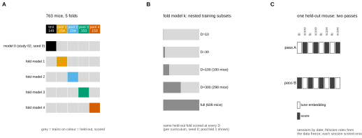
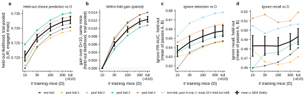
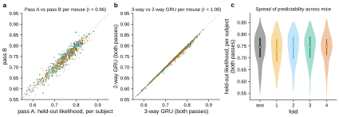
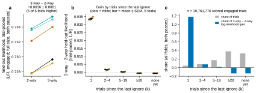
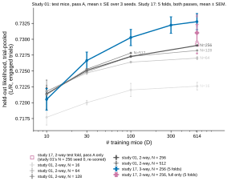
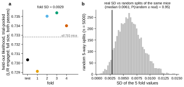
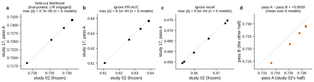
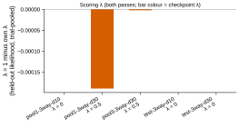
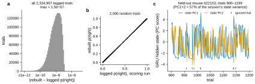

# r1 — Every fold gains from more training mice; mice differ far more than folds

## Question

How well does the GRU predict a mouse it never saw, and does that hold for every mouse, not only
the 149 test mice that every earlier held-out number spent? Studies 01 and 02 measured held-out
prediction once, on one split; a model ranking, a scaling curve or a per-mouse residual built on
that split could reflect which mice happened to be in it.

## Answer

- **F1.** Held-out likelihood (trial-pooled, left/right on engaged trials) rises from D = 10 to full size in all 5 folds, by +0.0123 ± 0.0007 within each fold's own mice (mean ± SEM, n = 5 folds).
- **F2.** Predictability is a property of the mouse: per-mouse held-out likelihood spans 0.623 to 0.825 (5th to 95th percentile, n = 763 mice), and the two disjoint halves of each mouse's sessions agree (Pearson r = 0.96).
- **F3.** The 3-way GRU predicts left/right better than the 2-way GRU in all 5 folds (+0.0016 ± 0.0001, SEM over folds), and the gain sits on the first engaged trial after an ignore: +0.034 there, where 4.5% of trials carry 118% of the gain.
- **F4.** The fold-to-fold spread (SD 0.0029) is within which-mice sampling (random 5-way splits of the same mice: median SD 0.0061, P(random ≥ real) = 0.95); the original test fold scores 0.0024 below all 763 mice.

## Methods

<!-- BEGIN methods -->

**Fig. M1. Design.** **a**, the 763 mice in 5 folds; each fold model trains on the other 4 folds and scores its own. **b**, nested training subsets per fold (D = 10, 30, 100, 300, full). **c**, the two scoring passes.

| fact | value |
|---|---|
| mice | 763 (data snapshot `20260603`) |
| folds | test 149, pool 1–4: 154, 154, 153, 153 mice |
| sessions with a role | 22,478 (fit 11,437, score 11,041) |
| models scored | 32 (3-way: 27, 2-way: 5); hidden size 256 |
| checkpoint | `best_eval`, scored at its own session λ (Supplementary S2) |
| passes | A: tune on fit sessions, score on score sessions; B: swapped. Each session is scored once |
| estimand | held-out likelihood, trial-pooled: `exp(Σ log p / n)` over scored trials, L/R on engaged trials; per fold, both passes pooled |
| uncertainty | mean ± SEM over the 5 folds (n = folds; one model per fold and D, seed 0) |
<!-- END methods -->

As in the study methods ([README](../../README.md), [PLAN](../../PLAN.md)). In short: the 763
mice are split into 5 folds. The test fold is the freeze's 149 test mice; its models are study 02's
(`nxd-3way`, H256) and study 01's (2-way). Each pool fold has its own models, trained on the other
4 folds with study 02's recipe (3-way, and 2-way at full size). A *held-out* score works as in
studies 01/02: the network is frozen, only the new mouse's subject embedding (a short vector that
tells the shared network which mouse it is predicting) is fine-tuned on half of that mouse's
sessions (`500` steps, learning rate `1e-3`, all held-out mice of a fold together), and the other
half is scored. Two passes swap the halves (Fig. M1c), so every session is scored once.

*Held-out likelihood, trial-pooled* ([glossary](../../../../CONTEXT.md#metric-heldout-likelihood-trial-pooled))
is `exp(Σ log p / n)` over every scored trial: the geometric-mean probability the model gave to
the choice the mouse made. Chance is `0.5` for left/right. Here it is left/right on engaged trials,
so 3-way and 2-way models are compared on the same trials. *SEM over folds* treats each fold's
value as one measurement (n = 5); it carries both model-to-model and which-mice variation.

## Results

### F1 — Held-out prediction rises with training mice in every fold

<!-- BEGIN result-1 -->

**Fig. 1. Cross-validated scaling.** **a**, held-out likelihood, trial-pooled (L/R, engaged), vs training mice D; thin lines = folds, black = mean ± SEM (5 folds); dashed = test fold, pass A only (study 02's held-out half). **b**, gain over D = 10 within each fold (same mice at every D). **c**, ignore PR-AUC. **d**, ignore recall (p_ignore ≥ 0.5). c and d: mean of passes A and B.

| D | held-out likelihood | gain over D = 10 | ignore PR-AUC | ignore recall |
|---|---|---|---|---|
| 10 | 0.7205 ± 0.0017 | +0.0000 ± 0.0000 | 0.6361 ± 0.0061 | 0.4833 ± 0.0111 |
| 30 | 0.7266 ± 0.0013 | +0.0061 ± 0.0006 | 0.6457 ± 0.0062 | 0.4834 ± 0.0103 |
| 100 | 0.7303 ± 0.0013 | +0.0098 ± 0.0007 | 0.6521 ± 0.0061 | 0.4831 ± 0.0093 |
| 300 | 0.7322 ± 0.0013 | +0.0117 ± 0.0007 | 0.6566 ± 0.0062 | 0.4879 ± 0.0087 |
| full | 0.7328 ± 0.0013 | +0.0123 ± 0.0007 | 0.6578 ± 0.0061 | 0.4932 ± 0.0086 |

Mean ± SEM over n = 5 folds. Gain at full size per fold: test +0.0140, pool_1 +0.0118, pool_2 +0.0108, pool_3 +0.0107, pool_4 +0.0140. Verdict: **rises in every fold**.
<!-- END result-1 -->

### F2 — Predictability is a stable property of the mouse

<!-- BEGIN result-2 -->

**Fig. 2. The per-mouse predictability map (full-size models).** **a**, held-out likelihood per mouse, pass A vs pass B (two disjoint halves of the mouse's sessions). **b**, 3-way vs 2-way GRU per mouse (both passes). **c**, per-mouse held-out likelihood by fold (violin: distribution; bar: interquartile range; dot: median).

| quantity | value |
|---|---|
| mice | 763 |
| per-mouse held-out likelihood, 5th / 50th / 95th percentile | 0.6233 / 0.7448 / 0.8247 |
| per-mouse SD | 0.0621 |
| pass A vs pass B, Pearson r (n = 763 mice) | 0.961 |
| 3-way vs 2-way, Pearson r (n = 760 mice) | 0.999 |
<!-- END result-2 -->

### F3 — The 3-way GRU's left/right gain sits on the first trial after an ignore

<!-- BEGIN result-3 -->

**Fig. 3. Where the 3-way GRU beats the 2-way GRU.** Full-size models, both passes, scored engaged trials. **a**, per fold, 2-way and 3-way held-out likelihood (L/R). **b**, 3-way − 2-way by trials since the last ignore (dots: folds; bar: mean ± SEM, 5 folds). **c**, share of trials and share of the log-likelihood gain.

| engaged trial | share of trials | 3-way − 2-way (mean ± SEM, 5 folds) | share of gain |
|---|---|---|---|
| 1st | 4.5% | +0.0337 ± 0.0004 | 118% |
| 2nd–4th | 7.8% | +0.0015 ± 0.0002 | 8% |
| 5th–19th | 17.2% | +0.0002 ± 0.0001 | 1% |
| 20th or later | 37.6% | −0.0006 ± 0.0000 | -13% |
| before any ignore | 32.8% | −0.0007 ± 0.0000 | -13% |

All engaged trials: +0.0016 ± 0.0001 (SEM, n = 5 folds); verdict: **3-way higher in every fold**.

**Fig. 4. Study 17's models on study 01's 2-way scaling curves.** Grey: study 01's 2-way GRU per hidden size N (test mice, pass A, mean ± SE over 3 seeds; read from study 01's `nxd_scaling.json`). Blue: study 17's 3-way curve; purple: study 17's full-size 2-way models (5 folds, both passes, mean ± SEM). Open square: study 01's N = 256, D = 614, seed-0 run re-scored by study 17 (pass A, 146 of its 149 test mice): 0.72918 vs study 01's 3-seed mean 0.72902.
<!-- END result-3 -->

### F4 — The folds differ no more than random sets of mice would

<!-- BEGIN result-4 -->

**Fig. 5. Fold-to-fold spread vs random splits.** **a**, the 5 fold values (full-size 3-way, both passes) and the value over all 763 mice pooled. **b**, SD of the 5 fold values when the same mice (each scored by its own fold model) are reassigned to 5 random folds of the real sizes, 5,000 times; black line = real SD.

| quantity | value |
|---|---|
| SD of the 5 real fold values | 0.0029 |
| SD under random splits: median (95% range) | 0.0061 (0.0024–0.0111) |
| P(random SD ≥ real SD) | 0.95 |
| test fold − all mice | −0.0024 |

Verdict: the fold spread is **within which-mice sampling**.
<!-- END result-4 -->

## Supplementary

Validation and housekeeping: checks that the numbers above are the ones they claim to be.

### S1 — Scoring reproduces study 02

<!-- BEGIN supp-1 -->

**Fig. S1. Study 17's scoring reproduces study 02.** **a–c**, study 02's 6 test-fold models (D = 10, 30, 100, full seeds 0–2) re-scored by study 17 on pass A vs study 02's frozen held-out metrics. **d**, pass B vs pass A.

| metric | max abs difference vs study 02 | n models |
|---|---|---|
| held-out likelihood, trial-pooled (L/R) | 4.7e−05 | 6 |
| ignore PR-AUC | 8.1e−04 | 6 |
| ignore recall | 6.5e−04 | 6 |

Pass A − pass B, held-out likelihood: +0.0030 (mean over the same models).
<!-- END supp-1 -->

### S2 — The choice of session λ at scoring hardly matters

<!-- BEGIN supp-2 -->

**Fig. S2. Session λ at scoring.** Models whose best_eval checkpoint has a session-curriculum λ below 1, scored at their own λ (the study's rule) and at λ = 1 (the in-training fine-tune's value in studies 01/02).

| model | checkpoint λ | own λ | λ = 1 | λ = 1 − own |
|---|---|---|---|---|
| pool1-3way-d10 | 0 | 0.717343 | 0.717343 | +0.000000 |
| pool1-3way-d30 | 0.5 | 0.723237 | 0.723047 | −0.000189 |
| pool3-3way-d30 | 0.5 | 0.729351 | 0.729349 | −0.000002 |
| test-3way-d10 | 0 | 0.716353 | 0.716353 | +0.000000 |
| test-3way-d30 | 0 | 0.723675 | 0.723675 | +0.000000 |
<!-- END supp-2 -->

### S3 — Held-out models and their latents can be rebuilt from W&B

<!-- BEGIN supp-3 -->

**Fig. S3. A fine-tuned held-out model rebuilt from W&B alone reproduces its scoring run** (pool4-3way-full, pass A; wrapper PR #130). **a**, |rebuilt − logged p(right)| over every logged trial. **b**, rebuilt vs logged. **c**, rebuilt GRU hidden states of one held-out session (first two principal components).

| check | value |
|---|---|
| logged trials matched 1:1 | 2,334,957 of 2,334,957 |
| max abs difference, p(left/right/ignore) | 1.5e−07 |
| readout of the states vs the logits, max abs error | 5.7e−06 |
<!-- END supp-3 -->

### S4 — Models scored

<!-- BEGIN supp-4 -->
**Table S4. Models scored** (`scores.json`; each scored in passes A and B).

| model | D | way | seed | best_eval step | checkpoint λ | held-out mice | source run |
|---|---|---|---|---|---|---|---|
| pool1-2way-full | full | 2way | 0 | 90000 | 1 | 154 | `NeuralDynamics/dfbfm_17-gru-crossfit-predictability/pool-folds-2way-20261113-112505-f522d37b` |
| pool1-3way-d10 | 10 | 3way | 0 | 10000 | 0 | 154 | `NeuralDynamics/dfbfm_17-gru-crossfit-predictability/scaling-folds-20261113-015941-efd8ee9d` |
| pool1-3way-d100 | 100 | 3way | 0 | 60000 | 1 | 154 | `NeuralDynamics/dfbfm_17-gru-crossfit-predictability/scaling-folds-20261113-005618-52d14219` |
| pool1-3way-d30 | 30 | 3way | 0 | 40000 | 0.5 | 154 | `NeuralDynamics/dfbfm_17-gru-crossfit-predictability/scaling-folds-20261113-015432-3bf72a82` |
| pool1-3way-d300 | 300 | 3way | 0 | 90000 | 1 | 154 | `NeuralDynamics/dfbfm_17-gru-crossfit-predictability/scaling-folds-20261113-015410-00c0c3b5` |
| pool1-3way-full | full | 3way | 0 | 90000 | 1 | 154 | `NeuralDynamics/dfbfm_17-gru-crossfit-predictability/pool-folds-20261113-005356-806aa10d` |
| pool2-2way-full | full | 2way | 0 | 90000 | 1 | 154 | `NeuralDynamics/dfbfm_17-gru-crossfit-predictability/pool-folds-2way-20261113-112505-14c74354` |
| pool2-3way-d10 | 10 | 3way | 0 | 20000 | 0 | 154 | `NeuralDynamics/dfbfm_17-gru-crossfit-predictability/scaling-folds-20261113-045923-71928b3c` |
| pool2-3way-d100 | 100 | 3way | 0 | 70000 | 1 | 154 | `NeuralDynamics/dfbfm_17-gru-crossfit-predictability/scaling-folds-20261113-005618-8756e767` |
| pool2-3way-d30 | 30 | 3way | 0 | 30000 | 0 | 154 | `NeuralDynamics/dfbfm_17-gru-crossfit-predictability/scaling-folds-20261113-015432-6e84e407` |
| pool2-3way-d300 | 300 | 3way | 0 | 90000 | 1 | 154 | `NeuralDynamics/dfbfm_17-gru-crossfit-predictability/scaling-folds-20261113-015410-907db7bd` |
| pool2-3way-full | full | 3way | 0 | 90000 | 1 | 154 | `NeuralDynamics/dfbfm_17-gru-crossfit-predictability/pool-folds-20261113-005356-f914d6fe` |
| pool3-2way-full | full | 2way | 0 | 90000 | 1 | 153 | `NeuralDynamics/dfbfm_17-gru-crossfit-predictability/pool-folds-2way-20261113-112505-3a05f9bd` |
| pool3-3way-d10 | 10 | 3way | 0 | 20000 | 0 | 153 | `NeuralDynamics/dfbfm_17-gru-crossfit-predictability/scaling-folds-20261113-015432-488efb62` |
| pool3-3way-d100 | 100 | 3way | 0 | 70000 | 1 | 153 | `NeuralDynamics/dfbfm_17-gru-crossfit-predictability/scaling-folds-20261113-005618-49a491d9` |
| pool3-3way-d30 | 30 | 3way | 0 | 40000 | 0.5 | 153 | `NeuralDynamics/dfbfm_17-gru-crossfit-predictability/scaling-folds-20261113-015432-7cc36a4b` |
| pool3-3way-d300 | 300 | 3way | 0 | 90000 | 1 | 153 | `NeuralDynamics/dfbfm_17-gru-crossfit-predictability/scaling-folds-20261113-015410-00a4e8e3` |
| pool3-3way-full | full | 3way | 0 | 90000 | 1 | 153 | `NeuralDynamics/dfbfm_17-gru-crossfit-predictability/pool-folds-20261113-005356-8cefb6d1` |
| pool4-2way-full | full | 2way | 0 | 90000 | 1 | 153 | `NeuralDynamics/dfbfm_17-gru-crossfit-predictability/pool-folds-2way-20261113-015357-52417094` |
| pool4-3way-d10 | 10 | 3way | 0 | 20000 | 0 | 153 | `NeuralDynamics/dfbfm_17-gru-crossfit-predictability/scaling-folds-20261113-015432-d7240f02` |
| pool4-3way-d100 | 100 | 3way | 0 | 70000 | 1 | 153 | `NeuralDynamics/dfbfm_17-gru-crossfit-predictability/scaling-folds-20261113-005618-48d8261d` |
| pool4-3way-d30 | 30 | 3way | 0 | 30000 | 0 | 153 | `NeuralDynamics/dfbfm_17-gru-crossfit-predictability/scaling-folds-20261113-015432-a9ffbc17` |
| pool4-3way-d300 | 300 | 3way | 0 | 90000 | 1 | 153 | `NeuralDynamics/dfbfm_17-gru-crossfit-predictability/scaling-folds-20261113-015410-be483b7f` |
| pool4-3way-full | full | 3way | 0 | 90000 | 1 | 153 | `NeuralDynamics/dfbfm_17-gru-crossfit-predictability/pool-folds-20261113-005356-e41da10d` |
| test-2way-full-s0 | full | 2way | 0 | 90000 | 1 | 146 | `AIND-disRNN/mice_data_scaling/nxd-grid-20260623-102649-78e14bfc` |
| test-3way-d10 | 10 | 3way | 0 | 20000 | 0 | 149 | `AIND-disRNN/mice_ignore_scaling/zo86jzng` |
| test-3way-d100 | 100 | 3way | 0 | 70000 | 1 | 149 | `AIND-disRNN/mice_ignore_scaling/8s29y3nc` |
| test-3way-d30 | 30 | 3way | 0 | 30000 | 0 | 149 | `AIND-disRNN/mice_ignore_scaling/nxd-3way-20260708-231938-66540faa` |
| test-3way-d300 | 300 | 3way | 0 | 90000 | 1 | 149 | `NeuralDynamics/dfbfm_17-gru-crossfit-predictability/scaling-folds-20261113-015420-118d9c82` |
| test-3way-full-s0 | full | 3way | 0 | 90000 | 1 | 149 | `AIND-disRNN/mice_ignore_scaling/nxd-3way-20260707-075401-80a6d102` |
| test-3way-full-s1 | full | 3way | 1 | 90000 | 1 | 149 | `AIND-disRNN/mice_ignore_scaling/nxd-3way-20260707-075401-3c79d1d1` |
| test-3way-full-s2 | full | 3way | 2 | 90000 | 1 | 149 | `AIND-disRNN/mice_ignore_scaling/nxd-3way-20260707-075401-a3171d8e` |

Not scored: 10 λ = 1 jobs of λ = 0 checkpoints, cancelled because λ cannot change those (their session weights are zero; Fig. S2).
<!-- END supp-4 -->

## What it means

**The scaling result is not an artefact of one split (F1, F4).** Studies 01 and 02 measured the
gain from more training mice on one set of 149 test mice. Rotating the held-out set over all 763
mice gives the same picture in every fold: each fold's own mice are predicted better as D grows,
and most of the gain is reached by D ≈ 100–300 (Fig. 1b). The folds differ in level, but no more
than random sets of mice do (F4), so the level differences are about which mice a fold holds, not
about the models.

**Mice, not models, set most of the variation (F2).** The spread across mice (Fig. 2c) is several
times the whole gain from 10 to about 610 training mice (F1). A mouse's score from one half of its
sessions predicts its score from the other half, so the per-mouse map is a stable measurement: it
can serve as the per-mouse ceiling and residual map for every mouse, which is what study 41 and
MEvolve's scientist mode need. Every mouse now has a held-out GRU prediction, not only the test 149.

**The ignore class helps left/right prediction only right after an ignore (F3).** A 2-way GRU never
sees ignored trials, so it cannot know that the mouse just disengaged. The 3-way GRU does, and its
advantage is concentrated on the first engaged trial afterwards; far from an ignore it is slightly
worse. This fits the earlier reading that mice change strategy after an ignore (for example, a
reset of action values), but F3 locates the gain; it does not show what the change is.

**For the leaderboard (F4).** The original test split is a fair sample of mice for comparing models
on the same mice: the which-mice effect cancels in a difference, and the 3-way minus 2-way gap has
the same sign in every fold (Fig. 3a). Its absolute level is slightly below the all-mice value, so
an absolute "GRU predictability" is better quoted as the 5-fold mean.

## Caveats

- **One model per fold and D (seed 0).** The SEM over folds mixes two sources: which mice a fold
  holds, and the training run. Seeds 1–2 exist only for the test fold's full-size model (Fig. S1).
- **The folds' models have different origins.** The test fold's models are study 02's and study
  01's runs; the pool folds' were trained for this study with the same recipe (Beaker, H200). A
  platform or code-version effect would show up as a fold effect; F4 finds none larger than mouse
  sampling, but it cannot rule out a small one.
- **Pass B scores lower than pass A** for the same models (Fig. S1d). Both passes are pooled here, so
  every session counts once; the reason for the difference is not known.
- **F3 is a location, not a mechanism.** That the gain sits right after an ignore does not show
  that the mouse resets its values; that needs a model of what changes, for example from the
  held-out latents (Fig. S3c).
- **The 2-way models exist only at full size,** so there is no cross-validated 2-way scaling curve;
  Fig. 4 places the 2-way models against study 01's single-split curves instead, which used pass A
  only and so sit on a slightly different footing (Fig. S1d).
- **Ignore recall** (Fig. 1d) depends on a fixed threshold (`0.5`) and varies between folds more than
  it changes with D; read Fig. 1c (PR-AUC) for ignore detection.

## Next

1. Register the per-mouse predictability map (per-trial, per-session, per-mouse) as the shared
   reference for study 41 and MEvolve scientist mode.
2. Leaderboard: add a mouse bootstrap to every model-minus-GRU gap on the test split, so each gap
   carries the which-mice uncertainty.
3. Test the post-ignore mechanism with the held-out latents (Fig. S3): does the 3-way GRU's state
   move toward a reset after an ignore?

## Provenance

Scoring runs: W&B project [`NeuralDynamics/dfbfm_17-gru-crossfit-predictability`](https://wandb.ai/NeuralDynamics/dfbfm_17-gru-crossfit-predictability),
groups `scoring@20261114-034950`, `scoring@20261114-081940`, `scoring@20261114-092226` (launch
records and the `:v1` artifact backfill under `variants/scoring/launch_record/`). Training groups:
the study README's variants table. Frozen inputs: `analysis/scores.json` (`make freeze-scoring`),
`analysis/ignore_split.json` (`make freeze-ignore-split`), `analysis/rebuild_check.json`
(`make freeze-rebuild-check`). Reproduce the report with `make -C studies/17-gru-crossfit-predictability r1`.
