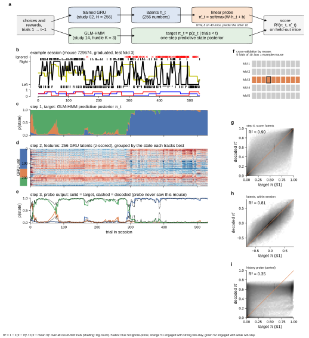
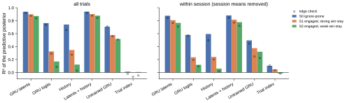
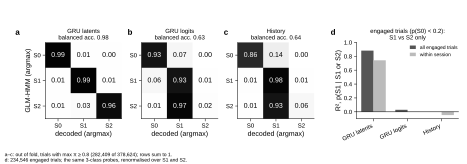
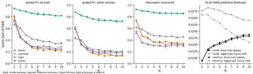
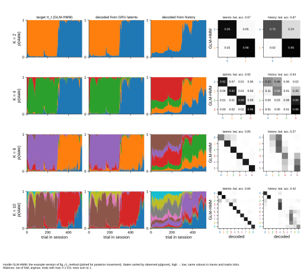
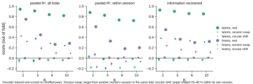
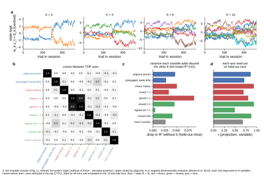
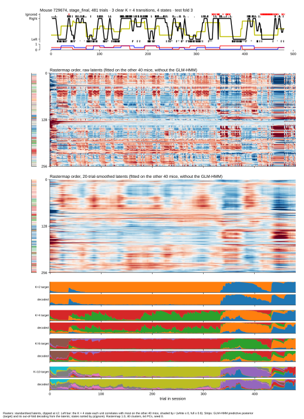
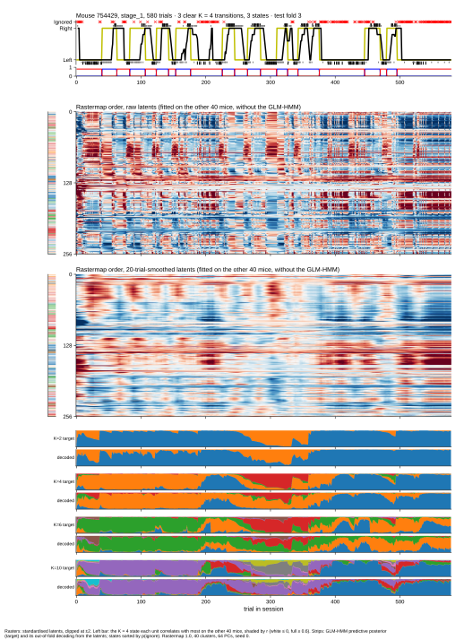
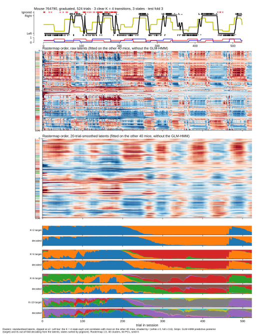

# r1 — Pilot: GLM-HMM states decoded from GRU latents on training mice

**Question.** Study 02's 3-way GRU was trained only to predict the next choice. Study 14's GLM-HMM explains
the same trials with K discrete states. Can a linear readout of the GRU's hidden vector recover the GLM-HMM's
state probabilities trial by trial, beyond what the GRU's own prediction and simple choice/reward history carry?
Does this hold as K grows, and is it more than a generic slow-signal artefact?

**Method.** Figure a–i below walks through one trial and one session.
- **Target.** The GLM-HMM's one-step predictive state posterior, π_t = p(z_t | trials < t). Study 14's saved
  `filtered_k` is p(z_t | trials ≤ t): it already contains trial t's choice, which the GRU has not seen. The
  predictive posterior is filtered_{t−1} · A (result-1).
- **Features.** The GRU hidden vector h_t (256 numbers) that predicts trial t, z-scored with the training-fold
  mean and SD.
- **Decoder.** π̂_t = softmax(W·h_t + b): a one-layer softmax network (multinomial logistic regression) fitted to
  the soft target by cross-entropy, L2 penalty fixed in advance, L-BFGS.
- **Cross-validation.** By mouse: 5 folds of 10 mice. The decoder never sees the mice it is scored on.
- **Scores.** *Pooled R²*: the share of the posterior's variance the decoder reproduces, summed over states.
  *Within session*: the same after removing each session's mean from target and prediction, so only changes
  inside a session count. *Information recovered*: 1 − KL(decoder) / KL(best constant guess), the same idea for
  probability distributions.
- **Baselines.** The same decoder on the GRU's 3 output logits; on history features (the GLM-HMM's 40 lag
  regressors, running averages of ignore and reward over 10, 50 and 200 trials, and trial number); on latents
  plus history; on the untrained GRU; on trial number alone.
- **Shuffle nulls.** *Session swap*: pair each session's latents with another mouse's session. *Circular
  shift*: rotate the target in time within its own session. The decoder is trained and scored on the shuffled
  pairs.

<!-- BEGIN result-1 -->
|  | value |
|---|---|
| GRU | study 02 3-way, H256 / D614 / seed 0, run `nxd-3way-20260707-075401-80a6d102` (W&B `AIND-disRNN/mice_ignore_scaling`), artifact `gru-output-nxd-3way-20260707-075401-80a6d102:v0` digest `585e7419016aa3399e3b58406b1a94db`, step 90,000 |
| GLM-HMM | study 14 hurdle and reference K = 2–10, L = 10, global parameters for every mouse (groups `hurdle@20261027-212905`, `reference@20261027-213006`) |
| mice / data | 50 GRU-training mice, odd (eval) sessions only: 702 sessions, 378,624 trials (snapshot 20260603, ignores included) |
| cross-validation | 5 folds of 10 mice (GroupKFold, seed 0); every score is out of fold |
| target | one-step predictive posterior p(z_t | trials < t) |
| decoder | softmax linear readout, soft labels, L2 0.0001 on z-scored features |
| likelihood on these trials | GRU 0.6294, GLM-HMM (K = 3, global) 0.6133; GRU better on 61 % of trials |
| saved `filtered_k` (study 14) | = p(z_t | trials ≤ t), max diff 3.5e-07; differs from the predictive posterior by up to 0.84 |

<!-- END result-1 -->

## Result 2 — the latents decode all three K = 3 states; history and the GRU's own output decode only engagement

<!-- BEGIN result-2 -->
K = 3 hurdle, per-state R² (S0 ignore-prone / S1 engaged strong win-stay / S2 engaged weak win-stay), out of fold. Within-session share of the target's variance: 42 % / 44 % / 46 %.

| features | R² all trials | R² within session | KL (nats) |
|---|---|---|---|
| GRU latents | 0.94 / 0.90 / 0.87 | 0.88 / 0.81 / 0.77 | 0.066 |
| GRU logits | 0.76 / 0.33 / 0.17 | 0.58 / 0.24 / 0.12 | 0.352 |
| History | 0.74 / 0.35 / 0.12 | 0.59 / 0.24 / 0.06 | 0.422 |
| Latents + history | 0.94 / 0.90 / 0.88 | 0.88 / 0.82 / 0.78 | 0.064 |
| Untrained GRU | 0.71 / 0.58 / 0.52 | 0.50 / 0.38 / 0.32 | 0.271 |
| Trial index | 0.01 / 0.00 / 0.01 | 0.10 / 0.05 / −0.02 | 0.653 |

<!-- END result-2 -->

## Result 3 — the decoded state is more than engagement

<!-- BEGIN result-3 -->
| features | balanced acc. (max π ≥ 0.8) | S2 → S2 | engaged-only R², S1 vs S2 | within session |
|---|---|---|---|---|
| GRU latents | 0.98 | 0.96 | 0.88 | 0.74 |
| GRU logits | 0.63 | 0.02 | 0.03 | 0.00 |
| History | 0.64 | 0.06 | −0.00 | −0.05 |

<!-- END result-3 -->

## Result 4 — across K, the latents stay readable while every baseline collapses

<!-- BEGIN result-4 -->
Hurdle emission; pooled R² all trials / within session (reference agrees within ±0.03, figure). The untrained-GRU probe hit the 1,000-iteration cap in every fold (unconverged fits).

| K | run | GLM-HMM lik. | latents | untrained GRU | GRU logits | history |
|---|---|---|---|---|---|---|
| 2 | bax62c47 | 0.6089 | 0.94 / 0.88 | 0.67 / 0.44 | 0.79 / 0.60 | 0.75 / 0.60 |
| 3 | u4j7ukti | 0.6133 | 0.91 / 0.82 | 0.61 / 0.41 | 0.46 / 0.34 | 0.45 / 0.33 |
| 4 | 8crhqlqk | 0.6147 | 0.89 / 0.80 | 0.49 / 0.29 | 0.37 / 0.24 | 0.37 / 0.26 |
| 5 | gpqv6sub | 0.6157 | 0.86 / 0.76 | 0.42 / 0.24 | 0.27 / 0.17 | 0.29 / 0.21 |
| 6 | nxvyn933 | 0.6163 | 0.84 / 0.73 | 0.40 / 0.23 | 0.24 / 0.15 | 0.26 / 0.18 |
| 7 | qqgkv2yu | 0.6174 | 0.84 / 0.74 | 0.37 / 0.21 | 0.29 / 0.19 | 0.29 / 0.21 |
| 8 | xdpnnxs9 | 0.6175 | 0.83 / 0.74 | 0.38 / 0.23 | 0.25 / 0.15 | 0.29 / 0.21 |
| 9 | 8r9ltf6k | 0.6181 | 0.82 / 0.72 | 0.34 / 0.20 | 0.23 / 0.14 | 0.25 / 0.18 |
| 10 | 3gknqru4 | 0.6182 | 0.82 / 0.72 | 0.35 / 0.21 | 0.25 / 0.14 | 0.28 / 0.20 |

<!-- END result-4 -->

## Result 5 — shuffle nulls: the decoding follows this session's state at this moment

<!-- BEGIN result-5 -->
Pooled R² all trials / within session; nulls as mean (max within-session value, number of shuffles).

| features | K | real | session swap | circular shift |
|---|---|---|---|---|
| latents | 2 | 0.94 / 0.88 | −0.04 / 0.03 (max within 0.04, n = 5) | 0.43 / −0.18 (max within −0.17, n = 5) |
| latents | 3 | 0.91 / 0.82 | −0.05 / −0.01 (max within −0.01, n = 10) | 0.37 / −0.19 (max within −0.18, n = 10) |
| latents | 6 | 0.84 / 0.73 | −0.04 / −0.01 (max within −0.00, n = 5) | 0.29 / −0.18 (max within −0.18, n = 5) |
| latents | 10 | 0.82 / 0.72 | −0.04 / −0.01 (max within −0.01, n = 5) | 0.24 / −0.17 (max within −0.17, n = 5) |
| history | 2 | 0.75 / 0.60 | 0.00 / 0.07 (max within 0.08, n = 5) | 0.32 / −0.17 (max within −0.16, n = 5) |
| history | 3 | 0.45 / 0.33 | −0.01 / 0.01 (max within 0.02, n = 10) | 0.19 / −0.11 (max within −0.10, n = 10) |
| history | 6 | 0.26 / 0.18 | −0.00 / 0.02 (max within 0.02, n = 5) | 0.10 / −0.06 (max within −0.06, n = 5) |
| history | 10 | 0.28 / 0.20 | −0.00 / 0.01 (max within 0.01, n = 5) | 0.09 / −0.06 (max within −0.06, n = 5) |

<!-- END result-5 -->

## Result 6 — where the state sits in the population

<!-- BEGIN result-6 -->
| measure | value |
|---|---|
| TDR full model, held-out R² of the population | 0.61 |
| unique R² (drop without it): p(ignore-prone) + p(engaged, weak WS) | 0.05 + 0.03 |
| unique R² (drop without it): ignore t−1 / choice history / reward t−1 | 0.09 / 0.05 / 0.05 |
| cosine, choice t−1 vs ignore t−1 axes | 0.90 |
| top 6 PCs: variance / slow share (20-trial average, complete sessions) | PC1 29 % / 0.64, PC2 13 % / 0.77, PC3 10 % / 0.64, PC4 8 % / 0.71, PC5 6 % / 0.30, PC6 4 % / 0.93 |
| Rastermap seed stability (Spearman of embeddings, raw / smooth) | 0.55 / 0.54 |

<!-- END result-6 -->

## Result 7 — example sessions with clear state transitions

<!-- BEGIN result-7 -->
All five sessions are in test fold 3. Sessions 1–4 were ranked by clear K = 4 transitions (max π ≥ 0.8, runs ≥ 20 trials, one session per mouse).

| mouse | stage | trials | why shown |
|---|---|---|---|
| 729674 | graduated | 532 | showcase: the session with the most posterior movement |
| 798839 | stage_1 | 754 | 4 clear K = 4 transitions, 3 states |
| 729674 | stage_final | 481 | 3 clear K = 4 transitions, 4 states |
| 754429 | stage_1 | 580 | 3 clear K = 4 transitions, 3 states |
| 764790 | graduated | 524 | 3 clear K = 4 transitions, 3 states |

<!-- END result-7 -->

## What it says

- **The GRU learned the variables the GLM-HMM uses to define its states.** A linear readout of its latents
  recovers the predictive state posterior on mice the readout never saw (result 2). It recovers the two engaged
  states, which differ in how strongly the mouse follows reward history, at R² near 0.9. The GRU's own output
  and linear history features decode them at chance (result 3).
- **The link holds at every K.** As K grows, the extra states split engaged behaviour by history-reliance.
  The latents keep pooled R² above 0.8; every baseline falls to about 0.25 (result 4).
- **It is not a generic slow-signal artefact.** Within a session, the real score is 0.72–0.88. Paired with another
  mouse's session, or shifted in time, it is at most 0.03 (result 5). The circular shift keeps part of the
  all-trials score, because each session's average state survives the rotation and the latents know the mouse
  and session.
- **The state is a small population direction.** Choice and outcome dominate the latents' variance, and
  engagement is the next visible structure. The state axes are nearly orthogonal to the choice and reward axes
  and add about 7 % unique variance (result 6). An unsupervised sort (Rastermap) shows choice and engagement,
  but not history-reliance; the trained readout finds it.
- **This is evidence for shared variables, not for discrete states.** The K = 10 posterior decodes almost as well
  as K = 3, although study 14's per-mouse score selects K = 3. Any real function of past behaviour also beats the
  shuffle nulls, including the linear history features. Whether the mouse switches between discrete modes or
  drifts is still open.

## Side findings

- **`filtered_k` includes trial t.** Any analysis that predicts trial t from study 14's saved posteriors must use
  filtered_{t−1} · A, or it leaks the answer (result-1).
- **The 3-way GRU gets the previous choice as one number (0 = left, 1 = right, 2 = ignore).** An ignore enters as
  an "extra-right" choice. The TDR axes for choice t−1 and ignore t−1 have cosine 0.9 (result 6). The wrapper
  needs a one-hot encoding, and study 30 should repeat this report on a one-hot 3-way GRU.

## Limitations

- **Training mice only.** The decoder is held out by mouse, but the GRU and the GLM-HMM global fit saw these
  mice's even sessions, and GRU early stopping used these odd sessions.
- **One GRU** (H256 / D614 / seed 0) and the GLM-HMM's **global** parameters, not per-mouse refits.
- **Linear history baseline only.** The GLM-HMM posterior is a nonlinear recursion over the whole session, so the
  fair claim is linear readability. A nonlinear history decoder is the next control.
- **The untrained-GRU baseline** hit the iteration cap in every fold and has no subject or session context.
- **Few shuffles** (5–10 per cell); the nulls are tight, so this does not limit the conclusion.
- **Example sessions are selected** (result 7); the scores pool every trial.

## Next steps

1. Repeat on the 149 held-out mice (redo the GRU's 500-step embedding fine-tune offline, without writing to
   W&B), with per-mouse GLM-HMM refits and their state labels aligned across mice.
2. More GRU seeds and sizes, and a one-hot 3-way GRU.
3. A nonlinear history decoder (small MLP or gradient boosting).
4. Tests of discreteness: bimodality and transition sharpness along the decoded axes, dwell-time shape.
5. Decoding error against trials since the last ignore or reward (the misses in result 7).
6. Embeddings: do the GRU's per-mouse embeddings predict per-mouse GLM-HMM parameters?
