# r1 — The GRU's latents carry the GLM-HMM's state posterior at every K, beyond engagement (training mice)

## Question

Study 02's 3-way GRU was trained only to predict the next choice; study 14's GLM-HMM explains the same
trials with K discrete states. Does the GRU's hidden state contain, in linearly readable form, the
GLM-HMM's belief about which state the mouse is in, beyond what the GRU's own prediction and simple
choice and reward history carry? If it does, the expressive model and the interpretable one describe the
same behavioural variables, and the GLM-HMM's states can be used to read the GRU.

## Answer

- **F1.** At every K from 2 to 10, a linear readout of the GRU latents recovers the GLM-HMM's predictive state posterior on mice it never saw (pooled R² at least 0.82 [0.80, 0.83] and within session at least 0.72 [0.70, 0.73], both lowest at K = 9; 95% intervals over n = 50 mice), while the GRU's own logits and linear history fall to 0.25 [0.21, 0.28] and 0.28 [0.24, 0.32] at K = 10.
- **F2.** The decoded state is more than engagement: on engaged trials at K = 3, the latents separate the two engaged states (S1 vs S2 R² 0.88 [0.86, 0.90]), but the GRU's logits (0.03 [−0.04, 0.07]) and linear history (0.00 [−0.07, 0.06]) do not (95% intervals over n = 50 mice).
- **F3.** The decoding follows this session's state at this moment: within session the latents score 0.72 to 0.88 (K = 2, 3, 6, 10), while every session-swap and circular-shift null stays at or below 0.04 (5 to 10 shuffles per cell).
- **F4.** Readability does not single out K = 3, the K that study 14's per-mouse refit score favours: the latents' pooled R² declines steadily with K and is only 0.09 [0.08, 0.10] lower at K = 10 than at K = 3 (paired 95% interval over n = 50 mice), so r1 shows shared variables, not a preferred number of discrete states.

## Methods

<!-- BEGIN methods -->
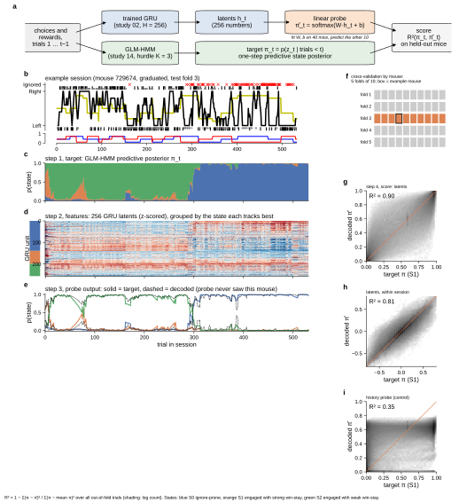

**Fig. M1. Method**, on one trial and one example session (test fold, a mouse the decoder never saw).

| fact | value |
|---|---|
| GRU | study 02 3-way, H256 / D614 / seed 0 (single seed), run `nxd-3way-20260707-075401-80a6d102` (W&B `AIND-disRNN/mice_ignore_scaling`), artifact `gru-output-nxd-3way-20260707-075401-80a6d102:v0` digest `585e7419016aa3399e3b58406b1a94db`, step 90,000 |
| GLM-HMM | study 14 hurdle K = 2–10, L = 10, global parameters for every mouse (groups `hurdle@20261027-212905`; reference emission `reference@20261027-213006`, dashed in Fig. 1 only) |
| mice and trials | 50 GRU-training mice, odd (eval) sessions only: 702 sessions, 378,624 trials (snapshot 20260603, ignores included) |
| cross-validation | 5 folds of 10 mice (GroupKFold, seed 0); every score is out of fold |
| target | one-step predictive state posterior π_t = p(z_t | trials < t) |
| decoder | softmax linear readout, soft labels, L2 0.0001 on z-scored features |
| interval | 95% percentile interval over 1,000 resamples of the 50 mice (seed 0); population analysis (SupFig. 1): 10 test mice, or 40 training mice for the axis cosine |
<!-- END methods -->

As in the study methods ([README](../../README.md), Design), on the training-mice pilot
([`variants/training-mice-pilot`](../../variants/training-mice-pilot/notes.md)). The target is the
GLM-HMM's one-step **predictive state posterior** π_t = p(z_t | trials < t)
([CONTEXT.md](../../CONTEXT.md), predictive posterior): the probability of each state before trial t's
choice, the same information the GRU's hidden state h_t has when it predicts trial t. The decoder is a
**softmax linear readout**: a one-layer network (multinomial logistic regression) that maps h_t to K
state probabilities, fitted to the soft target by cross-entropy. Three scores
([CONTEXT.md](../../CONTEXT.md), probe scores): **pooled R²**, the share of the posterior's variance
the decoder reproduces, summed over states; the same **within session**, after removing each session's
mean from target and prediction, so that only changes inside a session count; and **information
recovered**, 1 − KL(decoder) / KL(best constant guess). Baselines get the same decoder: the GRU's own
3 output logits, linear history features (the GLM-HMM's 40 lag regressors, running averages of ignores
and rewards, trial number), latents plus history, the untrained GRU, and trial number alone.

Uncertainty: a **bootstrap over mice** resamples the 50 mice with replacement 1,000 times and
re-scores the fixed out-of-fold predictions; the interval is the 2.5th to 97.5th percentile. It captures
which mice were sampled, not GRU seed (one seed) or GLM-HMM refit variability. The out-of-fold
predictions were regenerated for every probe (`analysis/oof_r1.py`) because the pilot saved them for
latents and history only; every refit reproduces the pilot's scores (the freeze asserts it).

## Results

### Fig. 1 — At every K the latents decode the state posterior; the GRU's output and history do not keep up (F1)

<!-- BEGIN result-1 -->
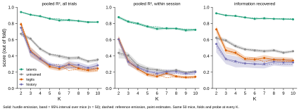

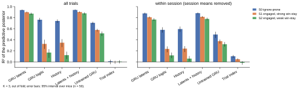

**Fig. 1.** Pooled R² of the predictive posterior, out of fold, hurdle emission (dashed in the K-scan panels: reference emission, point estimates). Bars and bands: 95% interval over mice (n = 50). The untrained-GRU probe reached the 1,000-iteration cap in 43 of 45 fits (unconverged).

Pooled R², all trials [95% interval over mice]:

| K | GRU latents | untrained GRU | GRU logits | history |
|---|---|---|---|---|
| 2 | 0.94 [0.93, 0.95] | 0.67 [0.64, 0.70] | 0.79 [0.76, 0.82] | 0.75 [0.72, 0.77] |
| 3 | 0.91 [0.90, 0.92] | 0.61 [0.59, 0.63] | 0.46 [0.40, 0.51] | 0.45 [0.39, 0.50] |
| 4 | 0.89 [0.88, 0.90] | 0.49 [0.46, 0.51] | 0.37 [0.33, 0.40] | 0.37 [0.32, 0.40] |
| 5 | 0.86 [0.85, 0.87] | 0.42 [0.40, 0.44] | 0.27 [0.24, 0.29] | 0.29 [0.26, 0.32] |
| 6 | 0.84 [0.82, 0.85] | 0.40 [0.38, 0.41] | 0.24 [0.21, 0.26] | 0.26 [0.23, 0.29] |
| 7 | 0.84 [0.83, 0.86] | 0.37 [0.34, 0.39] | 0.29 [0.25, 0.33] | 0.29 [0.24, 0.34] |
| 8 | 0.83 [0.82, 0.84] | 0.38 [0.36, 0.40] | 0.25 [0.21, 0.28] | 0.29 [0.25, 0.32] |
| 9 | 0.82 [0.80, 0.83] | 0.34 [0.31, 0.35] | 0.23 [0.20, 0.25] | 0.25 [0.21, 0.29] |
| 10 | 0.82 [0.81, 0.83] | 0.35 [0.33, 0.37] | 0.25 [0.21, 0.28] | 0.28 [0.24, 0.32] |

Pooled R², within session (session means removed) [95% interval over mice]:

| K | GRU latents | untrained GRU | GRU logits | history |
|---|---|---|---|---|
| 2 | 0.88 [0.86, 0.89] | 0.44 [0.37, 0.49] | 0.60 [0.56, 0.65] | 0.60 [0.56, 0.65] |
| 3 | 0.82 [0.81, 0.84] | 0.41 [0.36, 0.44] | 0.34 [0.29, 0.37] | 0.33 [0.28, 0.37] |
| 4 | 0.80 [0.79, 0.81] | 0.29 [0.25, 0.32] | 0.24 [0.21, 0.27] | 0.26 [0.23, 0.29] |
| 5 | 0.76 [0.75, 0.78] | 0.24 [0.22, 0.27] | 0.17 [0.15, 0.19] | 0.21 [0.18, 0.24] |
| 6 | 0.73 [0.72, 0.75] | 0.23 [0.20, 0.25] | 0.15 [0.13, 0.17] | 0.18 [0.15, 0.21] |
| 7 | 0.74 [0.73, 0.76] | 0.21 [0.19, 0.22] | 0.19 [0.16, 0.21] | 0.21 [0.17, 0.23] |
| 8 | 0.74 [0.72, 0.75] | 0.23 [0.21, 0.24] | 0.15 [0.13, 0.17] | 0.21 [0.18, 0.23] |
| 9 | 0.72 [0.70, 0.73] | 0.20 [0.18, 0.21] | 0.14 [0.12, 0.15] | 0.18 [0.16, 0.20] |
| 10 | 0.72 [0.71, 0.74] | 0.21 [0.19, 0.22] | 0.14 [0.13, 0.16] | 0.20 [0.18, 0.23] |

K = 3, per state (S0 ignore-prone / S1 engaged strong win-stay / S2 engaged weak win-stay) [95% interval]:

| features | R² all trials | R² within session | KL (nats) |
|---|---|---|---|
| GRU latents | 0.94 [0.93, 0.95] / 0.90 [0.89, 0.91] / 0.87 [0.85, 0.89] | 0.88 [0.86, 0.89] / 0.81 [0.79, 0.82] / 0.77 [0.74, 0.79] | 0.066 [0.061, 0.071] |
| GRU logits | 0.76 [0.73, 0.80] / 0.33 [0.24, 0.40] / 0.17 [0.07, 0.23] | 0.58 [0.53, 0.63] / 0.24 [0.17, 0.28] / 0.12 [0.07, 0.17] | 0.352 [0.319, 0.385] |
| History | 0.74 [0.71, 0.77] / 0.35 [0.27, 0.41] / 0.12 [0.05, 0.19] | 0.59 [0.54, 0.64] / 0.24 [0.18, 0.29] / 0.06 [0.02, 0.11] | 0.422 [0.379, 0.470] |
| Latents + history | 0.94 [0.93, 0.95] / 0.90 [0.89, 0.91] / 0.88 [0.85, 0.90] | 0.88 [0.86, 0.90] / 0.82 [0.80, 0.83] / 0.78 [0.75, 0.80] | 0.064 [0.059, 0.068] |
| Untrained GRU | 0.71 [0.68, 0.73] / 0.58 [0.55, 0.60] / 0.52 [0.47, 0.55] | 0.50 [0.43, 0.55] / 0.38 [0.33, 0.40] / 0.32 [0.28, 0.36] | 0.271 [0.258, 0.284] |
| Trial index | 0.01 [−0.04, 0.04] / 0.00 [−0.03, 0.02] / 0.01 [−0.03, 0.03] | 0.10 [0.08, 0.12] / 0.05 [0.03, 0.07] / −0.02 [−0.05, 0.01] | 0.653 [0.611, 0.701] |

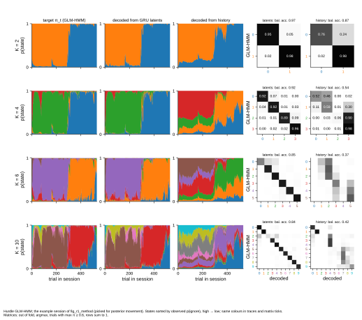
<!-- END result-1 -->

### Fig. 2 — The decoded state is more than engagement (F2)

<!-- BEGIN result-2 -->
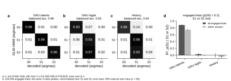

**Fig. 2.** K = 3. a–c: confusion on trials with max π ≥ 0.8 (n = 282,409 trials). d: engaged trials (π_S0 < 0.2, n = 234,546), the 3-class decoder renormalised over S1 and S2; bars with 95% interval over mice (n = 50).

| features | balanced acc. (max π ≥ 0.8) | S2 → S2 | engaged-only R², S1 vs S2 | within session |
|---|---|---|---|---|
| GRU latents | 0.98 [0.97, 0.98] | 0.96 [0.94, 0.97] | 0.88 [0.86, 0.90] | 0.74 [0.72, 0.76] |
| GRU logits | 0.63 [0.62, 0.64] | 0.02 [0.00, 0.04] | 0.03 [−0.04, 0.07] | 0.00 [−0.02, 0.02] |
| History | 0.64 [0.61, 0.67] | 0.06 [0.00, 0.17] | 0.00 [−0.07, 0.06] | −0.05 [−0.09, −0.01] |
<!-- END result-2 -->

### Fig. 3 — Shuffle nulls: the decoding follows this session's state at this moment (F3)

<!-- BEGIN result-3 -->
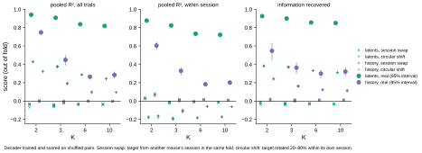

**Fig. 3.** Decoder trained and scored on shuffled pairs (n shuffles per cell in the table). Session swap: target from another mouse's session in the same fold. Circular shift: target rotated 20–80% within its own session. Real scores with 95% interval over mice.

Pooled R² within session: real [95% interval over mice]; nulls as mean (range over shuffles, n shuffles).

| features | K | real | session swap | circular shift |
|---|---|---|---|---|
| latents | 2 | 0.88 [0.86, 0.89] | 0.03 (range 0.03 to 0.04, n = 5) | −0.18 (range −0.18 to −0.17, n = 5) |
| latents | 3 | 0.82 [0.81, 0.84] | −0.01 (range −0.03 to −0.01, n = 10) | −0.19 (range −0.20 to −0.18, n = 10) |
| latents | 6 | 0.73 [0.72, 0.75] | −0.01 (range −0.01 to 0.00, n = 5) | −0.18 (range −0.19 to −0.18, n = 5) |
| latents | 10 | 0.72 [0.71, 0.74] | −0.01 (range −0.02 to −0.01, n = 5) | −0.17 (range −0.18 to −0.17, n = 5) |
| history | 2 | 0.60 [0.56, 0.65] | 0.07 (range 0.06 to 0.08, n = 5) | −0.17 (range −0.18 to −0.16, n = 5) |
| history | 3 | 0.33 [0.28, 0.37] | 0.01 (range −0.01 to 0.02, n = 10) | −0.11 (range −0.12 to −0.10, n = 10) |
| history | 6 | 0.18 [0.15, 0.21] | 0.02 (range 0.01 to 0.02, n = 5) | −0.06 (range −0.06 to −0.06, n = 5) |
| history | 10 | 0.20 [0.18, 0.23] | 0.01 (range 0.01 to 0.01, n = 5) | −0.06 (range −0.06 to −0.06, n = 5) |
<!-- END result-3 -->

### Fig. 4 — Readability does not pick K (F4)

<!-- BEGIN result-4 -->
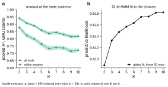

**Fig. 4.** a: the latents' decoding of the K-state posterior declines steadily with K. b: the GLM-HMM's predictive likelihood: the global fit on these trials rises with K; study 14's per-mouse refit score, the one it selects K by, peaks at K = 3.

|  | pooled R², all trials | pooled R², within session |
|---|---|---|
| GRU latents, K = 3 | 0.91 [0.90, 0.92] | 0.82 [0.81, 0.84] |
| GRU latents, K = 10 | 0.82 [0.81, 0.83] | 0.72 [0.71, 0.74] |
| difference, K = 3 − K = 10 (paired) | 0.09 [0.08, 0.10] | 0.10 [0.09, 0.12] |

Intervals: 95% over mice (n = 50); the difference resamples the same mice for both K. Fig. 1 shows every K.
<!-- END result-4 -->

## Supplementary

### SupFig. 1 — Where the state sits in the population

<!-- BEGIN supp-1 -->
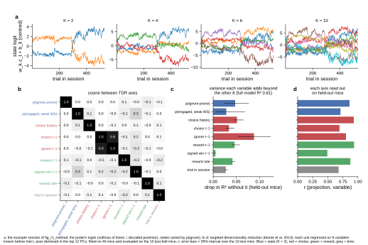

**SupFig. 1.** Targeted dimensionality reduction (TDR): each latent unit regressed on 9 variables known before trial t, fitted on 40 mice, scored on the 10 test-fold mice. b and d: point estimates of one fit.

| measure | value [95% interval] |
|---|---|
| held-out R² of the population, full model (n = 10 test mice) | 0.61 [0.57, 0.62] |
| unique R² (drop without it): p(ignore-prone) | 0.05 [0.02, 0.08] |
| unique R²: p(engaged, weak WS) | 0.03 [0.01, 0.07] |
| unique R²: ignore t−1 | 0.09 [0.05, 0.12] |
| unique R²: choice history | 0.05 [0.04, 0.07] |
| unique R²: reward t−1 | 0.05 [0.04, 0.06] |
| cosine, choice t−1 vs ignore t−1 axes (n = 40 training mice) | 0.90 [0.88, 0.92] |
<!-- END supp-1 -->

### SupFig. 2 — Example sessions with clear state transitions

<!-- BEGIN supp-2 -->
All five sessions are in test fold 3. Sessions 1–4 were ranked by clear K = 4 transitions (max π ≥ 0.8, runs ≥ 20 trials, one session per mouse); they are examples, not scores.

| mouse | stage | trials | why shown |
|---|---|---|---|
| 729674 | graduated | 532 | showcase: the session with the most posterior movement |
| 798839 | stage_1 | 754 | 4 clear K = 4 transitions, 3 states |
| 729674 | stage_final | 481 | 3 clear K = 4 transitions, 4 states |
| 754429 | stage_1 | 580 | 3 clear K = 4 transitions, 3 states |
| 764790 | graduated | 524 | 3 clear K = 4 transitions, 3 states |

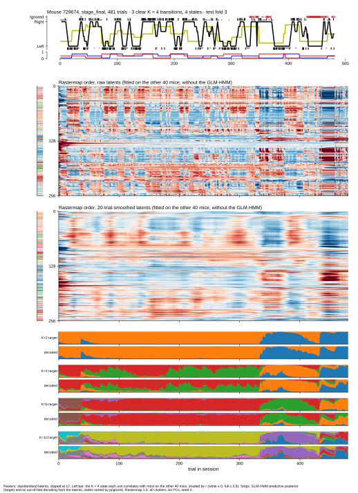
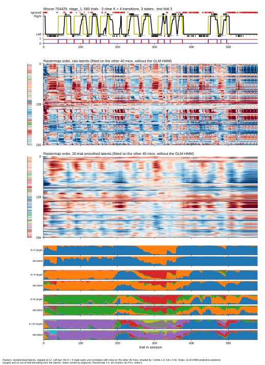
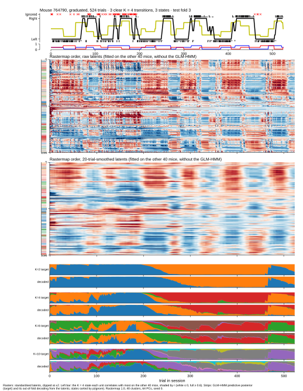
<!-- END supp-2 -->

### SupFig. 3 — Study 14's saved `filtered_k` includes trial t

<!-- BEGIN supp-3 -->
| check | value |
|---|---|
| study 14's saved `filtered_k` vs p(z_t | trials ≤ t), recomputed (one held-out mouse, 6,730 trials) | max abs difference 3.5e-07 |
| the same `filtered_k` vs the predictive posterior p(z_t | trials < t) | max abs difference 0.84 |
<!-- END supp-3 -->

Any analysis that predicts trial t from study 14's saved posteriors must use filtered_{t−1} · A, or it
leaks trial t's choice into the predictor. r1 uses the predictive posterior throughout.

## What it means

- **The GRU learned the variables the GLM-HMM uses to define its states (F1, F2).** A linear readout
  of its hidden state recovers the GLM-HMM's state belief on mice the readout never saw, including the
  split between the two engaged states, which differ in how strongly the mouse follows reward history.
  The GRU's own output and linear history features carry engagement but not that split.
- **It is not a generic slow-signal artefact (F3).** The decoder fails when the target comes from
  another mouse's session or is shifted in time within the same session, so it tracks this session's
  state at this moment. The circular shift keeps part of the all-trials score because a session's average
  state survives the rotation.
- **This is evidence for shared variables, not for discrete states (F4).** The readout recovers the
  K = 10 posterior nearly as well as the K = 3 one, and its score has no peak at the K that study 14's
  per-mouse refit selects (Fig. 4b).
  Whether the mouse switches between discrete modes or drifts along these variables is open.
- **The state is a small direction in the population (SupFig. 1).** Choice and outcome dominate the
  latents' variance; the state variables add a small unique share on held-out mice. The axes for
  "choice t−1" and "ignore t−1" are nearly parallel: the 3-way GRU receives the previous choice as one
  number (0 = left, 1 = right, 2 = ignore), so an ignore enters as an "extra-right" choice. A one-hot
  input would separate them.

## Caveats

- **Training mice, internal validation.** The decoder is held out by mouse, but the GRU learned these
  mice's subject embeddings from their even sessions, GRU early stopping used these odd sessions
  (eval likelihood rose at every checkpoint, so the final checkpoint was chosen and the selection had no
  effect), and the GLM-HMM global fit used their even sessions ([PLAN.md](../../PLAN.md), leakage
  audit). The held-out variant removes all three.
- **One GRU** (single seed) and the GLM-HMM's **global** parameters, not per-mouse refits. The
  intervals cover mouse sampling only.
- **Linear readout and linear history baseline.** The GLM-HMM posterior is a nonlinear recursion over
  the whole session, so the claim is linear readability; a nonlinear history decoder could close part of
  the gap in F1 and F2.
- **The untrained-GRU decoder** reached the iteration cap in most fits (Fig. 1 caption) and has no
  subject or session context, so its score is a loose baseline.
- **Few shuffles** per null cell (Fig. 3 table); the nulls are far below the real scores.
- **Selected examples.** SupFig. 2's sessions were chosen for clear transitions; every score pools all
  trials.
- **SupFig. 1** comes from one TDR fit; its intervals cover test-mouse sampling (and training-mouse
  sampling for the cosine), not the choice of regressors or the 12-PC denoising.

## Next

Repeat on the 149 held-out mice (variant `heldout-mice`, report r2): GRU embeddings fine-tuned offline with study 02's recipe, and per-mouse GLM-HMM refits with state
labels matched across mice ([PLAN.md](../../PLAN.md)). Then more GRU seeds, a one-hot 3-way GRU and a
nonlinear history decoder.

## Provenance

GRU: study 02 run
[`nxd-3way-20260707-075401-80a6d102`](https://wandb.ai/AIND-disRNN/mice_ignore_scaling/runs/nxd-3way-20260707-075401-80a6d102)
(group `nxd-3way@20260707-075401`). GLM-HMM: study 14 groups
[`hurdle@20261027-212905`](https://wandb.ai/AIND-disRNN/mice_glmhmm/groups/hurdle@20261027-212905) and
[`reference@20261027-213006`](https://wandb.ai/AIND-disRNN/mice_glmhmm/groups/reference@20261027-213006).
Frozen inputs: `analysis/frozen_r1.json` and `analysis/frozen_r1_sessions.npz` (`make freeze-r1`, which
reads the pilot's scratch outputs and the out-of-fold refit, each by sha256). Reproduce with
`make -C studies/30-gru-vs-glmhmm-latents r1`.
