# r1 — Gate 4: program recovery on simulated mice

**Question.** Before the real search, can MEvolve recover what it is meant to find? Gate 4 (PLAN)
asks this twice. First half: does the 2-level EM fitter recover the typical values and spreads that
generated simulated mice? Second half: does a short search, on mice simulated from a known program,
reach that program's own score within 0.2 (×100)? This report also compares the search with and
without seed programs, and checks two ways to avoid refitting repeated programs.

**Answer.** Yes, on both halves, for $4 of Claude. The fitter recovers Hattori2019 (two other models
are known limits of 2-level EM). Both searches pass: the seeded one at proposal 3, the one without
seeds at proposal 71, where Claude invented the missing slow reward trace itself.

## First half: the fitter recovers simulated parameters

<!-- BEGIN result-1 -->
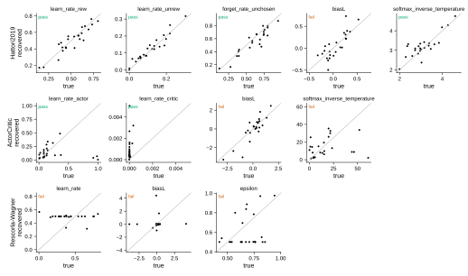

True against recovered typical values of 24 simulated subjects per model, 2-level EM (MEvolve 85de84f, at most 100 EM iterations). Errors are medians on the probit scale. A parameter passes when its 2-level error is at most the per-subject fit's on the same data (criterion amended 2026-11-03), a parameter on a bound is recovered within 0.05 of its range, and the median spread ratio is within [1/2, 2].

| model | parameter | subjects off bound | 2-level error | per-subject error | spread ratio | criteria |
|---|---|---|---|---|---|---|
| Hattori2019 | learn_rate_rew | 24 | 0.114 | 0.237 | 0.83 | pass |
| Hattori2019 | learn_rate_unrew | 22 | 0.090 | 0.401 | 0.73 | pass |
| Hattori2019 | forget_rate_unchosen | 24 | 0.139 | 0.243 | 0.76 | pass |
| Hattori2019 | biasL | 24 | 0.031 | 0.026 | – | fail |
| Hattori2019 | softmax_inverse_temperature | 24 | 0.029 | 0.039 | 0.51 | pass |
| ActorCritic | learn_rate_actor | 24 | 0.381 | 0.668 | 0.85 | pass |
| ActorCritic | learn_rate_critic | 0 | – | – | – | pass |
| ActorCritic | biasL | 24 | 0.084 | 0.065 | 0.83 | fail |
| ActorCritic | softmax_inverse_temperature | 23 | 0.360 | 0.861 | 1.02 | fail |
| Rescorla-Wagner | learn_rate | 24 | 0.519 | 0.407 | 586.53 | fail |
| Rescorla-Wagner | biasL | 24 | 0.047 | 0.115 | 570.61 | fail |
| Rescorla-Wagner | epsilon | 24 | 0.489 | 0.671 | 492.97 | fail |

Pooled held-out likelihood ×100 on the same simulated subjects, and the share of subjects whose 2-level fit converged:

| model | 2-level | per subject | converged |
|---|---|---|---|
| Hattori2019 | 64.27 | 63.09 | 92% |
| ActorCritic | 70.88 | 68.98 | 25% |
| Rescorla-Wagner | 51.10 | 50.40 | 0% |
<!-- END result-1 -->

## The test bed: a hand-set generating program

The generating program, `variants/gate4-recovery/generator/two_timescale_ck.py`, has a fast and a
slow reward trace for each side (learned on the chosen side), a choice kernel and a side bias:
7 parameters, 5 latent variables. Its values are hand-set (`make_truths.py`), the same for every
simulated mouse, with a spread of 0.3 on the probit scale per session; only session counts and
lengths come from real mice (Han, 2026-11-04). It is in neither the seeds nor the prompt, and the
literature library is off, because Lopez-DoubleTrace already has two timescales. The reference,
scored but never shown, is the same program without its slow trace.

<!-- BEGIN result-2 -->
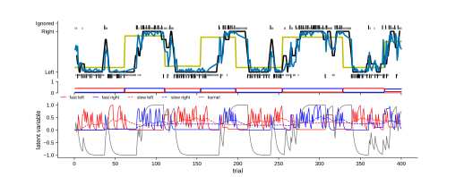

One session from the generator at setting a (rate_fast 0.6, rate_slow 0.05, weight_fast 3, weight_slow 6, kernel_rate 0.3, kernel_weight 1.5, bias_right 0.2), 400 trials, seed 1: choices with the generator's p(right), and its latent variables below (right blue, left red; slow traces dashed, kernel grey).

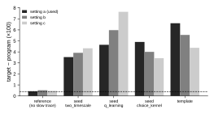

Pre-check on the simulated validation mice: each program's margin below the target. The dashed line is the stop rule (0.4). Every program is outside it in every setting, so the pre-registered order picks setting a.

| program | setting a | setting b | setting c |
|---|---|---|---|
| target `two_timescale_ck` (its score) | 72.928 | 78.437 | 84.596 |
| `one_timescale_ck` | 0.429 | 0.522 | 0.458 |
| `two_timescale` | 3.529 | 3.915 | 4.327 |
| `q_learning` | 4.645 | 5.973 | 7.639 |
| `choice_kernel` | 4.906 | 4.006 | 3.433 |
| `template` | 6.601 | 5.538 | 4.370 |
<!-- END result-2 -->

## The two searches

Both use the same simulated mice, target, prompt, evaluator and budget (100 proposals by Claude
Sonnet 5.5 at effort medium, one repair attempt per edit, $8 cap). The seeded arm starts four
islands from the template and three simplified seeds; the other starts one island from the
template alone.

<!-- BEGIN result-3 -->
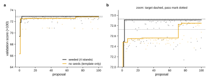

Best validation score so far against proposals (lines) and every proposal (dots). Target 72.928, pass mark 72.728 (one-sided). One run per arm: no run-to-run variance was measured.

| arm | best | at proposal | first at the pass mark | gate 4 | held-out winner | held-out target | cost | Claude calls | hours | failed edits |
|---|---|---|---|---|---|---|---|---|---|---|
| seeded (4 islands) | 72.910 | 3 | 3 | pass | 72.632 | 72.634 | $1.93 | 103 | 3.74 | 1 |
| no seeds (template only) | 72.847 | 75 | 71 | pass | 72.615 | 72.634 | $2.10 | 109 | 3.65 | 2 |
<!-- END result-3 -->

### The two searches in Shinka's portal

Screenshots of ShinkaEvolve's web portal for each run's W&B archive ([how they were made](../screenshots/README.md)).
In the tree, each node is a program and each edge goes from parent to child; colour is the score, the
badge names the island, and the orange line runs to the best program. In the score trace, red dots are
single proposals, blue is the best so far, green the mean so far, and orange the best program's ancestors.

**Seeded (4 islands: I0 the template, I1 to I3 the simplified seeds q_learning, choice_kernel and
two_timescale).** The best program came at proposal 3, one edit from the two_timescale seed (I3),
and nothing after it scored higher.

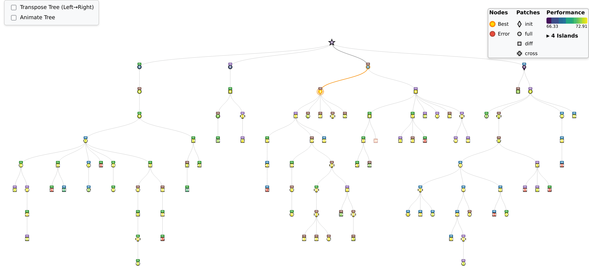

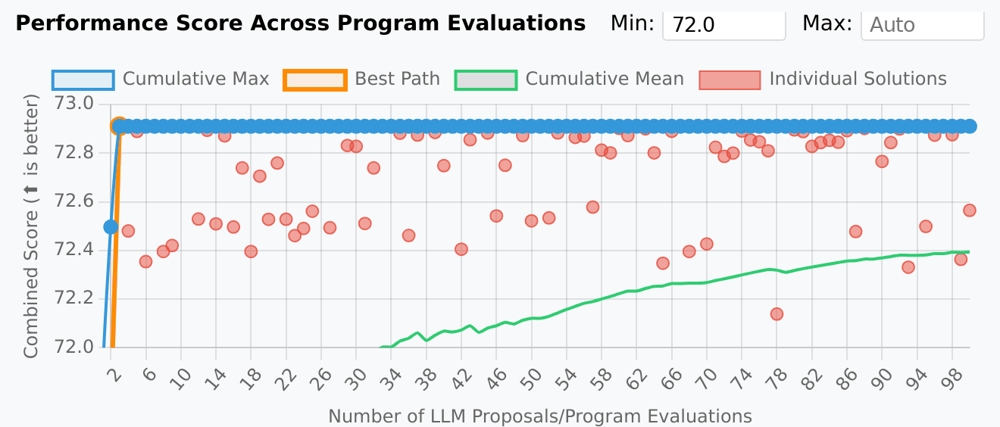

Seeded: the best program's ancestors, with Claude's hypothesis for each edit

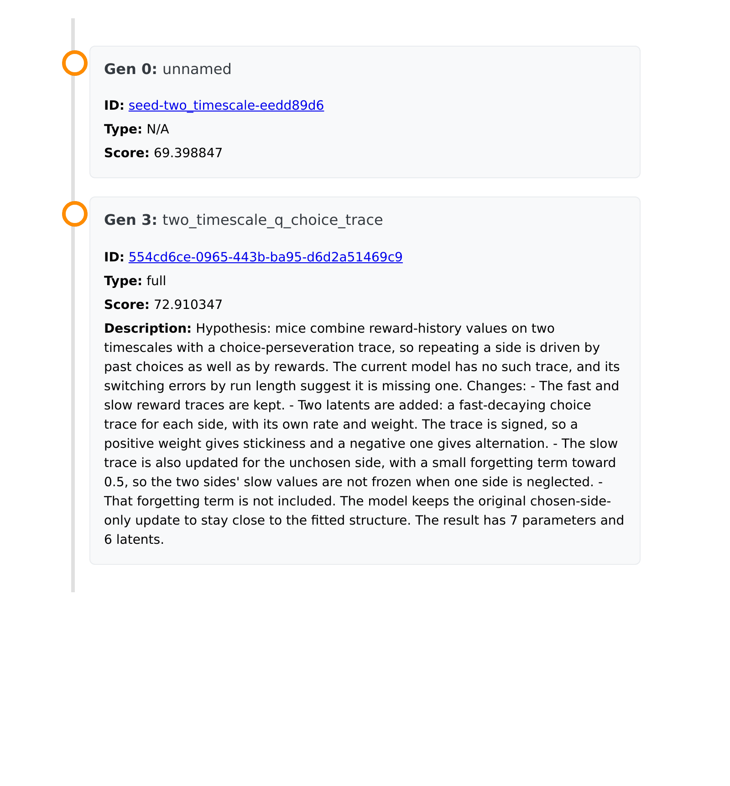

**No seeds (1 island, the template only).** The best so far climbs in steps. The large step is
proposal 71, which gave the values two learning rates (the slow reward trace the target has); proposal
75, its sibling from the same parent (53), scored a little higher and is the best.

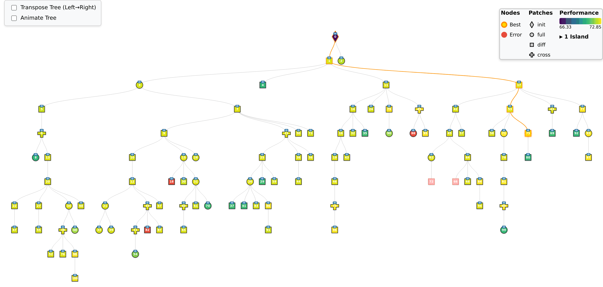

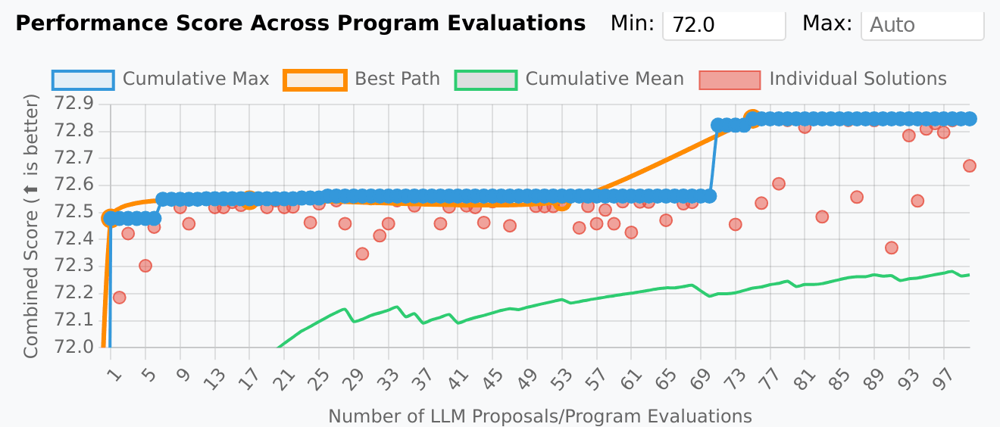

No seeds: the best program's ancestors, with Claude's hypothesis for each edit

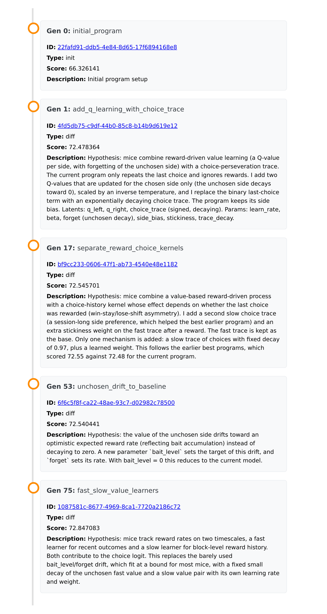

## Mechanisms: what the best programs contain

<!-- BEGIN result-4 -->
The starting programs and every program that set a new best score. Mechanisms read by hand from each program's code (kept in `analysis/gate4/runs.json`). The generator has a slow reward trace and a choice kernel, with 7 parameters.

| arm | proposal | program | score | parameters | slow reward trace | choice kernel | what it is |
|---|---|---|---|---|---|---|---|
| seeded (4 islands) | 0 | `q_learning` | 68.283 | 3 |  |  | seed: one reward value per side |
| seeded (4 islands) | 0 | `choice_kernel` | 68.022 | 3 |  | yes | seed: choice kernel, no reward learning |
| seeded (4 islands) | 0 | `two_timescale` | 69.399 | 5 | yes |  | seed: fast and slow reward values |
| seeded (4 islands) | 0 | `initial_program` | 66.326 | 2 |  |  | template: side bias and last choice |
| seeded (4 islands) | 1 | `q_learning_plus_choice_trace` | 71.822 | 5 |  | yes | one reward value with forgetting, choice trace |
| seeded (4 islands) | 2 | `q_learning_plus_choice_trace` | 72.496 | 6 |  | yes | the same, rewritten |
| seeded (4 islands) | 3 | `two_timescale_q_choice_trace` | 72.910 | 7 | yes | yes | fast and slow reward values, choice trace: the generator |
| no seeds (template only) | 0 | `initial_program` | 66.326 | 2 |  |  | template: side bias and last choice |
| no seeds (template only) | 1 | `add_q_learning_with_choice_trace` | 72.478 | 6 |  | yes | one reward value with forgetting, choice trace |
| no seeds (template only) | 7 | `two_timescale_choice_trace` | 72.549 | 6 |  | yes | adds a slow choice trace |
| no seeds (template only) | 12 | `forgetting_unchosen_q` | 72.552 | 7 |  | yes | unchosen value decays |
| no seeds (template only) | 23 | `fast_slow_trace_value_drift` | 72.554 | 6 |  | yes | crossover: two choice traces, value drift |
| no seeds (template only) | 26 | `reward_gated_choice_kernel` | 72.561 | 7 |  | yes | adds a win-stay kernel |
| no seeds (template only) | 71 | `dual_rate_values_with_choice_traces` | 72.823 | 8 | yes | yes | fast and slow reward values, two choice traces |
| no seeds (template only) | 75 | `fast_slow_value_learners` | 72.847 | 8 | yes | yes | the same, refined |
<!-- END result-4 -->

## Repeats and the novelty filter

<!-- BEGIN result-5 -->
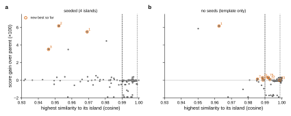

Post hoc. x: each proposal's highest code-embedding similarity to the programs on its island just before it (Alibaba-NLP/gte-modernbert-base); y: its gain over its parent (failed or unscored at the bottom). ShinkaEvolve flags everything right of its threshold (dashed 0.99, dotted 0.999) and asks an LLM novelty judge, an extra Claude call, whether to drop it; the table counts the flagged proposals, the most the filter could drop. Median similarity: seeded (4 islands) 0.991, no seeds (template only) 0.997.

| flagged above | seeded (4 islands) | no seeds (template only) |
|---|---|---|
| > 0.99 (ShinkaEvolve's default) | 52 of 99 (53%); new bests among them: none | 84 of 98 (86%); new bests among them: 12, 23, 75 |
| > 0.995 | 27 of 99 (27%); new bests among them: none | 70 of 98 (71%); new bests among them: 23 |
| > 0.999 | 2 of 99 (2%); new bests among them: none | 20 of 98 (20%); new bests among them: none |
| exact repeats (MEvolve's repeat key) | 3 scored repeats in 3 groups, 14 min of fitting | 6 scored repeats in 6 groups, 21 min of fitting |
<!-- END result-5 -->

## Compute for the main search

<!-- BEGIN result-6 -->
Measured per proposal (one 56-core job per run, two evaluations at a time, each on 24 + 24 simulated mice), and extrapolated to the PLAN's $450 search at the same rates.

| arm | Claude cost | node time | median evaluation | proposals for $450 | node-days |
|---|---|---|---|---|---|
| seeded (4 islands) | $0.0193 | 2.2 min | 4.6 min | 23,295 | 36 |
| no seeds (template only) | $0.0210 | 2.2 min | 4.1 min | 21,402 | 33 |
<!-- END result-6 -->

## What it says

*Draft, for the lead scientist's review.*

1. **Gate 4 passes.** The fitter recovers Hattori2019's typical values and spreads; its one failing
   parameter, biasL, differs from the per-subject fit by noise (accepted 2026-11-04,
   AllenNeuralDynamics/aind-dynamic-foraging-mevolve#36). ActorCritic (actor rate × temperature not
   identifiable) and Rescorla-Wagner (stepped likelihood, spreads diverge) are known limits: their
   parameters are not recovered and most of their fits do not converge, but their 2-level scores are
   still at least the per-subject fit's (the score table under the first half). Both searches reach the planted program's score within
   the tolerance, and the held-out check shows no winner's curse at this size.
2. **A recovery test needs a mechanism that clearly matters.** Two earlier designs failed this:
   with Hattori2019 as the target, a seed was within the stop rule; with Hattori2019 plus satiety
   fitted to real mice, satiety added only 0.015 (the `gate4-recovery` notes). A hand-set generator,
   calibrated with a pre-check, fixed it.
3. **The reference made the pass mark mean something.** The generator without its slow trace sits
   0.43 below the target. In both searches, programs without the slow trace stalled at that level
   (72.48 to 72.56) until the slow trace appeared; only then did the score cross the pass mark.
4. **Seeds speed discovery but were not needed here.** With the two-timescale seed, Claude added the
   missing kernel in one edit (proposal 3). With no seed and no library, it invented slow reward
   values at proposal 71. In the seeded run, the other islands got the slow trace from that seed's
   line, by migration or because it was shown as an inspiration; credit for a discovery needs the
   lineage and what Claude was shown, not only the island.
5. **Without seeds, the winner is not the simplest program.** It carries a slow choice trace the
   generator does not have (8 parameters against 7), and its docstring still describes the template.
   The simplification step and the readability checks (ADR 0005) are needed.
6. **An embedding novelty filter would hurt this program family.** All programs share one skeleton,
   so a general text embedding rates them nearly identical, and real progress sits among trivial
   edits: at ShinkaEvolve's default, more than half the proposals would go to an LLM novelty judge
   (one extra Claude call each), and a wrong verdict would lose a new best. Exact repeats are safe
   to skip: MEvolve now reuses their score (the repeat cache,
   AllenNeuralDynamics/aind-dynamic-foraging-mevolve#53).
7. **Node time, not dollars, limits the main search.** At these rates the PLAN's $450 buys over
   20,000 proposals, about a month of one node. Real mice are slower: one 48 + 48 evaluation takes
   about 3 minutes of a full node (MEvolve ADR 0004), against 2.2 minutes of node time per proposal
   here. The PLAN's "a few hundred to a thousand core-hours per search" is two orders of magnitude
   too low. The search needs a proposal budget set by node-hours, or many nodes.

**Data.** Both run directories are archived as W&B artifacts in `NeuralDynamics/dfbfm-mevolve`
(`analysis/gate4/archives.json`). The committed freeze keeps one row per program, and the code only
of the programs shown here.
