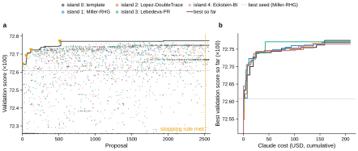
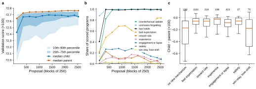
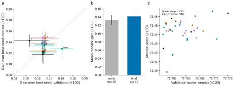

# r2 — The first production search: curve, mechanisms and gains on unseen mice

**Summary.** The first production search proposed 2,562 programs for $209 of Claude in 42 hours. Its
best program scores 72.775 on the 48 validation subjects, +0.167 over the best literature model
(Miller-RHG). Nearly all of the climb came in the first 500 proposals (about $40). After that the best
rose by only 0.004 and the search stopped by its rule. On the way, programs from all five islands
converged on one shared core: separate learning rates after reward and no reward, forgetting of the
unchosen side, a counterfactual update and a fast and a slow habit. Add-ons on top of that core
(reward rate, satiety, experience, bait expectation) rarely helped. On 100 monitor subjects the search
never saw, the early gain over the best seed holds (+0.12 to +0.15), but the late progress does not:
the final top 10 beat the early top 10 by +0.009 (95% CI −0.004 to +0.022), and validation ranks among
the best programs barely predict monitor ranks (Spearman ρ = 0.13). The differences among the top
programs are smaller than the noise of 48 subjects, so the choice among them goes to the 100 selection
subjects (ADR 0008, r3).

**Question.** How far did the first production search (`seeded-islands-2`) climb above the best
literature model, what did the programs learn on the way, and does the climb hold on subjects the
search never saw?

**Approach.** The search ran Claude proposals through MEvolve on five islands, each started from one
seed (the template or one of the four best literature models), and scored every program on the 48
validation subjects by 2-level EM (`max_em` 20). It stopped by its pre-registered rule. The run is
frozen from its archived run directory (`freeze_seeded_islands_2.py`). Programs are tagged with
mechanisms by their parameter names. To check the climb on new data, the best seed, the early top 10,
the program that set the stopping anchor and the 40 programs of the final archive were rescored on the
48 validation subjects and on 100 monitor subjects drawn apart from every other cohort (ADR 0003
amendment, issue #128; `freeze_monitor_rescoring.py`).

## 1. The search climbed early, then flattened

<!-- BEGIN result-1 -->

**2,562 proposals** (2,548 scored, 14 rejected by the static checks) cost **$209.32** of Claude in 2,564 calls over 42.5 h, with 2,563 evaluation jobs (27,313 CPU-hours). The best program, `reward_satiety_gain` (proposal 1,938, island 0), scores **72.775**, +0.167 over the best seed (Miller-RHG, 72.608). 1,773 of 2,548 scored proposals beat the best seed. 304 scored proposals repeated an earlier program and reused its score (the flat rows in a).

The stopping rule (stop when the best has not risen by 0.03 in 2,000 proposals) saw the anchor rise 4 times, 72.644 (proposal 1) → 72.690 (proposal 53) → 72.723 (proposal 118) → 72.771 (proposal 513), and was met at proposal 2,513. The one later best (proposal 1,938) is +0.0040 above the anchor, less than the rule's step.

| island | proposals | seed | best | gain |
|---|---|---|---|---|
| 0: template | 502 | 70.020 | 72.775 | +2.755 |
| 1: Miller-RHG | 522 | 72.608 | 72.769 | +0.162 |
| 2: Lopez-DoubleTrace | 515 | 72.548 | 72.766 | +0.218 |
| 3: Lebedeva-PR | 524 | 72.573 | 72.771 | +0.198 |
| 4: Eckstein-BI | 499 | 71.780 | 72.764 | +0.984 |

**Figure 1.** (a) Validation score (48 subjects, 2-level EM, `max_em` 20) of every scored proposal, by island; scores below the axis are drawn at its bottom. Line: best so far; triangles: the stopping rule's rises; dashed: the rule met. (b) Best so far per island against cumulative Claude cost.
<!-- END result-1 -->

## 2. The bulk kept rising as a shared core spread

<!-- BEGIN result-2 -->

The median scored proposal rose from 72.428 (proposals 1–250) to 72.669 (proposals 2,501–2,750), and the median parent from 72.642 to 72.763. The rise follows the spread of a shared core (counterfactual update, unchosen forgetting, two habits), whose shares went from 20%, 88%, 41% to 100%, 100%, 98%.

| mechanism (parameter names) | share, proposals 1–250 | share, last block |
|---|---|---|
| counterfactual update | 19.6% | 100.0% |
| unchosen forgetting | 88.0% | 100.0% |
| two habits | 40.8% | 98.4% |
| bait expectation | 22.0% | 83.9% |
| reward rate | 5.6% | 0.0% |
| experience | 1.2% | 9.7% |
| engagement or lapse | 6.4% | 8.1% |
| satiety | 0.4% | 0.0% |
| win-stay, lose-shift | 14.0% | 0.0% |

When a child adds one add-on mechanism to its parent, its score changes by:

| added | children | median change | IQR | share improved |
|---|---|---|---|---|
| no new mechanism | 199 | −0.173 | [−0.442, −0.052] | 0.05 |
| bait expectation | 1181 | −0.059 | [−0.114, −0.014] | 0.02 |
| reward rate | 219 | −0.059 | [−0.142, −0.018] | 0.06 |
| experience | 198 | −0.027 | [−0.115, −0.006] | 0.16 |
| engagement or lapse | 423 | −0.085 | [−0.153, −0.028] | 0.03 |
| satiety | 37 | −0.057 | [−0.115, −0.004] | 0.19 |
| win-stay, lose-shift | 75 | −0.180 | [−0.485, −0.033] | 0.11 |

**Figure 2.** (a) Score quantiles of scored proposals and the median score of their parents, per block of 250 proposals. (b) Share of scored programs whose parameter names carry each mechanism (patterns in `r2_search_curve.json`). (c) Score change from parent to child when the child adds an add-on mechanism, against children that keep the parent's mechanisms; boxes are quartiles, whiskers 1.5 IQR, outliers not drawn, numbers are children.
<!-- END result-2 -->

## 3. The early gain holds on unseen subjects; the late gain does not

<!-- BEGIN result-3 -->

**The gain over the best seed holds on unseen subjects.** On the 100 monitor subjects the early top 10 gain +0.118 to +0.148 (SE 0.011–0.024) over the best seed, and the program that set the stopping rule's anchor (`reward_rate_gated_perseveration`, proposal 527) gains +0.128 ± 0.015.

**The search's late progress does not.** The final archive's top 10 gain +0.142 on the monitor subjects, against +0.133 for the early top 10: a difference of +0.009, 95% CI [−0.004, +0.022]. Across the final archive of 40, validation and monitor ranks barely agree (Spearman ρ = 0.13; 3 of the validation top 10 are in the monitor top 10).

| program | name | proposal | gain, validation | gain, monitor | fallback subjects (val, mon) |
|---|---|---|---|---|---|
| new best | `reward_rate_gated_perseveration` | 527 | +0.162 ± 0.020 | +0.128 ± 0.015 | 0, 2 |
| top01 | `counterfactual_q_engagement_gated_habits` | 304 | +0.132 ± 0.016 | +0.136 ± 0.011 | 0, 0 |
| top02 | `reward_rate_gated_stay` | 306 | +0.129 ± 0.018 | +0.118 ± 0.012 | 1, 3 |
| top03 | `satiety_value_sensitivity` | 384 | +0.133 ± 0.023 | +0.147 ± 0.012 | 0, 0 |
| top04 | `dualrate_habit_bait_expectation` | 435 | +0.131 ± 0.018 | +0.133 ± 0.011 | 0, 2 |
| top05 | `experience_scaled_value_forager` | 314 | +0.131 ± 0.021 | +0.124 ± 0.024 | 0, 1 |
| top06 | `experience_scaled_beta` | 293 | +0.130 ± 0.022 | +0.120 ± 0.020 | 0, 3 |
| top07 | `experience_scaled_value_forager` | 318 | +0.106 ± 0.033 | +0.142 ± 0.011 | 1, 0 |
| top08 | `training_sharpens_exploitation` | 316 | +0.129 ± 0.020 | +0.148 ± 0.012 | 0, 0 |
| top09 | `experience_scaled_value_streams` | 355 | +0.129 ± 0.023 | +0.122 ± 0.021 | 0, 1 |
| top10 | `experience_scaled_value_sensitivity` | 250 | +0.128 ± 0.021 | +0.138 ± 0.011 | 0, 2 |

**Figure 3.** Programs rescored with the search's evaluator (MEvolve 761cefd, 2-level, `max_em` 20) and the per-subject fallback (tolerance 0.005 nats per trial). (a) Gain over the best seed on the 48 validation and 100 monitor subjects, ± paired bootstrap SE over subjects (2,000 resamples); numbers are early top-10 ranks. (b) Mean monitor gain of the early top 10 (proposals 250–435) and of the final archive's top 10, ± bootstrap SE. (c) The final archive's 40 programs: search validation score against monitor score, coloured by island as in Figure 1.
<!-- END result-3 -->

## Caveats

- **Search scores use `max_em` 20.** Reported scores use 100 (MEvolve ADR 0004); the selection and test
  scores in r3 are at 100. The monitor rescoring used the search's evaluator (MEvolve 761cefd) and
  applies the per-subject fallback of MEvolve 146153c offline.
- **Mechanism tags come from parameter names.** A program can carry a mechanism under another name, or
  use a name for something else; the patterns are in `r2_search_curve.json`. Shares are a guide, not a
  code audit.
- **Children score below their parents by construction.** Parents are drawn from the top of the archive,
  so most children fall back toward the bulk. Only the comparison between add-ons and children with no
  new mechanism (Figure 2c) carries information, not the sign of the change.
- **Proposal numbers.** The x axis is the proposal (submission) number. The stopping rule counts
  proposals in the order they finished, so its rises sit a few proposals off (the anchor program,
  proposal 527, is its rise at 513).
- **One search, one seed of the engine.** Nothing here measures how much a second search would differ.
