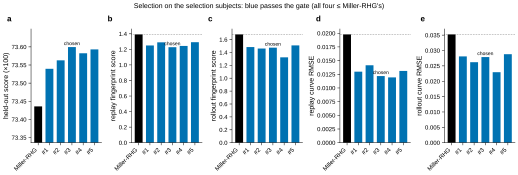
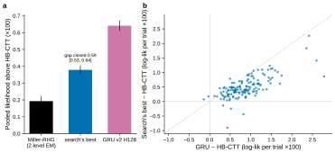
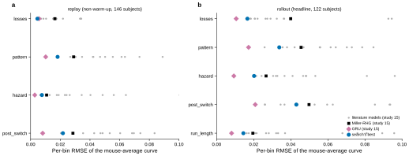

# r3 — The search's best on the selection and test subjects

**Summary.** On the 100 selection subjects all five of the search's top programs pass the behaviour
gate. Each beats Miller-RHG on held-out likelihood and on all four behaviour scores, including the error
of the mouse-average curves. The selection picks `satiety_engagement` (search rank 3; the validation
order did not hold). Scored once on the test subjects, it closes **0.59 of the gap from HB-CTT to the
GRU** (95% CI 0.53 to 0.64) on the 146 shared subjects and beats HB-CTT on 142 of them. About half of
that comes from the fitting regime, not the mechanisms: Miller-RHG fitted the same way (2-level EM,
parameters per session) already closes 0.30. On the mouse-average curves the program beats Miller-RHG
on every statistic and is close to the best literature model (better on two replay statistics, tied on
two, worse on five, most of all on rollout pattern and post-switch), but the GRU stays clearly best on
eight of the nine. The GRU still captures behaviour that no cognitive program here does.

**Question.** Of the search's top programs, which one is its best on mice it never saw, and how much of
the gap from the best hierarchical cognitive model (HB-CTT) to the GRU does it close on the test mice?
Does it also behave like the mice, as the GRU does?

**Approach.** Fixed in ADR 0008 before any selection or test score. The five top programs by validation
score, and Miller-RHG as the reference, were fitted by 2-level EM (`max_em` 100, per-subject fallback)
on 100 selection subjects drawn apart from the search's cohorts. Each also played every session's task
ten times and was replayed on the subjects' own choices. A candidate passes the gate if it is at least
as close to the subjects as Miller-RHG on four behaviour scores: study 15's replay and rollout
fingerprint scores, and the per-bin RMSE of the mouse-average curves (study 15's Figure 5 view) in
replay and rollout. Of those that pass, the highest selection score is the search's best. The
simplification design was committed next; only then was the search's best scored, once, on the 149
test subjects and on the GRU's own 149. The headline pools every model over the 146 subjects both lists
share.

## 1. All five pass the gate; the selection reorders them

<!-- BEGIN result-1 -->

All 5 candidates pass the gate: each beats Miller-RHG on all four behaviour scores, and on held-out likelihood by +0.104 to +0.164 (×100). The highest selection score, **73.599**, is `satiety_engagement` (search rank 3). The validation order did not hold: the search's rank 1 is fifth of five here, and the five span only 0.060.

| program | search rank (validation) | selection score | fallback subjects | replay score | rollout score | replay curve RMSE | rollout curve RMSE | gate |
|---|---|---|---|---|---|---|---|---|
| Miller-RHG (reference) | — | 73.436 | 0 | 1.393 | 1.680 | 0.0198 | 0.0353 | — |
| `reward_satiety_gain` | 1 (72.775) | 73.540 | 3 | 1.250 | 1.483 | 0.0130 | 0.0281 | pass |
| `reward_rate_gated_perseveration` | 2 (72.771) | 73.563 | 1 | 1.290 | 1.461 | 0.0142 | 0.0262 | pass |
| **`satiety_engagement`** | 3 (72.769) | 73.599 | 1 | 1.228 | 1.474 | 0.0122 | 0.0279 | pass |
| `dual_cf_habit_experience` | 4 (72.766) | 73.582 | 2 | 1.244 | 1.323 | 0.0119 | 0.0229 | pass |
| `unchosen_relax_to_reward_rate` | 5 (72.764) | 73.593 | 1 | 1.292 | 1.509 | 0.0131 | 0.0288 | pass |

**Figure 1.** The five candidates and Miller-RHG on the 100 selection subjects (`selection_gate.py`): (a) held-out likelihood, 2-level EM, `max_em` 100; (b, c) replay and rollout fingerprint scores (study 15's floor ratios, geometric mean); (d, e) the mouse-average curves' per-bin RMSE, geometric mean over statistics. Lower is closer to the subjects in b–e; dotted: Miller-RHG.
<!-- END result-1 -->

## 2. On the test subjects

<!-- BEGIN result-2 -->

On the 146 shared test subjects (994,094 trials), the search's best scores **72.568** against HB-CTT's 72.190 and the GRU's 72.831: it closes **0.59** of the gap from HB-CTT to the GRU (95% CI 0.53 to 0.64, bootstrap over subjects). Miller-RHG, fitted the same way, scores 72.383. The program beats HB-CTT on 142 of 146 subjects.

| model | 146 shared (×100) | above HB-CTT ± paired SE | published list (×100) |
|---|---|---|---|
| Miller-RHG, 2-level EM (this study) | 72.383 | +0.193 ± 0.030 | — |
| HB-CTT (study 13 r5) | 72.190 | — | 72.246 (149 test) |
| search's best (`rank3_e3819885`) | **72.568** | +0.379 ± 0.027 | 72.627 (149 test); 72.557 (GRU's 149) |
| GRU v2 H128 (study 01) | 72.831 | +0.641 ± 0.031 | 72.823 (GRU's 149) |

**Figure 2.** (a) Pooled held-out likelihood per trial above HB-CTT's on the 146 shared test subjects, each model re-pooled from its committed per-subject values (the GRU: mean over its 3 seeds); bars: paired bootstrap SE over subjects (2,000 resamples). (b) Per subject, the program's and the GRU's held-out log-likelihood per trial above HB-CTT's; dotted: the program matches the GRU.
<!-- END result-2 -->

## 3. The mouse-average curves

<!-- BEGIN result-3 -->

| mode | statistic | search's best | GRU | Miller-RHG | best literature model | search's best, rank |
|---|---|---|---|---|---|---|
| replay | losses | 0.0046 | 0.0056 | 0.0164 | 0.0059 | 1 / 22 |
| replay | pattern | 0.0182 | 0.0101 | 0.0290 | 0.0267 | 2 / 22 |
| replay | hazard | 0.0076 | 0.0028 | 0.0108 | 0.0064 | 3 / 22 |
| replay | post_switch | 0.0218 | 0.0081 | 0.0285 | 0.0204 | 3 / 22 |
| rollout | losses | 0.0166 | 0.0106 | 0.0400 | 0.0160 | 3 / 22 |
| rollout | pattern | 0.0338 | 0.0172 | 0.0456 | 0.0259 | 3 / 22 |
| rollout | hazard | 0.0202 | 0.0093 | 0.0267 | 0.0202 | 4 / 22 |
| rollout | post_switch | 0.0430 | 0.0208 | 0.0498 | 0.0260 | 6 / 22 |
| rollout | run_length | 0.0144 | 0.0081 | 0.0196 | 0.0143 | 3 / 22 |

**Figure 3.** Study 15's Figure 6 view on the test subjects: per statistic, the per-bin RMSE between the subjects' mean curve and the model's, on study 15's headline sets and the subjects every model holds out (replay: 146; rollout: 122). Literature models and the GRU from study 15 (2-level EM where it has it); the search's best from its test run. Its subjects' curves equal study 15's exactly (`test/curves.json`, `subject_check`).
<!-- END result-3 -->

## Caveats

- **Model and fitting regime are mixed in the gap.** HB-CTT is a hierarchical Bayes fit; the program is
  fitted by 2-level EM. Miller-RHG in the program's regime already closes 0.30 of the gap, so the
  mechanisms the search found add about 0.29 (+0.186 ×100 over Miller-RHG, both 2-level EM).
- **One test score, chosen on 100 subjects.** The five candidates span only 0.06 (×100) on the
  selection subjects, the size of differences r2 found to be mostly noise on 48 subjects; the choice
  among them is close, and any of them would likely score similarly on test.
- **Comparators from other studies.** HB-CTT (study 13 r5) and the GRU (study 01) are re-pooled from
  their committed per-subject values; every subject's trial count matches the program's. Study 15's
  curves are reproduced exactly (our RMSEs equal its published ones to 1e-17).
- **Rollouts cover 122 of the 146 subjects**, those with gym tasks (study 15 ADR 0006); replay covers
  all 146.
- **The test outputs were rewritten without indentation** after they ran (their content and digests
  unchanged), to stay under the repository's file-size limit.
