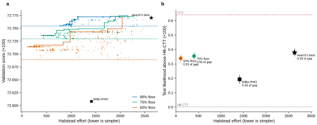
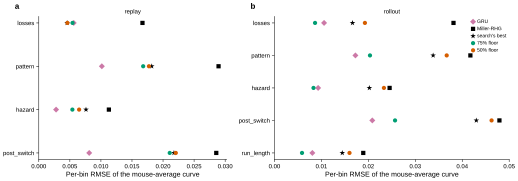

# r4 — Simplification at three floors: fit against complexity on the test subjects

**Summary.** Simplification costs little. Three runs ($40 each) cut the search's programs from
Halstead effort 2,634 to 775, 403 and 107 while keeping 90%, 75% and 50% of the validation gain over
Miller-RHG (effort 1,414). On the test subjects, the 75% program (effort 403, 10 parameters) closes
**0.55** of the HB-CTT-to-GRU gap and the 50% program (effort 107, 9 parameters) **0.53**, against 0.59
for the search's best and 0.30 for Miller-RHG fitted the same way. The 50% program is the search's
shared core in its plainest form: two learning rates, forgetting of the unchosen side, and a fast and a
slow choice trace, all one delta rule; no counterfactual update. The 75% program adds one term: the
fast habit's weight changes with the mouse's training experience (log number of sessions). That term
matters for closed-loop behaviour: in rollout, its mouse-average curves match the subjects as well as
or better than the GRU's on three of five statistics (losses, hazard, run length), which no other
program here does. The 90% floor has no program: its candidates passed the gate but fell 0.01 to 0.03
short of the selection floor.

**Question.** How simple can the search's programs become while keeping 90%, 75% or 50% of their gain
over Miller-RHG, what do the simplest programs contain, and how do they score on the test subjects?

**Approach.** Fixed before any test score (ADR 0005; ADR 0008, floors amendment). Three MEvolve runs in
simplification mode (MEvolve ADR 0006), one per floor, rewrote the five selection candidates with
Claude Opus 5.5 ($40 each). A program counted only if its validation score stayed at or above the
floor; among those, the run minimized Halstead effort, a count of a program's operators and operands
(lower is simpler). Each run's five correct programs of lowest effort went to the 100 selection
subjects. The floor's program is the simplest one that passes the behaviour gate and keeps the same
share of the gain on the selection subjects; it was scored once on the test subjects.

## 1. The runs

<!-- BEGIN result-1 -->


| run | floor (×100) | proposals | above the floor | Claude cost | seeds' lowest effort | lowest effort above the floor | its validation score | parameters |
|---|---|---|---|---|---|---|---|---|
| `simplify-90` | 72.754 | 539 | 288 | $40.09 | 2,447 | **775** | 72.755 | 12 |
| `simplify-75` | 72.730 | 537 | 308 | $40.09 | 2,447 | **403** | 72.736 | 10 |
| `simplify-50` | 72.689 | 553 | 429 | $40.05 | 2,447 | **107** | 72.714 | 9 |

For scale: the search's best has Halstead effort 2,634, Miller-RHG 1,414. Every run spent its $40 cap while still finding simpler programs.

**Figure 1.** (a) Every proposal above its run's floor: validation score against Halstead effort (lower is simpler), with each run's floor (dashed) and its frontier (the simplest program at each score); star: the search's best, square: Miller-RHG. (b) On the 146 shared test subjects: pooled likelihood above HB-CTT against effort for Miller-RHG (2-level EM), the search's best and each floor's program; dashed: the GRU; bars: paired bootstrap SE.
<!-- END result-1 -->

## 2. Selection and test

<!-- BEGIN result-2 -->
| run | candidate | effort | selection score | selection floor | gate | reaches floor |  |
|---|---|---|---|---|---|---|---|
| `simplify-90` | 1 | 775 | 73.570 | 73.583 | pass | no |  |
| `simplify-90` | 2 | 775 | 73.570 | 73.583 | pass | no |  |
| `simplify-90` | 3 | 833 | 73.570 | 73.583 | pass | no |  |
| `simplify-90` | 4 | 852 | 73.562 | 73.583 | pass | no |  |
| `simplify-90` | 5 | 892 | 73.551 | 73.583 | pass | no |  |
| `simplify-90` | 6 | 892 | 73.551 | 73.583 | pass | no |  |
| `simplify-90` | 7 | 892 | 73.551 | 73.583 | pass | no |  |
| `simplify-90` | 8 | 892 | 73.551 | 73.583 | pass | no |  |
| `simplify-90` | 9 | 892 | 73.551 | 73.583 | pass | no |  |
| `simplify-90` | 10 | 892 | 73.551 | 73.583 | pass | no |  |
| `simplify-75` | 1 | 403 | 73.572 | 73.559 | pass | yes | **chosen** |
| `simplify-75` | 2 | 403 | 73.572 | 73.559 | pass | yes |  |
| `simplify-75` | 3 | 403 | 73.572 | 73.559 | pass | yes |  |
| `simplify-75` | 4 | 403 | 73.572 | 73.559 | pass | yes |  |
| `simplify-75` | 5 | 441 | 73.572 | 73.559 | pass | yes |  |
| `simplify-50` | 1 | 107 | 73.552 | 73.518 | pass | yes | **chosen** |
| `simplify-50` | 2 | 149 | 73.552 | 73.518 | pass | yes |  |
| `simplify-50` | 3 | 149 | 73.552 | 73.518 | pass | yes |  |
| `simplify-50` | 4 | 149 | 73.552 | 73.518 | pass | yes |  |
| `simplify-50` | 5 | 177 | 73.552 | 73.518 | pass | yes |  |

`simplify-90`: no candidate reached the selection floor, so no program goes to test.

On the 146 shared test subjects (HB-CTT 72.190, GRU 72.831); the last column is each program on the GRU's own 149 (the GRU there: 72.823):

| program | Halstead effort | test (×100) | above HB-CTT ± paired SE | gap closed [95% CI] | GRU's 149 (×100) |
|---|---|---|---|---|---|
| Miller-RHG (2-level EM) | 1,414 | 72.383 | +0.193 ± 0.030 | 0.30 | — |
| search's best | 2,634 | **72.568** | +0.379 ± 0.027 | **0.59** [0.53, 0.64] | 72.557 |
| 75% floor | 403 | **72.544** | +0.354 ± 0.026 | **0.55** [0.50, 0.60] | 72.531 |
| 50% floor | 107 | **72.528** | +0.338 ± 0.026 | **0.53** [0.47, 0.58] | 72.516 |
<!-- END result-2 -->

## 3. The floor programs

<!-- BEGIN result-3 -->
**75% floor** (`simplify-75_c1_141c8a13`, effort 403):

```python
# EVOLVE-BLOCK-START
"""Dual-rate Rescorla-Wagner values with forgetting of the unchosen side toward 0,
fast and slow signed choice (habit) traces whose fast component's weight changes with
training experience (log number of sessions), and a side bias.
All latents are kept in logit units, so the right logit is a plain sum."""
import jax
import jax.numpy as jnp

PARAMS = {
    "learn_rate_rewarded": (0.0, 1.0),
    "learn_rate_unrewarded": (0.0, 1.0),
    "forget_rate_unchosen": (0.0, 1.0),
    "value_inverse_temperature": (0.0, 20.0),
    "fast_habit_step_size": (0.2, 1.0),
    "fast_habit_weight": (-6.0, 10.0),
    "slow_habit_step_size": (0.0, 0.3),
    "slow_habit_weight": (-6.0, 6.0),
    "right_bias": (-3.0, 3.0),
    "habit_experience_gain": (-3.0, 3.0),  # change of fast-habit weight per log(sessions)
}
N_LATENT = 6
LATENT_NAMES = ("q_left", "q_right", "fast_habit", "slow_habit", "right_bias",
                "fast_habit_weight_this_session")


def init_latents(p, session):
    # Fast-habit weight for this session: changes with log(1 + sessions), centred ~20 sessions.
    fast_weight = p["fast_habit_weight"] + p["habit_experience_gain"] * (
        jnp.log1p(session["index"]) - 3.0)
    return jnp.array([0.0, 0.0, 0.0, 0.0, p["right_bias"], fast_weight])


def predict(latents, p):
    # Right logit = right value + fast habit + slow habit + bias.
    return jnp.array([latents[0], jnp.sum(latents[1:5])])


def update(latents, choice, reward, p):
    # One delta rule: every latent moves toward its target at its own rate.
    chosen = jax.nn.one_hot(choice, 2)
    rate = jnp.where(reward, p["learn_rate_rewarded"], p["learn_rate_unrewarded"])
    # Chosen value -> beta*reward; unchosen value forgotten toward 0;
    # habit traces -> weight * signed choice; bias and session weight fixed (rate 0).
    rates = jnp.concatenate([
        jnp.where(chosen, rate, p["forget_rate_unchosen"]),
        jnp.array([p["fast_habit_step_size"], p["slow_habit_step_size"], 0.0, 0.0])])
    targets = jnp.concatenate([
        chosen * reward * p["value_inverse_temperature"],
        (choice - 0.5) * jnp.array([latents[5], p["slow_habit_weight"], 0.0, 0.0])])
    return latents + rates * (targets - latents)
# EVOLVE-BLOCK-END
```

**50% floor** (`simplify-50_c1_cd994c73`, effort 107):

```python
# EVOLVE-BLOCK-START
"""Every latent follows one delta rule, x <- x + step * (target - x):
  - chosen side's value moves toward the reward (rate depends on reward / no reward),
  - unchosen side's value decays toward 0 (forgetting),
  - fast and slow choice traces move toward the side just chosen (+1 right, -1 left).
The right-minus-left logit is a weighted sum of the value difference, the two
traces, and a constant side bias."""
import jax
import jax.numpy as jnp

PARAMS = {
    "learn_rate_rewarded": (0.0, 1.0),     # value step after a reward
    "learn_rate_unrewarded": (0.0, 1.0),   # value step after no reward
    "unchosen_forgetting": (0.0, 1.0),     # decay of the unchosen side's value toward 0
    "beta": (0.0, 20.0),                   # inverse temperature on the value difference
    "fast_trace_step": (0.2, 1.0),         # step size of fast choice trace (perseveration)
    "fast_trace_weight": (-3.0, 5.0),      # pull of fast trace, in logits
    "slow_trace_step": (0.0, 0.3),         # step size of slow choice trace (habit)
    "slow_trace_weight": (-3.0, 3.0),      # pull of slow trace, in logits
    "right_bias": (-3.0, 3.0),             # fixed preference for right, in logits
}
N_LATENT = 4
LATENT_NAMES = ("q_left", "q_right", "fast_trace_signed", "slow_trace_signed")


def init_latents(p, session):
    return jnp.zeros(4)


def predict(latents, p):
    # Signals: q_right - q_left, fast trace, slow trace, constant 1 (for the bias).
    signals = jnp.concatenate([jnp.diff(latents[:2]), latents[2:], jnp.ones(1)])
    weights = jnp.array([p["beta"], p["fast_trace_weight"],
                         p["slow_trace_weight"], p["right_bias"]])
    return jnp.stack([0.0, jnp.dot(weights, signals)])


def update(latents, choice, reward, p):
    chosen = jax.nn.one_hot(choice, 2)
    side = jnp.diff(chosen)  # +1 right, -1 left
    rate = jnp.where(reward, p["learn_rate_rewarded"], p["learn_rate_unrewarded"])
    step = jnp.concatenate([jnp.where(chosen, rate, p["unchosen_forgetting"]),
                            jnp.array([p["fast_trace_step"], p["slow_trace_step"]])])
    target = jnp.concatenate([jnp.where(chosen, reward, 0.0), side, side])
    return latents - step * (latents - target)
# EVOLVE-BLOCK-END
```
<!-- END result-3 -->

## 4. The mouse-average curves

<!-- BEGIN result-4 -->


| mode | statistic | Miller-RHG | search's best | 75% floor | 50% floor | GRU |
|---|---|---|---|---|---|---|
| replay | losses | 0.0167 | 0.0046 | 0.0054 | 0.0046 | 0.0056 |
| replay | pattern | 0.0289 | 0.0182 | 0.0168 | 0.0177 | 0.0101 |
| replay | hazard | 0.0113 | 0.0076 | 0.0054 | 0.0065 | 0.0028 |
| replay | post_switch | 0.0286 | 0.0218 | 0.0211 | 0.0221 | 0.0081 |
| rollout | losses | 0.0381 | 0.0166 | 0.0086 | 0.0193 | 0.0106 |
| rollout | pattern | 0.0417 | 0.0338 | 0.0203 | 0.0367 | 0.0172 |
| rollout | hazard | 0.0245 | 0.0202 | 0.0083 | 0.0233 | 0.0093 |
| rollout | post_switch | 0.0479 | 0.0430 | 0.0257 | 0.0463 | 0.0208 |
| rollout | run_length | 0.0189 | 0.0144 | 0.0059 | 0.0160 | 0.0081 |

**Figure 2.** The per-bin RMSE of the mouse-average curves (study 15's view, its headline sets and common subjects, as in r3) for each program and the GRU; lower is closer to the mice.
<!-- END result-4 -->

## 5. On all 149 test subjects (the atlas leaderboard)

<!-- BEGIN result-5 -->
Pooled likelihood (geometric-mean probability per choice) on all 149 test subjects, the atlas leaderboard's metric. The leaderboard reads the raw 2-level EM score, which is study 12 r3's convention for the literature models. The other columns are the score with the per-mouse fallback (MEvolve ADR 0004; this study's headline on the 146 shared subjects uses it) and the per-subject fit.

| program | 2-level EM (raw) | with per-mouse fallback | per subject | mice on fallback |
|---|---|---|---|---|
| Miller-RHG (2-level EM) | 0.7225 | 0.7244 | 0.7196 | 2 |
| search's best (`satiety_engagement`) | 0.7261 | 0.7263 | 0.7212 | 1 |
| 75% floor | 0.7260 | 0.7260 | 0.7214 | 1 |
| 50% floor | 0.7258 | 0.7258 | 0.7207 | 0 |

### search's best (`satiety_engagement`)

Values learned at separate rates after reward and no reward. The unchosen side is forgotten toward 0 and, after a miss, also learns that the other side pays (counterfactual learning, with its own strength in coupled and uncoupled tasks). Fast and slow choice traces and a side bias. The weight on values and traces changes with the rewards collected in the session (satiety). Its docstring also mentions a bait expectation; the code has none. Code: [`analysis/selection/programs/rank3_e3819885.py`](../selection/programs/rank3_e3819885.py).

Notation: trial $t$; choice $c_t \in \{L, R\}$, $u_t$ the side not chosen; reward $r_t \in \{0, 1\}$; signed choice $s_t = +1$ (right) or $-1$ (left); $\sigma(x) = 1/(1+e^{-x})$; learning rate $\alpha_t = \alpha_+$ after a reward, $\alpha_-$ after none. Latent variables with index $t$ are the ones used to choose on trial $t$; they are updated after $c_t, r_t$ are seen.

**Update:**

$$\begin{aligned} Q_{t+1}(c_t) &= Q_t(c_t) + \alpha_t\,\big(r_t - Q_t(c_t)\big) \\ Q_{t+1}(u_t) &= (1-\phi)\,Q_t(u_t) + \kappa\,\alpha_t\,\big((1 - r_t) - (1-\phi)\,Q_t(u_t)\big) \\ F_{t+1} &= F_t + \tau_F\,(s_t - F_t) \\ S_{t+1} &= S_t + \tau_S\,(s_t - S_t) \\ n_{t+1} &= n_t + r_t/100 \end{aligned}$$

with $\kappa = \kappa_c$ in coupled tasks and $\kappa_u$ in uncoupled ones; $n_t$ is the rewards collected so far, in hundreds.

**Choice** ($\epsilon = 10^{-4}$):

$$\begin{aligned} g_t &= \exp\!\big(-\gamma\,(n_t - 1)\big) \\ P(c_t = R) &= \epsilon + (1 - 2\epsilon)\,\sigma\Big(g_t\,\big[\beta\,(Q_t(R) - Q_t(L)) + w_F F_t + w_S S_t\big] + b\Big) \end{aligned}$$

**Initial values:** every latent variable is 0 at the start of each session.

**Parameters (12):** $\alpha_+$ `learn_rate_rewarded`, $\alpha_-$ `learn_rate_unrewarded`, $\phi$ `forget_rate_unchosen`, $\beta$ `value_inverse_temperature`, $\tau_F$ `fast_habit_step_size`, $w_F$ `fast_habit_weight`, $\tau_S$ `slow_habit_step_size`, $w_S$ `slow_habit_weight`, $b$ `right_bias`, $\kappa_c$ `counterfactual_weight`, $\kappa_u$ `counterfactual_weight_uncoupled`, $\gamma$ `satiety_gain`.

### 75% floor

The 50% floor's model with one addition: the fast choice trace's weight changes with the mouse's training experience (the log of the session's index). Values and traces are kept in logit units, so the choice is their plain sum. Code: [`analysis/simplify/simplify-75/programs/c1_141c8a13.py`](../simplify/simplify-75/programs/c1_141c8a13.py).

Notation: trial $t$; choice $c_t \in \{L, R\}$, $u_t$ the side not chosen; reward $r_t \in \{0, 1\}$; signed choice $s_t = +1$ (right) or $-1$ (left); $\sigma(x) = 1/(1+e^{-x})$; learning rate $\alpha_t = \alpha_+$ after a reward, $\alpha_-$ after none. Latent variables with index $t$ are the ones used to choose on trial $t$; they are updated after $c_t, r_t$ are seen.

**Session start:** the fast trace's weight for session $k$ (0 for the mouse's first session) is

$$w_F^{(k)} = w_F + \gamma\,\big(\ln(1 + k) - 3\big)$$

($\ln(1+k) = 3$ near the 20th session).

**Update:**

$$\begin{aligned} Q_{t+1}(c_t) &= Q_t(c_t) + \alpha_t\,\big(\beta\,r_t - Q_t(c_t)\big) \\ Q_{t+1}(u_t) &= (1-\phi)\,Q_t(u_t) \\ F_{t+1} &= F_t + \tau_F\,\big(w_F^{(k)}\,s_t/2 - F_t\big) \\ S_{t+1} &= S_t + \tau_S\,\big(w_S\,s_t/2 - S_t\big) \end{aligned}$$

**Choice:**

$$P(c_t = R) = \sigma\big(Q_t(R) - Q_t(L) + F_t + S_t + b\big)$$

**Initial values:** $Q$, $F$ and $S$ are 0 at the start of each session.

**Parameters (10):** $\alpha_+$ `learn_rate_rewarded`, $\alpha_-$ `learn_rate_unrewarded`, $\phi$ `forget_rate_unchosen`, $\beta$ `value_inverse_temperature`, $\tau_F$ `fast_habit_step_size`, $w_F$ `fast_habit_weight`, $\tau_S$ `slow_habit_step_size`, $w_S$ `slow_habit_weight`, $b$ `right_bias`, $\gamma$ `habit_experience_gain`.

### 50% floor

Values learned at separate rates after reward and no reward, with the unchosen side forgotten toward 0; fast and slow choice traces that pull toward repeating (or alternating) recent choices; a side bias; a softmax over their weighted sum. Code: [`analysis/simplify/simplify-50/programs/c1_cd994c73.py`](../simplify/simplify-50/programs/c1_cd994c73.py).

Notation: trial $t$; choice $c_t \in \{L, R\}$, $u_t$ the side not chosen; reward $r_t \in \{0, 1\}$; signed choice $s_t = +1$ (right) or $-1$ (left); $\sigma(x) = 1/(1+e^{-x})$; learning rate $\alpha_t = \alpha_+$ after a reward, $\alpha_-$ after none. Latent variables with index $t$ are the ones used to choose on trial $t$; they are updated after $c_t, r_t$ are seen.

**Update:**

$$\begin{aligned} Q_{t+1}(c_t) &= Q_t(c_t) + \alpha_t\,\big(r_t - Q_t(c_t)\big) \\ Q_{t+1}(u_t) &= (1-\phi)\,Q_t(u_t) \\ F_{t+1} &= F_t + \tau_F\,(s_t - F_t) \\ S_{t+1} &= S_t + \tau_S\,(s_t - S_t) \end{aligned}$$

**Choice:**

$$P(c_t = R) = \sigma\big(\beta\,(Q_t(R) - Q_t(L)) + w_F F_t + w_S S_t + b\big)$$

**Initial values:** every latent variable is 0 at the start of each session.

**Parameters (9):** $\alpha_+$ `learn_rate_rewarded`, $\alpha_-$ `learn_rate_unrewarded`, $\phi$ `unchosen_forgetting`, $\beta$ `beta`, $\tau_F$ `fast_trace_step`, $w_F$ `fast_trace_weight`, $\tau_S$ `slow_trace_step`, $w_S$ `slow_trace_weight`, $b$ `right_bias`.
<!-- END result-5 -->

## Caveats

- **Halstead effort counts operators, not calls.** Vectorized code (a dot product, `concatenate`) scores
  lower than the same arithmetic written out, so the efforts flatter compact code. The 50% program is
  genuinely simple; its effort of 107 overstates by how much.
- **The 90% floor is tight on 100 subjects.** Its selection floor sits 0.016 below the search's best
  selection score; the search's own rank 1 would also fail it. All ten candidates (five, then the five
  replacements ADR 0008 calls for) pass the gate and miss the floor; candidates 5 to 10 all score
  73.551, one model under different names (candidate 9 is the same syntax tree as 5 and 6 and takes
  their score; 7, 8 and 10 were fitted, on the interactive node when the queue was full).
- **One test score per program**, on the 149 test subjects and on the GRU's own 149; the headline pools
  the 146 both lists share.
- **The experience term is one program's finding.** It came from a single run and a single selection;
  r4 shows it matters for rollout, not why. It is a lead for the biology follow-ups
  (FUTURE_DIRECTIONS §1), not a result.
- **The floor programs' test scores and three 90% candidates ran on the interactive node** (4 to 8
  workers) when the queue was full; the code and settings are the queued runs'.
