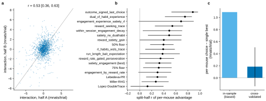
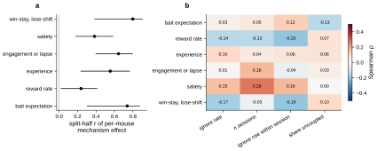
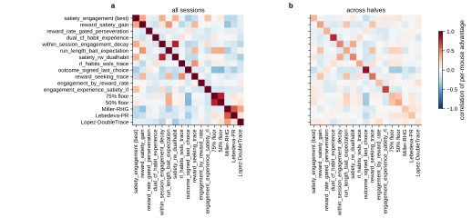

# r5 — Individual differences in mechanism fit

**Question.** The search's top programs share a core (counterfactual update, unchosen forgetting, two
habits) and differ in add-ons (satiety, engagement, experience, reward rate, bait, win-stay/lose-shift).
On average they tie, and their ranks barely carry over to unused mice (r2). Is that because each add-on
helps some mice and hurts others in a stable way, or because the differences are noise?

**Approach** (fixed on #146 before scoring).
1. **Data.** 17 programs on the 100 monitor mice, which no search or selection step used:
   - 12 search programs chosen for distinct add-ons;
   - the two floor programs;
   - three literature models.

   Each program is fitted per mouse (2-level, ADR 0008 settings) and scored on every held-out session.
2. **Two halves.** Each mouse's held-out sessions are split by order: the 1st, 3rd, 5th, … sessions
   form half A, the 2nd, 4th, … half B. If a program truly suits a mouse, it should do so in both halves.
3. **Interaction.** A cell is a mouse's log-likelihood per trial under one program on one half. The
   program's average and the mouse's average are removed; what is left is the program × mouse
   interaction: how much this program suits this mouse beyond both averages.
4. **Tests.**
   - Reliability: do the interactions agree between halves?
   - Per-mouse choice: does picking each mouse's own best program on one half help on the other?
   - Mechanisms: is the effect of each add-on per mouse reliable, and does it track the mouse's
     behaviour?
   - Union: does a program that has three add-ons beat each of its parts?

**Caveat.** Both halves are scored with one fitted parameter set per mouse. A fit that happens to suit a
mouse well therefore counts as a mouse-specific effect in both halves, though it reflects estimation
rather than mechanism.

## Is the program × mouse interaction reliable?

<!-- BEGIN result-1 -->
Program × mouse interaction (program and mouse means removed), correlated between the two halves of each mouse's score sessions: **r = 0.53** (95% bootstrap CI over mice 0.36 to 0.63; 100 monitor mice, 17 programs). Reliable interaction SD 1.33 mnats per trial (raw 1.60); SD of the program means 0.82 (reliable 0.84). Reliable SD = square root of the covariance between halves.

| program | split-half r of per-mouse advantage [95% CI] | mean advantage (mnats/trial) | mice on fallback |
|---|---|---|---|
| outcome_signed_last_choice | 0.88 [0.53, 0.97] | −0.46 | 1 |
| dual_cf_habit_experience | 0.75 [0.42, 0.87] | +0.37 | 3 |
| engagement_experience_satiety_rl | 0.69 [−0.02, 0.90] | +0.60 | 2 |
| reward_seeking_trace | 0.54 [0.25, 0.72] | −0.02 | 1 |
| within_session_engagement_decay | 0.49 [0.05, 0.70] | +0.62 | 3 |
| satiety_rw_dualhabit | 0.49 [0.14, 0.70] | +0.45 | 2 |
| reward_satiety_gain | 0.40 [−0.00, 0.69] | +0.68 | 0 |
| 50% floor | 0.39 [0.17, 0.56] | +0.22 | 0 |
| rl_habits_wsls_trace | 0.39 [0.09, 0.58] | +0.04 | 2 |
| run_length_bait_expectation | 0.38 [−0.00, 0.66] | +0.46 | 0 |
| reward_rate_gated_perseveration | 0.35 [−0.01, 0.57] | +0.43 | 1 |
| satiety_engagement (best) | 0.33 [0.09, 0.52] | +0.69 | 1 |
| 75% floor | 0.32 [0.06, 0.53] | +0.50 | 0 |
| engagement_by_reward_rate | 0.30 [−0.02, 0.52] | +0.44 | 5 |
| Lebedeva-PR | 0.29 [0.11, 0.45] | −1.50 | 0 |
| Miller-RHG | 0.27 [0.03, 0.48] | −1.51 | 0 |
| Lopez-DoubleTrace | 0.13 [−0.15, 0.40] | −1.98 | 0 |

<!-- END result-1 -->

## Does a per-mouse choice of program help on unseen sessions?

<!-- BEGIN result-2 -->
Choosing each mouse's best program on one half and scoring it on the other gains **+0.19 mnats per trial** over the single best program (95% CI −0.14 to +0.51; both directions averaged; mice weighted equally). Chosen and scored on the same sessions the gain would read +1.09, which noise inflates. Single best on all sessions: satiety_engagement (best); 16 programs win at least one mouse on a half.
<!-- END result-2 -->

## Which add-ons differ between mice, and do they track behaviour?

<!-- BEGIN result-3 -->
Mechanism effect per mouse = mean advantage of the search programs with the add-on minus those without (14 search programs; literature models left out). Spearman ρ against each mouse's covariates on all sessions; with 4 covariates per mechanism, read single p values with care.

| add-on | with | without | mean (mnats/trial) | SD across mice | share of mice > 0 | split-half r [95% CI] | ρ ignore rate | ρ n sessions | ρ ignore rise within session | ρ share uncoupled |
|---|---|---|---|---|---|---|---|---|---|---|
| bait expectation | 3 | 11 | −0.27 | 1.37 | 0.48 | 0.74 [0.30, 0.88] | +0.03 (p 0.77) | +0.05 (p 0.6) | +0.12 (p 0.24) | −0.13 (p 0.19) |
| reward rate | 2 | 12 | +0.09 | 1.14 | 0.60 | 0.24 [0.02, 0.41] | −0.14 (p 0.17) | −0.13 (p 0.18) | −0.20 (p 0.051) | +0.07 (p 0.49) |
| experience | 3 | 11 | +0.17 | 1.02 | 0.61 | 0.55 [0.23, 0.77] | +0.10 (p 0.33) | +0.04 (p 0.67) | +0.06 (p 0.54) | +0.06 (p 0.52) |
| engagement or lapse | 3 | 11 | +0.25 | 1.09 | 0.69 | 0.64 [0.40, 0.80] | +0.01 (p 0.95) | +0.16 (p 0.11) | −0.04 (p 0.72) | +0.03 (p 0.79) |
| satiety | 4 | 10 | +0.35 | 1.07 | 0.67 | 0.38 [0.18, 0.59] | +0.15 (p 0.14) | +0.26 (p 0.0082) | +0.16 (p 0.11) | +0.00 (p 0.99) |
| win-stay, lose-shift | 2 | 12 | −0.66 | 2.11 | 0.30 | 0.80 [0.38, 0.91] | −0.17 (p 0.096) | −0.03 (p 0.77) | −0.19 (p 0.053) | +0.10 (p 0.32) |

<!-- END result-3 -->

## Union test and program pairs

<!-- BEGIN result-4 -->
Union test: engagement_experience_satiety_rl (engagement, experience and satiety) minus each part on all sessions: within_session_engagement_decay −0.02, dual_cf_habit_experience +0.23, satiety_engagement (best) −0.09 mnats per trial. It beats every part on 30% of mice. Against each mouse's best part chosen on the other half: −0.29 (95% CI −0.68 to +0.05).

Correlation of per-mouse advantage between programs: positive means two programs help the same mice (interchangeable); zero or negative, different mice. Panel b correlates one program's half A with the other's half B, so noise shared within a half does not enter.

<!-- END result-4 -->

## What it says

- **Programs do fit some mice better than others, and the pattern is stable.** The program × mouse
  interaction agrees between the two halves of each mouse's sessions (r = 0.53). Its reliable spread,
  about 1.3 mnats per trial, is larger than the spread of the program means, which the three literature
  models drive. Among the search programs, the mouse a program suits matters more than which program it
  is.
- **The stable part sits in the add-ons.** Each add-on's per-mouse effect repeats across halves:
  win-stay/lose-shift (r 0.80), bait (0.74), engagement (0.64) and experience (0.55); satiety and reward
  rate less so (0.38, 0.24). Engagement, experience and satiety help about two thirds of the mice and
  hurt the rest. Win-stay/lose-shift and bait hurt most mice on average but help about a third. Pooled
  over mice, these gains and losses largely cancel, which fits r2's ties and its weak transfer of ranks to
  unused mice.
- **The stable part is not yet usable.** Choosing each mouse's best program on one half gains only
  +0.19 mnats per trial on the other half (95% CI −0.14 to +0.51). The program that has engagement,
  experience and satiety together does no better than each mouse's best single add-on (−0.29, CI −0.68
  to +0.05). Per-mouse parameters in the 2-level fit therefore do not switch the right add-on on per
  mouse.
- **None of the simple behaviour measures explains which mice an add-on helps.** Only satiety ×
  number of sessions passes p < 0.01 (ρ 0.26), and that is 1 of 24 tests.

Reading. The idiosyncratic part is real but small, about 1 mnat per trial against the 2.2 mnats per trial
by which the search's best leads Miller-RHG on these mice (result-1 table). It explains why mechanism swaps tie, rather than offering a large gain
still unclaimed. One alternative is not ruled out (Caveat): part of the stable effect may be how well
each program's fit happens to suit a mouse, not its mechanism. Refitting each half separately would
separate the two.

Next:
1. Refit on each half to separate fit quality from mechanism.
2. A mixture over add-ons in which each mouse carries a weight per add-on, so the fit can choose
   per mouse.
3. Check the per-mouse add-on profiles against task variant and training stage at the session level.
   These were pooled per mouse here.
