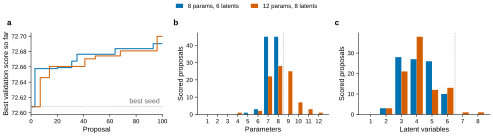

# Variant `seeded-islands-cap12`

**What.** `seeded-islands-smoke` with looser program limits: at most 12 parameters and 8 latent variables
instead of ADR 0005's 8 and 6 (issue #118; MEvolve's `max_params` and `max_latent`, AllenNeuralDynamics/aind-dynamic-foraging-mevolve#60).
Everything else is the same: 100 proposals by Claude Sonnet 5.5 at effort medium, the same seed-0
cohorts and freeze, the same five islands and seeds (`analysis/seed_choice.json`), the library in the
prompt, $20 list. The evaluations run 16 at a time as Slurm steps of 24 CPUs placed wherever 24 are free
(AllenNeuralDynamics/aind-dynamic-foraging-mevolve#59), each with 12 workers instead of the smoke run's 28;
the worker count changes the time of an evaluation, not its score.

**Deviation, on purpose.** ADR 0005 fixes 8 parameters and 6 latent variables for the study's programs.
This variant is a test of those limits, not a change to them: whether `seeded-islands` searches with
other limits is Han's decision after it (2026-11-05).

**Why.** In `seeded-islands-smoke` the limits bound: 90 of 94 scored proposals used 7 or 8 parameters,
and the best program used all 8 parameters and all 6 latent variables, with its bait rate written in
as a constant (0.15) because no parameter was left. A constant like that is tuned by the search on the
validation mice instead of fitted per mouse. This run should show whether Claude uses the extra room,
and what for. It is also the first search on many nodes, so it measures their throughput.

**Pre-registered (2026-11-05, before launch).**

1. **Pass:** the search finishes its 100 proposals within $20 and 6 hours, with no API errors, every
   evaluation step starts (no proposal fails for a Slurm reason), and the run's archive is logged.
2. **Reported against `seeded-islands-smoke`, not judged:** the share of scored proposals above 8
   parameters or 6 latent variables; the best program's parameter and latent counts, and the numbers
   written into its code; the best validation score and the best by lineage. One run each way, and
   the smoke run's steps were at or below the paired standard error between two programs on these
   mice (0.03 to 0.06, gate 2): a difference in the best score is one sample, not an effect of the
   limits.
3. **Throughput:** proposals per hour and CPU-minutes per proposal, against the smoke run's 17 per
   hour and 3.4 node-minutes (380 CPU-minutes) on one node.
4. As in the smoke run, the programs found here do not enter `seeded-islands`; only the seed scores
   in the shared `seed_cache` are reused.

**Run.** `search.sbatch`: 16 tasks of 24 CPUs and 1,500 MB per CPU on `aind` CPU nodes. The size was
chosen from the free-CPU landscape so the job ends earliest (Han, 2026-11-05): CPU-only jobs may not use
GPU nodes, where most free CPUs were, and on the CPU nodes Slurm planned 16 slots of 56 CPUs for the next
morning, while 16 slots of 24 CPUs could start at once (about 15 minutes per evaluation, 1¾ hours for
100 proposals). It is submitted to start only after the multi-node
runner's last $0 test passes (`--dependency=afterok`). MEvolve keeps Shinka's database on the first node's
local disk; each evaluation's program and results pass through `stage/` in the launch directory on
/allen. The exit trap copies only files `run.main` did not copy, so it cannot overwrite the archived run
(it did in `seeded-islands-smoke`).

**Data and archive.** `/allen/aind/scratch/han.hou/mevolve/runs/seeded-islands-cap12/<launch_id>/search`,
logged at the end of the run as the W&B artifact
`NeuralDynamics/dfbfm-mevolve/run-seeded-islands-cap12-<launch_id>` (type `mevolve-run`, in the
[dfbfm-mevolve](https://wandb.ai/NeuralDynamics/dfbfm-mevolve) project), with `archive.json` beside it.

**Launches.** Each launch writes its record to `launch_record/` and mints one W&B group `seeded-islands-cap12@<launch_id>` (docs/adr/0001). Interventions (rescue, resubmit, extend, ...) join that group.

**Result: pass.** Every number below is in `analysis/seeded_islands_cap12.json` (`make cap12-result`),
computed from `analysis/seeded_islands_cap12/run.json`, a freeze of the run's W&B archive and its Slurm
steps (`make freeze-seeded-islands-cap12`), and from the smoke run's freeze. Launched 2026-11-05 at
10:02 PT as `seeded-islands-cap12-1` (Slurm job 27634299, W&B group `seeded-islands-cap12@20261105-100249`
in [dfbfm-mevolve](https://wandb.ai/NeuralDynamics/dfbfm-mevolve), from studies b506d77 and MEvolve
8287dad). It waited on the multi-node runner's $0 test (Slurm job 27634227: 9 evaluation steps on 4 nodes,
the template and 8 proposals scored in the copied database), started at 10:20 PT on 16 nodes and completed
at 12:06 PT.

*a*, best validation score so far against proposals, in both runs (dotted: the best seed, Miller-RHG).
*b*, *c*, parameters and latent variables of the scored proposals; dotted: ADR 0005's limits.

| pre-registered | result |
|---|---|
| 1. 100 proposals within $20 and 6 hours, no API errors, every evaluation step starts, archive logged | pass: 100 proposals, $2.55 list, 1 h 42 min of the run; 103 Claude calls (100 + 3 repair attempts), all `end_turn`; 101 evaluation steps (100 proposals and the template; the seeds come from the seed cache) on 16 nodes, all `COMPLETED`, none failed for a Slurm reason; archive `NeuralDynamics/dfbfm-mevolve/run-seeded-islands-cap12-20261105-100249:v0`, digest `29d56803e288f29c602f339c5358f214`, 1,134 files, 20.0 MB |
| 2. scored proposals above 8 parameters or 6 latent variables | 37 of 89 (smoke: 0 of 94): 36 above 8 parameters, 2 above 6 latent variables |
| 2. the best program | proposal 96, 72.700 (smoke: 72.690, proposal 93), +0.092 over the best seed; 11 parameters, 6 latent variables (smoke: 8 and 6) |
| 2. numbers written into its code | one tuned constant: a loss streak capped at 8 (`jnp.minimum(count, 8.0)`); the others are structure (`jnp.zeros(6)` for its 6 latent variables, `one_hot(choice, 2)` for two sides, `2.0 * choice - 1.0` for a signed choice) |
| 3. throughput | 58.9 proposals per hour (smoke: 17.8), 391 CPU-minutes per proposal (smoke: 377); 384 CPUs (16 × 24) against 112; an evaluation step took a median 875 s with 12 workers |
| other | 36 of 89 scored proposals beat their parent (smoke: 30 of 94); 2 repeats; 11 rejected by the static checks, 9 of them syntax errors (smoke: 5, 3 of them syntax errors); 2-level fits failed for 20 of 89 (smoke: 10 of 94): 10 of the 36 above 8 parameters, 10 of the 53 at 8 or fewer |

By lineage (the seed a program descends from), best score against the seed's own and the smoke run's:

| lineage | proposals | seed | best | smoke best |
|---|---|---|---|---|
| template | 27 | 70.020 | 72.674 | 72.690 |
| Miller-RHG | 19 | 72.608 | 72.659 | 72.677 |
| Lebedeva-PR | 28 | 72.573 | 72.681 | 72.668 |
| Lopez-DoubleTrace | 11 | 72.548 | 72.700 | 72.591 |
| Eckstein-BI | 15 | 71.780 | 72.671 | 72.606 |

**What it teaches.**

1. **Many nodes work, at the same CPU cost.** Sixteen 24-CPU slots ran the search 3.3 times faster than
   one 112-CPU node, for about the same CPU-minutes per proposal (391 against 377). At 59 proposals per
   hour, the stopping rule's minimum of 2,000 proposals takes about 34 hours on 16 slots.
2. **Claude uses the extra parameters, rarely the extra latent variables.** 36 of 89 scored proposals
   have 9 to 12 parameters; only 2 have more than 6 latent variables. The parameter limit binds; the
   latent limit almost never does.
3. **The best program fits what the smoke run's best wrote in.** It keeps the smoke best's idea of a
   per-side value that grows while a side is not chosen ("bait"), but its growth rate is now a fitted
   parameter (`neglect_rate`), where the smoke best had a constant (0.15). It adds a slow choice trace
   and a same-side loss streak; the streak's cap (8) is its one tuned constant.
4. **The score does not show an effect of the limits.** The best score is 0.010 above the smoke run's,
   far below the paired standard error between two programs on these mice (0.03 to 0.06, gate 2). One
   run each way, 100 proposals each: no evidence either way.
5. **Two costs to watch.** Larger programs fail the 2-level fit more often (10 of 36 against 10 of 53);
   such a program keeps its per-subject score, which is lower. And syntax errors rejected 9 proposals
   (smoke: 3), each a lost Claude call and slot.

**Status.** Done. Whether `seeded-islands` searches with other limits is Han's decision (ADR 0005).
